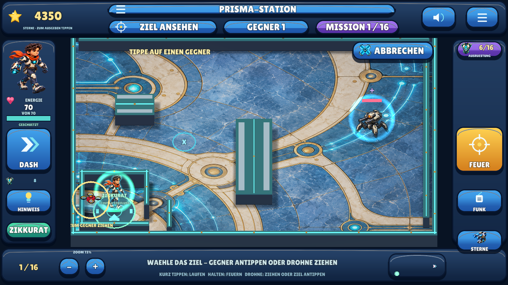
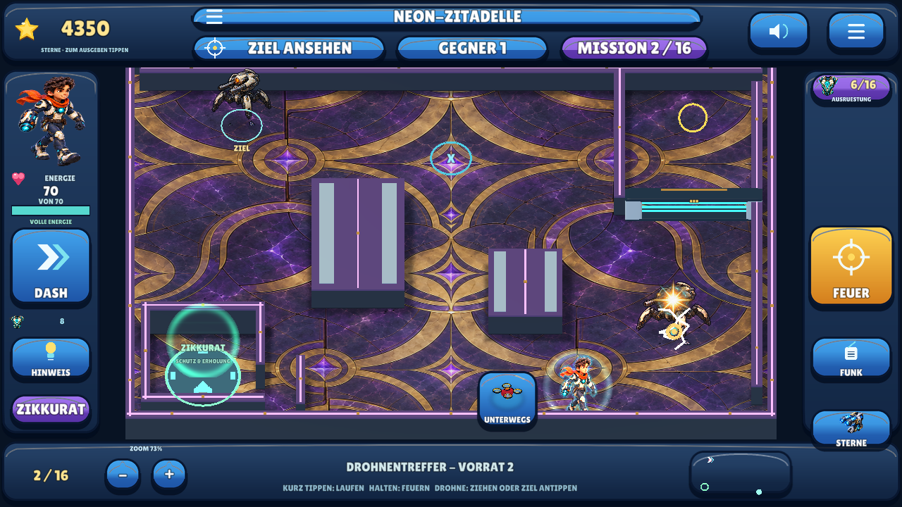

# EnergyBlast — Defold 0.14.1

> **Korrektur 0.14.1 zum Testen:** [Android-APK herunterladen — 69,1 MB](https://raw.githubusercontent.com/sayac007/EnergyBlast/387b8a7169d5b6a2a0b04dfaf4bfc12e03e929e7/downloads/energyblast-defold-debug.apk).
> Passive Relais direkt oder per Abpraller treffen; neue Ansage erklärt beide Wege.
> Die leuchtenden Kreise wechseln halb so schnell: 1,8 Sekunden je Schritt.
> **4.674 native Prüfungen, vollständige GUI-Suite und 16 Testgruppen bestanden.**
> [Änderungen, Bilder und Grenzen](https://github.com/sayac007/EnergyBlast/blob/eeb501f83a34cc13415f78609f0da649b6f7126b/docs/MILESTONE_13.md) ·
> [Vollständige Korrekturfassung](https://github.com/sayac007/EnergyBlast/tree/fix/free-relays-slower-patterns).
> Dieselbe App-Kennung und Signatur, als Update installieren. Handyabnahme bleibt
> offen. Der unten beschriebene Spielcode in `main` bleibt 0.14; die Korrektur liegt
> auf ihrem eigenen Branch.

Offline-Touch-Shooter für Kinder etwa von 7 bis 10 Jahren: **16 Missionen**, drei
Helden, reflektierte Schüsse, Deckung, Fallen und steuerbare Angriffsdrohnen.
Zehn neue Missionen steigern die Komplexität. Gespeicherte Sterne und Ausrüstung
bleiben erhalten; versteckte Bonusaufgaben und Schatztruhen entfallen.

**[Android 0.14.1 herunterladen — 69,1 MB](https://raw.githubusercontent.com/sayac007/EnergyBlast/387b8a7169d5b6a2a0b04dfaf4bfc12e03e929e7/downloads/energyblast-defold-debug.apk)** · [Update und Metadaten](downloads/README.md).

**[Vorherige geprüfte Android-APK 0.14 — 69,1 MB](https://raw.githubusercontent.com/sayac007/EnergyBlast/11248b5ef4215838cb08bd2c8164d9718d9efcae/downloads/energyblast-defold-debug.apk)** · [Update und Metadaten](downloads/README.md).
[Vorherige geprüfte APK 0.13](https://raw.githubusercontent.com/sayac007/EnergyBlast/9e486f1dec3b6ca67371f1491c8e7b5991885a14/downloads/energyblast-defold-debug.apk) ·
[Änderungen und Prüfstand](docs/MILESTONE_13.md) ·
[Qualitätsstatus](docs/QUALITY.md) · [Selbst bauen](docs/BUILD_AND_TEST.md)

## Aktueller Stand

**0.14.1 / Android-Code 16, Stand 30.10.2026**, Korrekturbranch
`fix/free-relays-slower-patterns`. Die zuvor geprüfte 0.14-Fassung liegt vollständig
auf `main`; die aktuelle Korrektur ist vollständig geprüft und als Update-APK verfügbar.
Es bleiben **16 Missionen**. Defold 1.14.0 bleibt der Schwerpunkt;
Godot 0.2 und GDevelop 0.3 sind unveränderte Vergleichsstände.
Android 7/API 24+, ARM64, lokale Spielstände und keine Konten, Werbung oder Telemetrie.

| Bestandteil | Aktuell implementiert |
|---|---|
| Missionen | 16 Missionen auf drei Auswahlseiten; Abpraller, Deckung, Relais, Lichterfolgen, Fallen und gemischte Gegner |
| Felder | Neue Arenen von 31,5 × 22,5 bis 42 × 30 statt bisher 21 × 15 Welteinheiten |
| Gegner | Wächter, Bodenkrabbler, Energiefunken, Mini-Drohnen und begrenzt teilbare Schwärme; maximal 50 lebende Gegner gleichzeitig |
| Schutz | Jede Mission startet im begehbaren, geschützten Zikkurat; Schüsse werden am Schutzbereich absorbiert |
| Angriffsdrohnen | Vorrat von drei bis acht; auswählen, zum Gegner ziehen oder das Ziel antippen; echter Flug und elektrische Zerstörung |
| Fortschritt | Abgeschlossene Missionen statt versteckter Funde; Gesamtsterne, verfügbares Guthaben, Käufe und aktuelle Mission bleiben gespeichert |
| Gesundheit/Tarnung | Maximal 100 Gesundheit einschließlich Rüstung; begrenzte Tarnung mit wiederholter gegnerischer Fernortung |
| Grafik/Ton | Drei animierte Originalhelden, native Weltmodelle und Effekte; deutsche synthetische Ansagen und eigene Science-Fiction-Musik |

Die größeren Arenen wachsen in beiden Achsen um 50 bis 100 Prozent, entsprechend
2,25- bis vierfacher Fläche. Ihre Schwierigkeit verbindet zusätzliche Schusslinien,
Relais, bewegliche Gegner und Lichterfolgen. [Alle Missionen im Überblick](docs/MILESTONE_13.md).

## Kleine Korrektur 0.14.1

- **Schalter frei treffen:** Passive Relais lassen sich direkt oder über eine
  Wand ausschalten. Der Abpraller ist dort freiwillig. Erst alle Schalter lösen,
  dann den Kern treffen; gefährliche Gegner behalten ihre Schild-/Fallenregeln.
- **Lichter langsamer:** In Echo-Kammer, Doppeltes Signal und Lichtlabyrinth
  dauert jeder Schritt jetzt **1,8 Sekunden**: 1,2 Sekunden leuchten, 0,6 Sekunden
  dunkel. Nach der Dreierfolge folgen 2,4 Sekunden Pause, insgesamt 7,8 Sekunden
  pro Wiederholung. Weltkreise und Seitenanzeige verwenden dieselbe Zeitsteuerung.
- **Passende Ansage:** „Erst die Schalter, dann der Kern. Du kannst direkt treffen
  oder die Wand nutzen.“ Alle bisherigen Missionen, Sterne und Käufe bleiben.

## Steuerung

| Berührung | Wirkung |
|---|---|
| Boden kurz antippen | Dorthin laufen |
| Boden halten | Nach 0,14 Sekunden wiederholt feuern; Ziehen ändert die Schussrichtung |
| Gegner ungefähr antippen | Sofort schießen, mit großzügigem Zielbereich |
| Eigene Figur anfassen und ziehen | Kollisionssicher bewegen |
| Fallenbild → Gerät wählen → freien Boden antippen | Eine Falle im hellen Reichweitenkreis platzieren |
| Drohnenbild → Drohne im Vorrat auswählen | Zielmodus mit gesprochener Anleitung starten |
| Im Drohnenmodus Gegner antippen **oder** bereitstehende Drohne auf ihn ziehen | Angriffsdrohne zum gewählten Gegner schicken |
| Abbrechen | Auswahl schließen, ohne Vorrat zu verbrauchen oder einen normalen Schuss auszulösen |
| Plus/Minus oder zwei Finger auf freiem Feld | Gesamtes Spielfeld samt Figuren vergrößern/verkleinern |
| Obere Ziel-/Gegneranzeige antippen | Aktuelle Missionsinformation öffnen |
| Oberen Missionsknopf antippen | Missionsauswahl öffnen |

Beim Auswählen einer Drohne öffnet sich vorübergehend eine **Übersicht der ganzen
Karte**, damit entfernte Ziele erreichbar sind. Die gespeicherte Zoomwahl bleibt
unverändert. Nach dem Flug oder Abbruch kehrt die vorherige Ansicht zurück.
Eine bewusst währenddessen geänderte Zoomwahl hat Vorrang vor dieser Rückkehr.
Die Drohne wird zum Gegner gelenkt und dort durch Kontakt ausgelöst.

Maximales Herauszoomen endet an den Feldgrenzen. Unterschiedliche Displayformate
können neutrale Ränder zeigen; dort stehen keine zusätzlichen All-Kulissen und
Touchpunkte außerhalb der dargestellten Arena bewegen oder beschießen nichts.
Die bewegte Spielfigur und tatsächliche Geschosse bleiben Teil der nativen Welt.

## Tatsächliche Spielansichten




Native Linux/OpenGL-Aufnahmen, keine behaupteten Handyaufnahmen.
[Größere Mission, Seitenübersicht und 50 Gegner](docs/MILESTONE_13.md).

## Missionen, Schutz und Ausrüstung

- **Start und Rückzug:** Die Figur beginnt im Zikkurat. Zum normalen Feuern den
  geschützten Bereich verlassen; bei Bedarf dorthin zurückkehren und erholen.
- **Drohne steuern:** Nach der Katalogwahl heißt die Ansage „Wähle jetzt das Ziel“.
  Ein gültiger Start verbraucht eine Drohne. Ungültige Ziele und Abbruch kosten
  keinen Vorrat. Ein durch Relais geschützter Boss behält seine Relaisregel.
- **Nächste Mission:** Die Hauptziele abschließen und anschließend **Nächste Mission**
  wählen. Es gibt keine versteckten Funde, die den Wechsel verzögern.
- **Sterne ausgeben:** Den Sternenknopf öffnen, Gegenstand wählen und **Kaufen**.
  Gesamtsterne bleiben; nur das verfügbare Guthaben sinkt. Heilung bleibt bei Bedarf
  wiederholt kaufbar. Bereits gekaufte Waffen, Rüstung und Tarnung bleiben erhalten.
- **Figur wählen:** Nova, Drache Flammi und Fennek bleiben über ihre Bilder auswählbar.

Aktuelle Missionen vergeben einmalig 300 bis 550 Sterne, dazu bis zu 100 für den
schadensfreien Abschluss. Frühere Bonus-/Schatzsterne bleiben im alten Spielstand
erhalten. Dieselben Missionserfolge werden beim Wiederholen nicht erneut bezahlt.
Gesundheit ist einschließlich Ausrüstung auf 100 begrenzt; Schild auf 20 und
Projektilschaden auf 8. Bei stärkster Tarnung können Gegner den Spieler weiterhin
regelmäßig präzise orten, auch aus großer Entfernung. Wände blockieren die echten
Geschosse weiterhin durch Reflexion oder klar markierte Absorption.

## Prüfstand und Grenzen

**Aktuelle Korrektur 0.14.1: vollständige Regression PASS.** Alle 22 Prüfschritte,
**4.674 native Prüfungen** (1.311 historische, 3.363 aktuelle, davon 134 neu) und
16 gemeinsame Testgruppen bestanden. Echte Projektiltreffer an allen elf Relais,
ein freiwilliger physischer Abpraller, Boss-Sperren, ein tatsächlicher Bildschirm-
Direktschuss sowie sechs zeitlich geprüfte native Lichtzustände sind abgesichert.
Wiederholte Bosstreffer starten die neue vollständige Ansage nicht neu.
**Sauberer APK-Export: PASS.** Identisches Paket und Entwicklungszertifikat,
Version 0.14.1/Code 16, 69.113.018 Bytes, keine Berechtigungen, Backup aus,
v2/v3, ZIP-CRC und 1.225 bytegleiche Projektdateien geprüft. [APK-Nachweise](https://github.com/sayac007/EnergyBlast/tree/387b8a7169d5b6a2a0b04dfaf4bfc12e03e929e7/downloads).

Die folgenden älteren Ergebnisse gehören zur vorherigen **0.14-Fassung**.

**Gezielte Prüfungen bereits bestanden:** 4.540 native Regelprüfungen, davon
1.311 mit eingefrorenen 0.13-Regeln und 3.229 mit aktiven 0.14-Regeln; 16 gemeinsame
Testgruppen einschließlich 1.686 Exportgeometrieprüfungen. Echte native GUI-Eingaben
prüfen alle 16 Missionen und drei Seiten bei 1280 × 720 sowie 1280 × 800,
anklickbare obere Menüs, Drohnen per Tippen/Ziehen und eine Szene mit 50 nativen
Gegnern. Ein kontrollierter alter Spielstand behält 4.350 Gesamtsterne und 2.690
Guthaben und startet nach der neuen Begrenzung mit 70 Gesundheit.

**Vollständige Suite: PASS.** Alle 21 zusammenhängenden Prüfschritte sind bestanden.
Die alten Bonus-/Millionenprüfungen sind historische Regressionen, keine Behauptung
dieser Funktionen im aktuellen Spiel. **Android-APK: PASS**, vom sauberen Quellcommit gebaut: Paket/Version,
Signaturgleichheit, keine Berechtigungen, Backup aus, ZIP-CRC und 1.220 identische
Projektdateien geprüft. Physische Geräteabnahme bleibt offen.
[Aktueller Qualitätsstatus](docs/QUALITY.md).

Realer Handy-/Tablet-Test, Eingabelatenz, Mehrfingergefühl, Klang, längere Runden,
GPU-Leistung bei 50 Gegnern und die neue Schwierigkeit bleiben manuell offen.
Keine behauptete Store-Reife, kommerzielle Qualitätsgleichheit oder empirische
Lernwirkung. Entwicklungssignatur, keine Release-/Play-Identität.

## Repositoryaufbau

| Pfad | Zweck |
|---|---|
| [pilots/defold](pilots/defold) | Aktuelles Spiel, Eingabe, native Darstellung, Speicher und Audio |
| [shared/defold04.json](shared/defold04.json) | Aktive 16-Missionen-Kampagne und Regeln |
| [Neue Weltgeometrie](shared/assets/defold14) | Eigene Feldmodelle und überprüfbare Herkunft |
| [Neue Einheiten](shared/assets/defold14_units) | Eigene Gegner-, Drohnen- und elektrische Effektmodelle |
| [tools](tools) | Synchronisation, reproduzierbare Builds und Regressionstests |
| [Prüffälle](pilots/defold/main) | Aktive Regeln und eingefrorene historische Fixtures |
| [docs](docs) | Auftrag, Meilensteine, Bauanleitung und Qualitätsnachweise |
| [downloads](downloads) | Geprüfte APKs und Metadaten; frühere Dateien über feste Commits |

```bash
python3 tools/check_shared.py
python3 tools/check_defold.py
```

Voraussetzungen und gezielte Einzelprüfungen: [BUILD_AND_TEST.md](docs/BUILD_AND_TEST.md).
Die Übernahme nach `main` erfolgt auf ausdrücklichen Betreiberauftrag. Andere
Repositories und Vergleichs-Engines bleiben unverändert. Veröffentlichungen als
GitHub-Release oder im Store benötigen einen gesonderten Auftrag.

## Entwicklungshistorie

EnergyBlast entstand als eigenständiges Projekt aus einer neuen Shooter-Idee.
Die Entwicklung wird vollständig erhalten; die folgende Tabelle trennt die
Entscheidungen und Spielstände. Ein technisch bestandener Test war keine
ästhetische Freigabe. Frühere Bedienkonzepte wurden durch spätere ersetzt.

| Datum | Version | Entwicklung und Entscheidung | Feste Nachweise |
|---|---|---|---|
| 27.10.2026 | 0.1 | Zwei Geometrie-/Timingmissionen, lokale Sterne und verdiente Hinweise. Godot/GDevelop spielbar; Unity nur Importkit, noch keine Defold-APK. | [Quelle](https://github.com/sayac007/EnergyBlast/commit/46c1fecc54356f9fecd8f6144ec00de2fd0df90d) · [APK-Snapshot](https://github.com/sayac007/EnergyBlast/tree/c29acbee7fea5f48565719db95f935f0626630ca/downloads) |
| 27.10.2026 | 0.2 | Erster echter Shootervergleich mit Godot, GDevelop und Defold: aktive Kanonen, Deckung, Abpraller, Schaden und DASH. | [Quelle](https://github.com/sayac007/EnergyBlast/commit/1006cde8595b4249d0375ddf8bc4ea60fd2a93c9) · [APK-Snapshot](https://github.com/sayac007/EnergyBlast/tree/defd791bd94809045cf5a8ed9429ead92c8bd959/downloads) · [Bericht](docs/MILESTONE_01.md) |
| 28.10.2026 | 0.3 | Defold/GDevelop weitergeführt: dritter Sektor, Relais, Boss und Patrouille; berechnete Schussbahn entfernt. Godot bleibt bei 0.2. | [Quelle](https://github.com/sayac007/EnergyBlast/commit/43527374e1705a9608a9ddb11ccc8e4af31ef69e) · [APK-Snapshot](https://github.com/sayac007/EnergyBlast/tree/943f9340ef78079ed60c7db068cd5b76f86d1b6a/downloads) · [Bericht](docs/MILESTONE_02.md) |
| 28.10.2026 | 0.4 | Schwerpunkt Defold: größere Welt, folgende Kamera, damalige Zeitsteuerung, eigene Musik und Explosionen. GDevelop bleibt bei 0.3. | [Quelle](https://github.com/sayac007/EnergyBlast/commit/d070a6021ac1ecfd84556da40cb1e852bbc2e593) · [APK-Snapshot](https://github.com/sayac007/EnergyBlast/tree/4539cdf739582e22046c36aa76e20d7750584fce/downloads) · [Bericht](docs/MILESTONE_03.md) |
| 28.10.2026 | 0.4.1 | Alle Wände reflektieren; Geschosse verlieren Energie und vergehen. Neutralisationsfelder absorbieren. | [Quelle](https://github.com/sayac007/EnergyBlast/commit/02a2b409830600bdaa85b10f6accc58f18a5f085) · [APK-Snapshot](https://github.com/sayac007/EnergyBlast/tree/bd3d6f1374a7aca4e79fe4b9ba512ff67244e78f/downloads) · [Bericht](docs/MILESTONE_03.md) |
| 28.10.2026 | 0.5 | Sechs Missionen, drei Figuren, tatsächliche Käufe, Beuteführung und native Geschossverdeckung. **Grafik anschließend vom Betreiber abgelehnt.** | [Quelle](https://github.com/sayac007/EnergyBlast/commit/321d5cf6f50f7b038a2f7f8189ac421770af9013) · [APK-Snapshot](https://github.com/sayac007/EnergyBlast/tree/4315cf73fe6fd5b8688e7d397766394010fe2e5d/downloads) · [Bericht](docs/MILESTONE_04.md) |
| 28.10.2026 | 0.6 | Texturierte Arenen, detaillierte native Modelle/AO, feste Landschaftsaufteilung und Batching. **Grafik erneut abgelehnt.** | [Quelle](https://github.com/sayac007/EnergyBlast/commit/19856c195a8b51d1136ef8e7e8f57efd744caf05) · [APK-Snapshot](https://github.com/sayac007/EnergyBlast/tree/24b24dd23d08eb73ebd5fc113c318da3b1f45e7a/downloads) · [Bericht](docs/MILESTONE_05.md) |
| 28.10.2026 | 0.7 | Originale Illustrationsanimationen als 2,5D-Hybrid, Bildmenüs und Magnet-/Eis-/Impulsfallen direkt im Spielfeld. | [Quelle](https://github.com/sayac007/EnergyBlast/commit/080ddfda31332b542f99fdcebc59fc1e6c885bf0) · [APK-Snapshot](https://github.com/sayac007/EnergyBlast/tree/f8e8542b30cf1691bedf8f28a2403936f9bafcb9/downloads) · [Bericht](docs/MILESTONE_06.md) |
| 28.10.2026 | 0.8 | Klarer Missionswechsel, sichtbare Helden/Käufe, Schatzführung, je zwei integrierte Bonusziele und höhere Belohnungen. | [Quelle](https://github.com/sayac007/EnergyBlast/commit/6b1afee89855c737358859ce4fd2f83100f53583) · [APK-Snapshot](https://github.com/sayac007/EnergyBlast/tree/5c8e1ca956e99abd805cc29f90f9ee6620a7a5ce/downloads) · [Bericht](docs/MILESTONE_07.md) |
| 29.10.2026 | 0.9 | Halten feuert, Gegnertipp schießt sofort, eigene Figur ziehen; neue Böden, plastischere Deckungen, AO, Schatten und Schilde. | [Quelle](https://github.com/sayac007/EnergyBlast/commit/d4dea7d0768191c67d01206381d4913615f74ff0) · [APK-Snapshot](https://github.com/sayac007/EnergyBlast/tree/e49218e7015e365a0913961a0f1e005436c271f2/downloads) · [Bericht](docs/MILESTONE_08.md) |
| 29.10.2026 | 0.10 | 15 Grundenergie, Erholung, sechs Zikurrate, zwölf Shopangebote mit Waffen-/Rüstungsstufen und ruhigere Science-Fiction-Musik. **In main integrierter Ausgangsstand.** | [Quelle](https://github.com/sayac007/EnergyBlast/commit/6cea6cdcdb0ad8092fa483dd641836dcbca2be94) · [APK-Snapshot](https://github.com/sayac007/EnergyBlast/tree/6ef588bd40f4a63e5f267f2fbf45e77b74aeca18/downloads) · [Bericht](docs/MILESTONE_09.md) |
| 29.10.2026 | 0.11 | Zoombedienung, verlässliche Schatzführung und HD-Figuren mit nativem Schimmer. **Durch PR #1 in main übernommen.** | [Quelle](https://github.com/sayac007/EnergyBlast/commit/f8e63f64fb8275cc49e609479777486c10da7181) · [APK-Snapshot](https://github.com/sayac007/EnergyBlast/tree/284a94a0659ca9c0fd453977343053274bf214df/downloads) · [Bericht](docs/MILESTONE_10.md) |
| 29.10.2026 | 0.12 | Bereits belohnte Bonusziele und Truhen wieder spielbar, passende Hinweise/Funk, größerer Fallenkreis und nach Lernerfolg abgestufte längere Wirkzeiten. **Neue Korrekturfassung auf dem Arbeitsbranch.** | [Quelle](https://github.com/sayac007/EnergyBlast/commit/9554e66ba5ede774779857a0285b27e4d670d8c1) · [APK-Snapshot](https://github.com/sayac007/EnergyBlast/tree/8d0de931d121f89e5ad8b6841c4124035a24c12b/downloads) · [Bericht](docs/MILESTONE_11.md) |
| 29.10.2026 | 0.13 | Dauerhafte Bonus-Macht bis 1.000.000 Grundgesundheit, Wachstum, echte Schilde, Feuerkraft und Tarnung. **Vor den 20 neuen Missionen und FPV vorgezogen.** | [Quelle](https://github.com/sayac007/EnergyBlast/commit/fda39e50c0fa1166b0be2847eebaf86adf38d89a) · [APK-Snapshot](https://github.com/sayac007/EnergyBlast/tree/9e486f1dec3b6ca67371f1491c8e7b5991885a14/downloads) · [Bericht](docs/MILESTONE_12.md) |
| 30.10.2026 | 0.14 | Zehn neue Missionen, keine versteckten Boni/Truhen, maximal 100 Gesundheit, geschützter Start, größere Felder, endliche Schwärme und steuerbare Angriffsdrohnen. **Vollständig nach main übernommen.** | [Umsetzung und Prüfstand](docs/MILESTONE_13.md) · [Quelle](https://github.com/sayac007/EnergyBlast/commit/9eecbbe5efe88973c8e4a4f0e26bbaa4a5dfdfa4) · [APK-Snapshot](https://github.com/sayac007/EnergyBlast/tree/11248b5ef4215838cb08bd2c8164d9718d9efcae/downloads) |
| 30.10.2026 | 0.14.1 | Freie Direkt-/Abpralltreffer an passiven Relais, langsamere Lichterfolge, passende Ansage ohne Neustart bei Bosstreffern. **Separater Korrekturbranch.** | [Quelle](https://github.com/sayac007/EnergyBlast/commit/2fb77853b9018ac872c11a92c6fe6afb46317853) · [APK-Snapshot](https://github.com/sayac007/EnergyBlast/tree/387b8a7169d5b6a2a0b04dfaf4bfc12e03e929e7/downloads) · [Bericht](https://github.com/sayac007/EnergyBlast/blob/eeb501f83a34cc13415f78609f0da649b6f7126b/docs/MILESTONE_13.md) |

**29.10.2026 – Repository-Übernahme von 0.10:** Bis 0.10 erschien auf `main` die aktuelle
Dokumentation, während der vollständige Spielcode auf dem Arbeitsbranch lag.
Auf Betreiberwunsch sind beide Historien mit einem Merge-Commit
zusammengeführt. Alle alten Quell-/APK-Commits bleiben erreichbar; kein Squash,
keine neu geschriebene Historie und keine neue APK nur für die Übernahme.

**30.10.2026 – Repository-Übernahme von 0.14:** Der Betreiber beauftragt die
Übernahme des aktuellen fertigen Standes. `main` enthält nun Spielcode, Inhalte,
Assets, Werkzeuge, Prüfungen und die unveränderte geprüfte APK von 0.14. Ein echter
Merge erhält sowohl die bisherige `main`-Historie als auch die Entwicklung von
0.12 bis 0.14. Der einzige Konflikt betraf die ältere README-Ankündigung; der
Spielstand entspricht bytegleich `425dd3c`. Aktuelle Angaben stehen oben,
historische Quell-/APK-Verweise bleiben bestehen. Die übernommenen Spieltests
und der APK-Build wurden für diese Repository-Integration nicht erneut ausgeführt;
Dateiidentität, Hash und Dokumentationslinks wurden gesondert geprüft.

[Ursprünglicher Auftrag](docs/pilot-brief.md),
[fortgeschriebene Entscheidungen](docs/PROJECT_BRIEF.md) und
[historische Downloads](downloads/README.md) bleiben getrennt nachvollziehbar.
Die [vollständige Commit-Historie](https://github.com/sayac007/EnergyBlast/commits/main/)
ist weiterhin im Repository verfügbar.


[Auftrag](docs/PROJECT_BRIEF.md) · [aktueller Meilenstein](docs/MILESTONE_13.md) ·
[Art Direction](docs/ART_DIRECTION.md) · [Figurenherkunft](shared/assets/defold11/PROVENANCE.json) ·
[Weltgeometrieherkunft](shared/assets/defold14/PROVENANCE.json) · [Lizenzen](THIRD_PARTY.md) ·
[vorheriger Spielstand 0.13](docs/MILESTONE_12.md).
