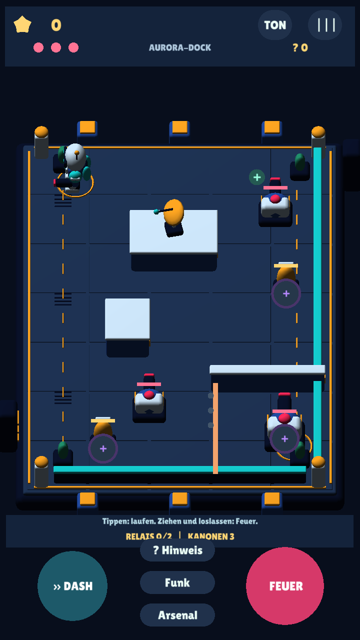
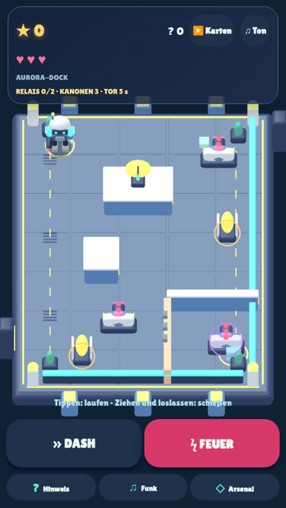

# EnergyBlast — Aurora Raid 0.3

Ein Android-Touch-Shooter für Kinder etwa von 7 bis 10 Jahren: Roboter, aktive
Kanonen, Deckung, Ausweichen und selbst eingeschätzte Abpraller. Nach dem ersten
Gerätetest entwickeln wir **Defold und GDevelop** weiter. Godot bleibt als
unveränderter 0.2-Vergleich erhalten. Eine endgültige Engine ist noch nicht gewählt.

**Neu am 28.10.2026:** dritter, anspruchsvollerer Sektor, überarbeitete Original-
3D-Modelle/Arenen, beweglicher Gegner, Fächersalven, Schalter und geschützter Boss.
**Keine berechnete Schussbahn:** Du siehst eine Zielmarke und echte Geschosse;
den richtigen Winkel musst du selbst finden.

| Beurteilen und weiterplanen | Einstieg |
|---|---|
| Direkt ausprobieren | [Zwei aktuelle Android-APKs und technische Nachweise](downloads/README.md) |
| Was genau ist neu / geprüft / offen? | [Meilenstein 02](docs/MILESTONE_02.md), [Qualitätsüberblick](docs/QUALITY.md) |
| Woher stammt der Auftrag? | [Auftrag und spätere Entscheidungen](docs/PROJECT_BRIEF.md), [unverändertes Originalzitat](docs/pilot-brief.md) |
| Wie war der erste Vergleich? | [Meilenstein 01 mit festen 0.2-Downloads](docs/MILESTONE_01.md) |
| Selbst bauen und prüfen | [Build-/Testanleitung](docs/BUILD_AND_TEST.md) |

## Die Apps herunterladen

- **[Defold 0.3 APK](https://github.com/sayac007/EnergyBlast/raw/refs/heads/feat/touch-shooter-v2/downloads/energyblast-defold-debug.apk)** — native ARM64-Engine.
- **[GDevelop 0.3 APK](https://github.com/sayac007/EnergyBlast/raw/refs/heads/feat/touch-shooter-v2/downloads/energyblast-gdevelop-debug.apk)** — echte GDJS/WebGL-Laufzeit in lokaler Android-WebView.
- [Godot 0.2, unveränderter Ausgangsvergleich](https://raw.githubusercontent.com/sayac007/EnergyBlast/defd791bd94809045cf5a8ed9429ead92c8bd959/downloads/energyblast-godot-debug.apk).

Android 7 / API 24 oder neuer; Defold benötigt ARM64, GDevelop eine System-WebView
mit WebGL. Beide können nebeneinander installiert werden und speichern getrennt.
Version 0.3.0 / Code 3 behält Paketkennung und Entwicklungssignatur von 0.2.
Update über die vorhandene App installieren; nicht vorher deinstallieren, wenn
Sterne erhalten bleiben sollen. Der tatsächliche Geräte-Update-Test ist offen.
Größe, SHA-256, Quellstand und Signaturstatus stehen bei den [Downloads](downloads/README.md).
Das sind Debug-Testfassungen, keine Google-Play-Upload-Dateien.

## Was du spielen kannst

**Prisma-Station:** Die Schildkanone trifft dich direkt; du kannst ihren Schild
mit einem passenden Schuss über eine leuchtende Wand überwinden.

**Neon-Zitadelle:** Zwei Kanonen, Deckungen und ein angekündigtes Torfenster.
Nach den Gegnern den Energiekern erreichen.

**Aurora-Dock:** Drei Kanonen und zwei goldene Schalter. Die Schalter brauchen
Abpraller, bevor der Boss verwundbar wird. Ein Gegner patrouilliert und bleibt
zum Laden stehen. Breite Salven verlangen andere Ausweichbewegungen. Eine
Energiezelle heilt einmal; versteckte Bonusausrüstung verbessert DASH.

| Eingabe | Aktion |
|---|---|
| Boden oder Deckung antippen | Laufen / nächsten erreichbaren Ort suchen |
| Sichtbares Ziel oder Reflektor antippen | Schießen |
| Ziehen und loslassen | Frei zielen und schießen |
| FEUER halten | Wiederholt feuern |
| DASH | Kurz geschützt ausweichen; danach Abklingzeit |
| Funk / Hinweis | Ansage wiederholen / verdientes Guthaben für die Beutesuche einsetzen |

Kein Joystick, keine Antwortabfrage vor dem Schuss. Gegner laden sichtbar und
halten ihre Zielrichtung. Geschosse, Treffer, Energie und Deckung wirken wirklich.
Die Zielmarke verrät weder den Abprallpunkt noch den weiteren Weg des Geschosses.

## So sehen die laufenden Prototypen aus

| Defold 0.3 | GDevelop 0.3 |
|---|---|
|  |  |

Gerenderte Cloud-Laufzeiten, keine Konzeptbilder und kein Android-Leistungsnachweis.
Die unterschiedlichen Materialien/Beleuchtungen gehören zum Engine-Vergleich.

## Fortschritt

Sterne bleiben lokal gespeichert. Erstmalige Missionen, schadensfreie Abschlüsse
und Geheimfunde bringen zusammen **600 Sterne** für ein frisches Profil; mit
zusätzlichen historischen 0.1-Punkten sind bis zu 925 möglich. Wiederholungen und
bloßes Warten zahlen nicht erneut. Alte Sterne und bezahlte Beutehinweise bleiben
im Speicherformat erhalten.

100 Sterne schalten Prisma mit zwei Abprallern frei, 160 zusätzliche Startenergie,
230 höheres Tempo und 300 eine geringere gegnerische Erfassungsreichweite. Kein
visueller Unsichtbarkeitsshader. Der neue geheime Kondensator verkürzt DASH von
2,8 auf 2,24 Sekunden. Missionswahl ist frei, auch ohne diese Ausrüstung.

## Was tatsächlich geprüft wurde

Am **28.10.2026**: Defold 42 Kampf-/Eingabeprüfungen, echte Menü-/FEUER-Klicks und
getrennte Speicherstarts; GDevelop 51 Prüfungen in Chromium/WebGL, ohne
Seitenfehler oder externe Requests; sechs gemeinsame Daten-/Medientestgruppen.
Auch die unveränderten Godot-Prüfungen (43 + 24) und die alte GDevelop-Regression
(32) bestehen. Beide aktuellen Fassungen wurden gerendert und selbst angesehen.

Das sind Cloud-/Desktop-Prüfungen. **Noch offen für 0.3:** tatsächliche Android-
Installation/Update, Touchgefühl, Rotation, Ton/Hörverständlichkeit, längeres
Spiel und Leistung auf demselben Handy. Der Betreiber bevorzugt die beiden
Engines nach seinem 0.2-Test; das ersetzt keinen Test der neuen APKs. Keine
behauptete Lernwirksamkeit oder Store-Reife. Es gibt keinen Actions-Workflow und
keinen behaupteten grünen CI-Lauf. [Ausführliche Ergebnisse und Grenzen](docs/QUALITY.md).

## Nächste Rückmeldung

Bitte beide Apps auf demselben Gerät vergleichen, besonders im Dock:

```text
Engine / Gerät / Android:
Update von 0.2: Sterne erhalten?
Gehen und Schießen eindeutig getrennt?
Relais/Schalter und Boss verständlich? Schwierigkeit?
Welche Engine fühlt sich besser an?
Nächste wichtigste Verbesserung:
```

## Implementierung und Herkunft

- [Gemeinsame 0.3-Regeln](shared/raid.json), [Originalmodelle](shared/assets/raid/), [Blender-Generator](tools/make_raid_models.py).
- [Defold-Kampf](pilots/defold/main/combat.lua), [native Laufzeit](pilots/defold/main/main.script), [GUI](pilots/defold/main/ui.gui_script).
- [GDevelop-Shooter](pilots/gdevelop/shooter.js), [nativer GDJS-Export](tools/gdevelop_export.mjs).
- [Herkunft/Lizenzen](THIRD_PARTY.md), [verbindlicher Dokumentationsstandard](docs/DOCUMENTATION_STANDARD.md).

`main` bleibt die Dokumentationsstartseite, Spielcode isoliert auf
`feat/touch-shooter-v2`. Keine Pull Requests, automatischen Merges oder Releases.
Der erste Vergleich bleibt über feste Commits in Meilenstein 01 erhalten.
Unity ist ein historischer, nicht ausgeführter Importkit; BRUTAL wurde geprüft,
aber nicht ausgewählt. Kinderwelt und andere Repositories bleiben unverändert.

Keine privaten Familien-Assets, Konten, Werbung oder Spiel-Telemetrie. Die Apps
verlangen keine Berechtigungen, Spielstände liegen lokal, Android-Backup ist aus.
Die eigenen Inhalte haben noch keine gewählte Nutzungslizenz; Fremdlizenzen bleiben erhalten.
