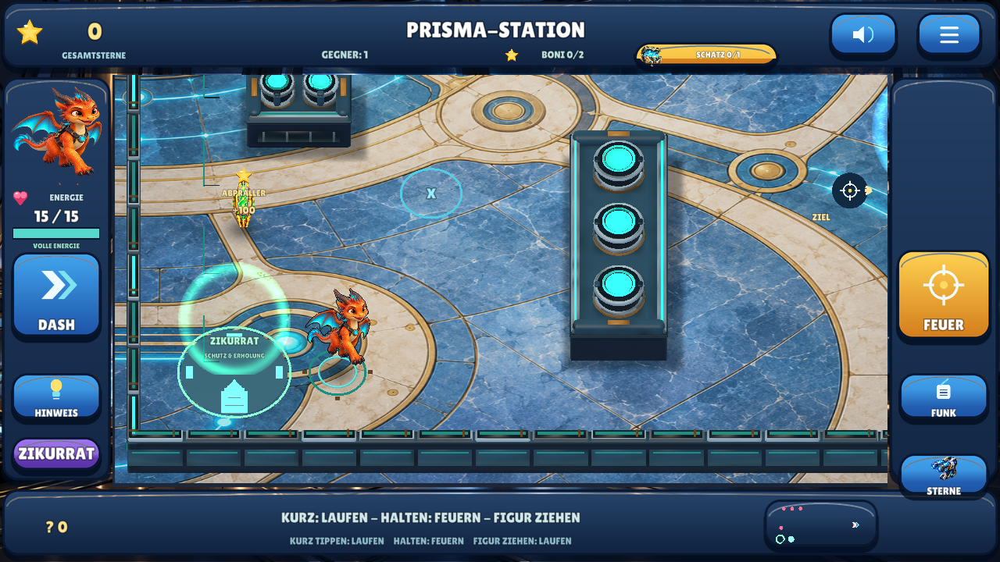
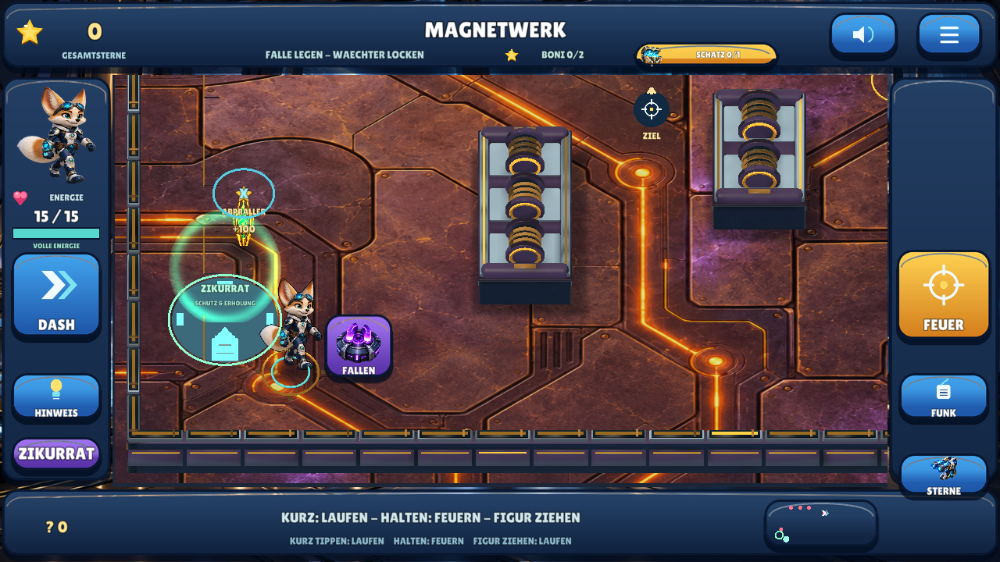
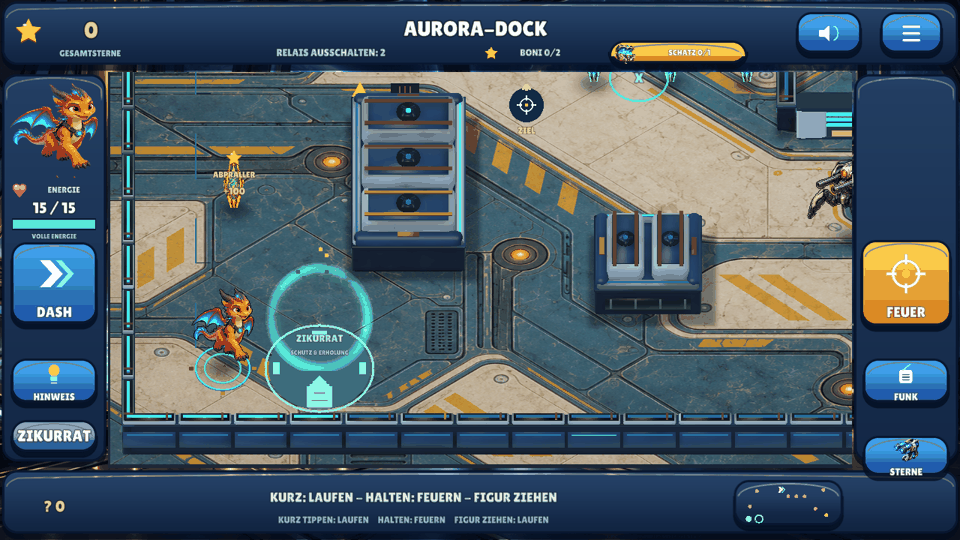

# EnergyBlast — Defold 0.10

Offline-Touch-Shooter mit drei Helden, sechs Missionen, reflektierten Schüssen,
integrierten Bonusaufgaben und lokal gespeicherten Sternen. **Mehr Gesundheit,
ein geschützter Zikurrat, ein größerer Stufenshop und neue Science-Fiction-Musik.**
Defold bleibt der Schwerpunkt.

**[Android 0.9 herunterladen — 63,9 MB](https://raw.githubusercontent.com/sayac007/EnergyBlast/e49218e7015e365a0913961a0f1e005436c271f2/downloads/energyblast-defold-debug.apk)** ·
[Update und geprüfte Metadaten](downloads/README.md) ·
[Änderungen und tatsächliche Tests](docs/MILESTONE_09.md) ·
[Qualitätsstatus](docs/QUALITY.md) · [Selbst bauen](docs/BUILD_AND_TEST.md)

## Weniger Frust, mehr Ausrüstung

- **15 statt 3 Energie.** Nach vier Sekunden ohne Treffer erholt sich die Figur
  um einen Punkt alle zwei Sekunden. Die Anzeige zeigt Energie und Erholung.
- **Zikurrat in jeder Arena:** mintfarben leuchtender Schutzort nahe dem Start,
  mit eigenem Wegknopf und Minikartenzeichen. Feindliche Schüsse werden an seinem
  Rand neutralisiert, auch nach Abprallern. Dort regenerieren zwei Punkte pro
  Sekunde. Zum Schießen verlässt man den geschützten Bereich.
- **Gesundheit immer im Shop:** 40 Sterne füllen die Energie vollständig auf.
  Wiederholt kaufbar; bei voller Gesundheit wird nichts abgebucht. Die kostenlose
  Erholung bleibt jederzeit als Alternative erhalten.
- **Vier Waffen- und vier Rüstungsstufen:** Waffen werden stärker, Rüstung erhöht
  die maximale Energie bis 35. Nächste Stufen bleiben gedimmt mit Preis sichtbar.
  Dazu zwei Tarnstufen und ein Erholungskern. Keine neuen Tempokäufe; alte Käufe
  und Spielstände bleiben erhalten. Verfügbare und gesamte Sterne sind getrennt.
- **Neue Musik:** originale 80-Sekunden-Komposition bei 96 BPM in D-Moll/modal,
  mit tiefem Puls, warmen Flächen, sparsamen Signalen und gedämpfter Percussion.
  Im Schutzort wird sie leiser; Ansagen senken sie weiterhin ab.

[Umsetzung, Preise, Laufzeitbilder und Grenzen](docs/MILESTONE_09.md).

## Neue Steuerung

| Berührung im Spielfeld | Wirkung |
|---|---|
| Boden kurz antippen | Dorthin laufen |
| Boden halten | Nach **0,14 Sekunden** wiederholt feuern; Finger bewegen ändert die Richtung |
| Gegner ungefähr antippen | Sofort im Eingabeereignis schießen, mit großzügiger Trefferzone |
| Gegner halten | Weiter beschießen |
| Eigene Figur anfassen und ziehen | Während des Ziehens kollisionssicher laufen |
| Loslassen | Halten/Ziehen beenden; **kein zusätzlicher Schuss** |

Die kurze Bodenschwelle unterscheidet Laufen von Feuern. Beim Gegner entfällt
sie vollständig. Waffenabstand jetzt 0,24 Sekunden; schnelle Gegnertipps während
dieser Abklingzeit werden begrenzt gepuffert. Die Zielhilfe verändert nicht die
Schussphysik: Deckungen reflektieren weiterhin. Reale Android-Eingabelatenz und
Mehrfingergefühl müssen am Gerät geprüft werden; keine Null-Millisekunden-Zusage.
Die Stimme erklärt die neuen Gesten. FEUER, DASH und die Fallenwahl bleiben erhalten.

## Neue Kampfansichten

Sechs eigene großformatige Bodenmaterialien, verschiedene plastische Deckungstypen,
echte gebackene AO-Schattierung pro Arena, weiche Bodenschatten, animierte
Energieschilde und eine nähere Kamera. Keine übernommenen Referenzspiel-Assets.
Die Figuren bleiben ein 2,5D-Hybrid aus Original-Animationsbildern und nativer 3D-Welt.

Native Linux/OpenGL-/XTest-Aufnahmen, keine behaupteten Handyaufnahmen.
[Alle sechs Bereiche und Gestenbelege](docs/MILESTONE_09.md).

## Wo finde ich was?

- **Drache wählen:** Auf der Startseite direkt das Bild **Drache Flammi** antippen.
  Alle drei Helden bleiben sichtbar. Auch das Heldenbild im Spiel öffnet die Wahl.
- **Sterne ausgeben:** Goldene Schaltfläche auf der Startseite → Bild/Effekt ansehen
  → **Kaufen**. Waffen, Rüstung, wiederholte Heilung, Tarnung und Erholung. Käufe
  wirken sofort; Gesamtsterne bleiben, nur das verfügbare Guthaben sinkt.
- **Offene Schätze:** Oben steht **Schatz 0/1** oder **1/1**. Antippen aktiviert
  einen kostenlosen goldenen Wegweiser zum Suchgebiet. Bei Annäherung wird die
  Truhe sichtbar. Nach Missionsabschluss führt er direkt zum verbliebenen Schatz.
- **Nächste Mission:** Nach dem Sieg ausdrücklich **Nächste Mission** antippen.
  Der Schatz und die Bonusziele sind freiwillig. Wer weitersucht, kann jederzeit
  über **Weiter** wechseln. Die aktuelle Mission bleibt beim Neustart gespeichert.
- **Neue Aufgaben:** Magnetfallen, Lichterfolge und Drohnenrettung sind deutlich
  markiert. Außerdem enthält **jede Mission zwei Bonusziele direkt im Spielfeld**.

## Mehr Sterne und integrierte Boni

| Erfolg | Einmalige Sterne |
|---|---:|
| Mission geschafft | 300 |
| Ohne Schaden / Drohne unbeschädigt | 100 |
| Schatz gefunden | 75 |
| Goldenen Kristall durch einen echten Abpraller treffen | 100 |
| Lichterfolge oder grünes Zeitfenster lösen | 150 |
| Maximum pro Mission | **725** |

Sechs Missionen ergeben bis **4.350 Sterne**, mit alten 0.1-Erfolgen bis 4.675.
Vorhandene Erfolge werden mit den erhöhten Werten bewertet; Käufe, Figur, Hinweise
und Musik bleiben erhalten. Wiederholen erzeugt keine doppelten Belohnungen.

Die Boni sind tatsächliche Schussaufgaben in der normalen Arena, keine zusätzliche
Bonusmission und kein vorgeschalteter Fragebogen. Die Lichterfolge wird beobachtet
und nachgespielt. Beim Zeitfenster muss das Kind auf Grün warten; Dauerfeuer startet
nur die Wartephase neu. Kein Verlust von Gesundheit oder schon verdienten Punkten.
Auch nach dem Sieg können die offenen Boni in Ruhe gelöst werden.

## Prüfungen und Grenzen

**29.10.2026:** Aktuelle Prüfungen zu Gesundheit, Schutzort und Stufenshop stehen
im [zentralen Qualitätsstatus](docs/QUALITY.md). Die fünf direkten Gesten sowie
Menüs, Käufe, Speicherneustarts, Fallen, Missionswechsel, native Audioausgabe und
Geschossverdeckung bleiben Teil der vollständigen Suite. Drei neue kurze
Schutzort-/Shopansagen wurden unabhängig exakt erkannt, 27 andere bleiben erhalten.

Handy-/Tablet-Installation, tatsächliche Latenz, Mehrfingergefühl, Klang,
längere Runden, Leistung und grafische Abnahme bleiben offen. Keine behauptete
kommerziell gleichwertige Gesamtproduktion, empirische Lernwirkung oder Store-Reife.

Spielcode auf `feat/touch-shooter-v2`; `main` bleibt Dokumentationsstartseite.
Keine PRs, Spielmerges, neuen Actions oder Releases. Andere Repositories und
Vergleichs-Engines bleiben unverändert. Keine privaten Familien-Assets oder Schlüssel,
Konten, Werbung oder Telemetrie. Lokale Daten, keine Android-Berechtigungen, Backup aus.

[Auftrag](docs/PROJECT_BRIEF.md), [Art Direction](docs/ART_DIRECTION.md),
[Regeln](shared/defold04.json), [Direktsteuerung](pilots/defold/main/touch.lua),
[Antippzonen](pilots/defold/main/hit_regions.lua),
[neue Bildherkunft](shared/assets/defold09/PROVENANCE.json),
[Lizenzen](THIRD_PARTY.md), [vorheriger Stand](docs/MILESTONE_07.md).
