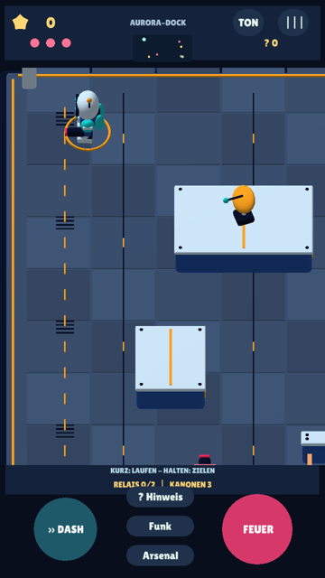
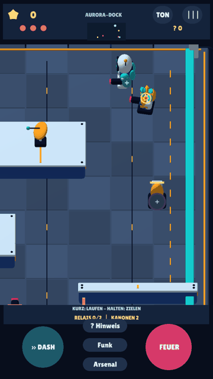

# EnergyBlast — Defold 0.4, Aurora Hop

Ein Android-Touch-Shooter für Kinder etwa von 7 bis 10 Jahren: Roboter, aktive
Kanonen, Deckung, Ausweichen und selbst eingeschätzte Abpraller. Nach deinem Test
liegt der Schwerpunkt jetzt auf **Defold**. GDevelop 0.3 und Godot 0.2 bleiben
als frühere Vergleichsfassungen erhalten.

**Neu am 28.10.2026:** klare Unterscheidung nach Druckdauer, 2,25-mal so große
Arenen mit folgender Kamera, eigene synthetische Hintergrundmusik und animierte
Energieexplosionen beim endgültigen Treffer. Keine berechnete Schussbahn.

| Einstieg | Dokumentation |
|---|---|
| App ausprobieren | [Defold-APK und technische Nachweise](https://github.com/sayac007/EnergyBlast/blob/40edbcdee1dae2e9281c02baa2f3e47b2d7b67bc/downloads/README.md) |
| Änderungen, Auftragsabgleich und Grenzen | [Meilenstein 03](docs/MILESTONE_03.md), [Qualitätsüberblick](https://github.com/sayac007/EnergyBlast/blob/40edbcdee1dae2e9281c02baa2f3e47b2d7b67bc/docs/QUALITY.md) |
| Ausgangsauftrag und spätere Entscheidungen | [Projektauftrag](docs/PROJECT_BRIEF.md), [unverändertes Originalzitat](docs/pilot-brief.md) |
| Frühere Vergleiche | [Defold/GDevelop 0.3](docs/MILESTONE_02.md), [Drei-Engine-Vergleich 0.2](docs/MILESTONE_01.md) |
| Selbst bauen und prüfen | [Build-/Testanleitung](https://github.com/sayac007/EnergyBlast/blob/40edbcdee1dae2e9281c02baa2f3e47b2d7b67bc/docs/BUILD_AND_TEST.md) |

## Herunterladen und aktualisieren

**[Defold 0.4 APK herunterladen](https://raw.githubusercontent.com/sayac007/EnergyBlast/4539cdf739582e22046c36aa76e20d7750584fce/downloads/energyblast-defold-debug.apk)**

Android 7 / API 24 oder neuer, ARM64. Version **0.4.0 / Code 4** behält Paketkennung
und Entwicklungsschlüssel von 0.3. Über die vorhandene App installieren, **vorher
nicht deinstallieren**, wenn die Sterne erhalten bleiben sollen. Der echte
Geräte-Update-Test der neuen APK steht aus. Größe, Hash und Quellstand bei den
[Downloads](https://github.com/sayac007/EnergyBlast/blob/40edbcdee1dae2e9281c02baa2f3e47b2d7b67bc/downloads/README.md). Debug-Testfassung, keine Play-Upload-Datei.

## Die neue Bedienung

| Auf dem Spielfeld | Wirkung |
|---|---|
| Kürzer als 0,30 Sekunden drücken und loslassen | Ausschließlich laufen — auch bei einem Tipp auf Gegner, Schalter oder Wand |
| Mindestens 0,30 Sekunden gedrückt halten | Frei zielen, an jeder Stelle; eine Füllanzeige bestätigt den Wechsel |
| Nach dem längeren Drücken loslassen | Ein Schuss in die gewählte Richtung |
| FEUER halten | Wiederholte Schüsse |
| DASH | Kurz geschützt ausweichen |
| Funk | Kurze Mission und neue Bedienansage wiederholen |
| Hinweis | Verdientes Guthaben für die optionale Beutesuche verwenden |

Du musst keine dünne Wand präzise antippen. Die Dauer entscheidet zwischen Laufen
und Zielen, nicht Bewegungsrichtung, Wischstrecke oder Zieltyp. Ein schneller
Wischer feuert nicht. Zielmarke ja, vorausberechnete Abpralllösung nein.
Kein Joystick und keine Antwortabfrage vor dem Schuss.

## Größere Arenen und sichtbare Treffer

Alle drei Sektoren wachsen von **14×10 auf 21×15**. Kamera und Miniübersicht helfen
beim Erkunden, ohne die Figur winzig herauszuzoomen. Spielfeldmarkierungen bleiben
von HUD und Tasten getrennt. Neue Bodenplatten, Leitungen, Dachdetails und ein
hellerer eigener Shader ergänzen die rotierende Radarschüssel.

Beim letzten Treffer schrumpft und dreht sich die Kanone; zehn goldene/türkise
Energiefragmente fliegen auseinander, ein Ring breitet sich aus. Der Ergebnis-
dialog wartet kurz, damit die letzte Explosion sichtbar bleibt.

| Erweiterte Arena | Echter endgültiger Treffer |
|---|---|
|  |  |

Tatsächlich gerenderte Cloud-Laufzeit. Für die Aufnahme wurde der letzte Treffer
kontrolliert ausgelöst; kein Konzeptbild und keine behauptete Handy-Spielrunde.

## Musik und Spielumfang

**Aurora Hop** ist eine eigene 60-Sekunden-Chiptune-Komposition: fröhliche
synthetische Melodie, Bass, Arpeggios und weiche Schlaginstrumente, 32 Takte bei
128 BPM. Sie läuft in Schleife, wird unter Ansagen leiser und lässt sich im
**Arsenal → Musik** separat ausschalten. Die Einstellung bleibt gespeichert.
TON schaltet auch Musik stumm. Keine übernommene Referenzmelodie oder Aufnahme.

Drei frei wählbare Sektoren bleiben spielbar: **Prisma-Station** mit Schildkanone,
**Neon-Zitadelle** mit zwei Gegnern und Torfenster, **Aurora-Dock** mit Patrouille,
Fächersalven, zwei Abprall-Schaltern vor dem geschützten Boss, Heilzelle und Kern.

Sterne bleiben lokal gespeichert. Ein frisches Profil erreicht insgesamt **600**,
mit historischen 0.1-Sternen bis 925. Wiederholungen und Warten zahlen nicht doppelt.
Prisma, zusätzliche Startenergie, Tempo, geringere gegnerische Erfassungsreichweite
und versteckte Ausrüstung bleiben erhalten. Kein visueller Unsichtbarkeitsshader.

## Was tatsächlich geprüft wurde

**28.10.2026:** 76 native Defold-Prüfungen einschließlich bisheriger Kampffälle,
Druckdauer, großer Welt, Kamera und Explosionen. Echte Menü-/Feldeingaben per
XTest: derselbe Punkt kurz gedrückt bewegt, lang gedrückt feuert. Speicherneustart,
TON-Pause/Fortsetzung und sieben gemeinsame Konsistenztestgruppen bestanden.

Die tatsächliche native Audioausgabe wurde als WAVE aufgezeichnet: Musik an
liefert Signal, Musik aus Nullsignal; Sprache und Explosion wurden mitgemischt
und auf Pegel geprüft. Eine doppelte Lautstärkeabsenkung wurde dadurch gefunden
und behoben. Die neue Bedienansage wurde unabhängig per ASR 1/1 exakt erkannt.

**Offen:** neue APK physisch installieren/aktualisieren, Touchgefühl, Rotation,
Ton-/Klangabnahme, längeres Spiel und Gerätebildrate. Keine behauptete Lernwirkung
oder Store-Reife. Kein Actions-Workflow und keine behauptete grüne CI.
[Prüfungen und Aussagegrenzen](https://github.com/sayac007/EnergyBlast/blob/40edbcdee1dae2e9281c02baa2f3e47b2d7b67bc/docs/QUALITY.md).

## Nächste Rückmeldung

```text
Gerät / Android:
Update von 0.3: Sterne erhalten?
Kurzes und langes Drücken jetzt eindeutig?
Musik gut hörbar, Ansagen verständlich?
Kamera und Explosionen angenehm?
Nächste wichtigste Verbesserung:
```

## Code, Herkunft und Arbeitsweise

[Defold-Regeln](https://github.com/sayac007/EnergyBlast/blob/40edbcdee1dae2e9281c02baa2f3e47b2d7b67bc/shared/defold04.json), [Originalmodelle](https://github.com/sayac007/EnergyBlast/blob/40edbcdee1dae2e9281c02baa2f3e47b2d7b67bc/shared/assets/defold04/),
[Blender-Generator](https://github.com/sayac007/EnergyBlast/blob/40edbcdee1dae2e9281c02baa2f3e47b2d7b67bc/tools/make_defold04_models.py), [Musiksynthese](https://github.com/sayac007/EnergyBlast/blob/40edbcdee1dae2e9281c02baa2f3e47b2d7b67bc/tools/make_defold_music.py),
[Zeitsteuerung](https://github.com/sayac007/EnergyBlast/blob/40edbcdee1dae2e9281c02baa2f3e47b2d7b67bc/pilots/defold/main/touch.lua), [Kamera](https://github.com/sayac007/EnergyBlast/blob/40edbcdee1dae2e9281c02baa2f3e47b2d7b67bc/pilots/defold/main/view.lua),
[Kampf](https://github.com/sayac007/EnergyBlast/blob/40edbcdee1dae2e9281c02baa2f3e47b2d7b67bc/pilots/defold/main/combat.lua), [Laufzeit](https://github.com/sayac007/EnergyBlast/blob/40edbcdee1dae2e9281c02baa2f3e47b2d7b67bc/pilots/defold/main/main.script).
[Herkunft/Lizenzen](https://github.com/sayac007/EnergyBlast/blob/40edbcdee1dae2e9281c02baa2f3e47b2d7b67bc/THIRD_PARTY.md), [Dokumentationsstandard](docs/DOCUMENTATION_STANDARD.md).

`main` bleibt die Dokumentationsstartseite. Spielcode liegt auf
`feat/touch-shooter-v2`; keine PRs, automatischen Merges oder Releases.
Kinderwelt und andere Repositories bleiben unverändert. Keine privaten Familien-
Assets, Konten, Werbung oder Telemetrie. Spielstände/Musikpräferenz bleiben lokal,
Backup ist aus, keine neuen Berechtigungen. Eigene Inhalte haben noch keine
gewählte Nutzungslizenz; Fremdlizenzen bleiben erhalten.
