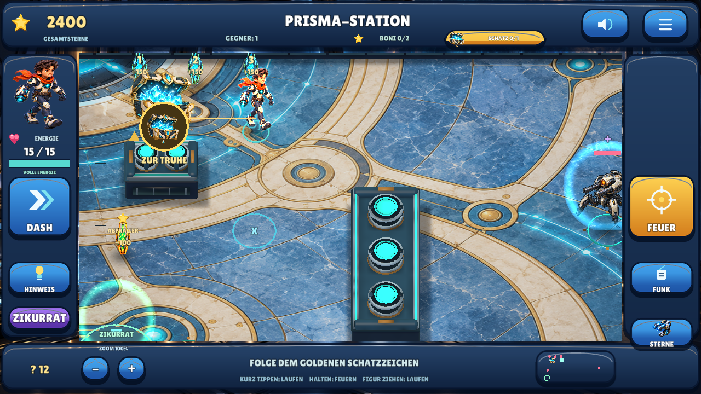
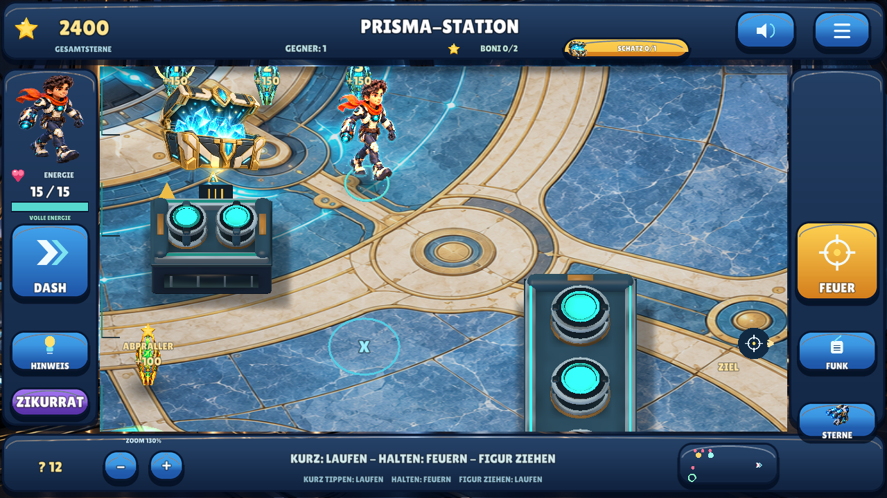
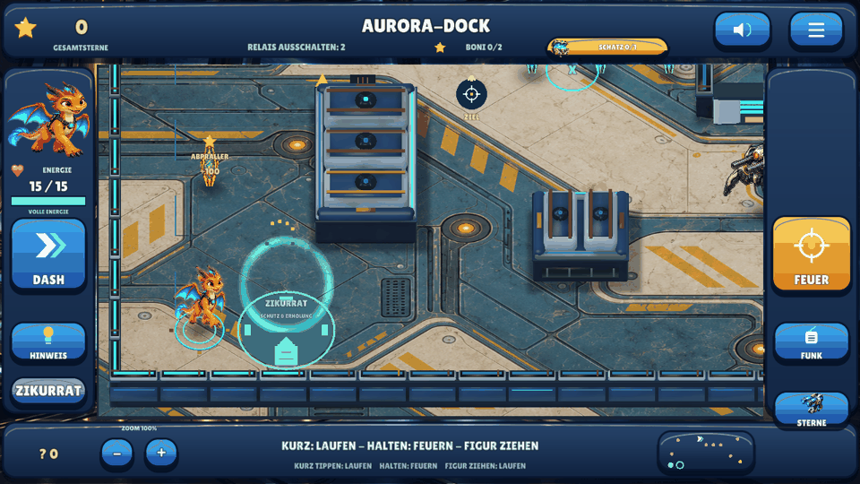

# EnergyBlast — Defold 0.11

Offline-Touch-Shooter für Kinder etwa von 7 bis 10 Jahren, mit drei Helden,
sechs Missionen, reflektierten Schüssen,
integrierten Bonusaufgaben und lokal gespeicherten Sternen. **Zoom, auffindbare
Schätze und neu gezeichnete HD-Figuren mit animiertem Schimmer.**
Defold bleibt der Schwerpunkt.

**[Android 0.10 herunterladen — 64,0 MB](https://raw.githubusercontent.com/sayac007/EnergyBlast/6ef588bd40f4a63e5f267f2fbf45e77b74aeca18/downloads/energyblast-defold-debug.apk)** ·
[Update und geprüfte Metadaten](downloads/README.md) ·
[Änderungen und tatsächliche Tests](docs/MILESTONE_10.md) ·
[Qualitätsstatus](docs/QUALITY.md) · [Selbst bauen](docs/BUILD_AND_TEST.md)

## Aktueller Stand

**Testversion 0.11.0 / Android-Code 12, Stand 29.10.2026.** Die neue Iteration liegt
auf `feat/zoom-treasure-polish`; der integrierte 0.10-Stand bleibt auf `main`.
Quellcode, Inhalte, Originalassets, Buildskripte, Tests und APK sind hier gemeinsam
nachvollziehbar. Android 7/API 24+, ARM64; Entwicklungsfassung mit lokaler Speicherung.

| Bestandteil | Aktuell enthalten |
|---|---|
| Spiel | Sechs Missionen: Abpraller, Deckung/Timing, Relais/Boss, Magnetfallen, Lichterfolge, Drohnenrettung |
| Figuren | Drei auswählbare Originalfiguren, darunter Drache Flammi; animierte 2,5D-Bilder in nativer 3D-Welt |
| Fortschritt | Lokale Gesamtsterne, verfügbares Guthaben, Käufe, Hinweise und aktuelle Mission; zwei freiwillige Bonusziele je Mission |
| Ausrüstung | Zwölf Shopangebote: wiederholte Heilung, vier Waffen-, vier Rüstungs-, zwei Tarnstufen und Erholungskern |
| Ton | Deutsche synthetische Ansagen, eigene Science-Fiction-Musik und Effekte; stummschaltbar |
| Engine | Defold 1.14.0 aktiv; Godot 0.2 und GDevelop 0.3 als unveränderte Vergleichsstände erhalten |

### Was 0.11 verbessert

- **Ganzes Spielfeld zoomen:** Plus/Minus oder zwei Finger auf freiem Boden,
  75–175 Prozent. Welt, Figuren und Weltbeschriftungen werden größer; das HUD
  bleibt gleich groß. Die gewählte Größe bleibt gespeichert, der betrachtete
  Bereich beim Stillstehen im Blick.
- **Hinweise führen zum Schatz:** Drei früher in Deckungen liegende Suchpunkte
  sind korrigiert. „Hinweis“ schaltet den goldenen Wegweiser auf die Schatzsuche.
  Die neue Stimme beschreibt dieses Zeichen statt einer nicht sichtbaren blauen Kiste.
- **Truhen erkennen:** Bei Annäherung leuchten und wachsen sie. Große Goldmarkierung,
  Minikarte und ein antippbares Suchzeichen helfen auch hinter einer Deckung.
  Zum Einsammeln muss die Figur tatsächlich hinlaufen; Wände bleiben wirksam.
- **Neue HD-Figuren:** Nova, Flammi und der Fuchs haben neue Originalbilder mit
  1536×1024 statt 1024×768 Pixeln pro Laufatlas. Farbige Schimmerkanten,
  Lichtpartikel, Atmen, Laufschwung und Rückstoß ergänzen die acht Bildphasen.

[Umsetzung und Laufzeitbilder](docs/MILESTONE_10.md).

### Aus 0.10 erhalten

- **15 statt 3 Energie.** Nach vier Sekunden ohne Treffer erholt sich die Figur
  um einen Punkt alle zwei Sekunden. Die Anzeige zeigt Energie und Erholung.
- **Zikurrat in jeder Arena:** mintfarben leuchtender Schutzort nahe dem Start,
  mit eigenem Wegknopf und Minikartenzeichen. Feindliche Schüsse werden an seinem
  Rand neutralisiert, auch nach Abprallern. Dort regenerieren zwei Punkte pro
  Sekunde. Zum Schießen verlässt man den geschützten Bereich.
- **Gesundheit immer im Shop:** 40 Sterne füllen die Energie vollständig auf.
  Wiederholt kaufbar; bei voller Gesundheit wird nichts abgebucht. Die kostenlose
  Erholung bleibt jederzeit als Alternative erhalten.
- **Vier Waffen- und vier Rüstungsstufen:** Waffen werden stärker, Rüstung erhöht
  die maximale Energie bis 35. Nächste Stufen bleiben gedimmt mit Preis sichtbar.
  Dazu zwei Tarnstufen und ein Erholungskern. Keine neuen Tempokäufe; alte Käufe
  und Spielstände bleiben erhalten. Verfügbare und gesamte Sterne sind getrennt.
- **Neue Musik:** originale 80-Sekunden-Komposition bei 96 BPM in D-Moll/modal,
  mit tiefem Puls, warmen Flächen, sparsamen Signalen und gedämpfter Percussion.
  Im Schutzort wird sie leiser; Ansagen senken sie weiterhin ab.

[Umsetzung, Preise, Laufzeitbilder und Grenzen](docs/MILESTONE_09.md).

## Entwicklungshistorie

EnergyBlast entstand als eigenständiges Projekt aus einer neuen Shooter-Idee.
Die Entwicklung wird vollständig erhalten; die folgende Tabelle trennt die
Entscheidungen und Spielstände. Ein technisch bestandener Test war keine
ästhetische Freigabe. Frühere Bedienkonzepte wurden durch spätere ersetzt.

| Datum | Version | Entwicklung und Entscheidung | Feste Nachweise |
|---|---|---|---|
| 27.10.2026 | 0.1 | Zwei Geometrie-/Timingmissionen, lokale Sterne und verdiente Hinweise. Godot/GDevelop spielbar; Unity nur Importkit, noch keine Defold-APK. | [Quelle](https://github.com/sayac007/EnergyBlast/commit/46c1fecc54356f9fecd8f6144ec00de2fd0df90d) · [APK-Snapshot](https://github.com/sayac007/EnergyBlast/tree/c29acbee7fea5f48565719db95f935f0626630ca/downloads) |
| 27.10.2026 | 0.2 | Erster echter Shootervergleich mit Godot, GDevelop und Defold: aktive Kanonen, Deckung, Abpraller, Schaden und DASH. | [Quelle](https://github.com/sayac007/EnergyBlast/commit/1006cde8595b4249d0375ddf8bc4ea60fd2a93c9) · [APK-Snapshot](https://github.com/sayac007/EnergyBlast/tree/defd791bd94809045cf5a8ed9429ead92c8bd959/downloads) · [Bericht](docs/MILESTONE_01.md) |
| 28.10.2026 | 0.3 | Defold/GDevelop weitergeführt: dritter Sektor, Relais, Boss und Patrouille; berechnete Schussbahn entfernt. Godot bleibt bei 0.2. | [Quelle](https://github.com/sayac007/EnergyBlast/commit/43527374e1705a9608a9ddb11ccc8e4af31ef69e) · [APK-Snapshot](https://github.com/sayac007/EnergyBlast/tree/943f9340ef78079ed60c7db068cd5b76f86d1b6a/downloads) · [Bericht](docs/MILESTONE_02.md) |
| 28.10.2026 | 0.4 | Schwerpunkt Defold: größere Welt, folgende Kamera, damalige Zeitsteuerung, eigene Musik und Explosionen. GDevelop bleibt bei 0.3. | [Quelle](https://github.com/sayac007/EnergyBlast/commit/d070a6021ac1ecfd84556da40cb1e852bbc2e593) · [APK-Snapshot](https://github.com/sayac007/EnergyBlast/tree/4539cdf739582e22046c36aa76e20d7750584fce/downloads) · [Bericht](docs/MILESTONE_03.md) |
| 28.10.2026 | 0.4.1 | Alle Wände reflektieren; Geschosse verlieren Energie und vergehen. Neutralisationsfelder absorbieren. | [Quelle](https://github.com/sayac007/EnergyBlast/commit/02a2b409830600bdaa85b10f6accc58f18a5f085) · [APK-Snapshot](https://github.com/sayac007/EnergyBlast/tree/bd3d6f1374a7aca4e79fe4b9ba512ff67244e78f/downloads) · [Bericht](docs/MILESTONE_03.md) |
| 28.10.2026 | 0.5 | Sechs Missionen, drei Figuren, tatsächliche Käufe, Beuteführung und native Geschossverdeckung. **Grafik anschließend vom Betreiber abgelehnt.** | [Quelle](https://github.com/sayac007/EnergyBlast/commit/321d5cf6f50f7b038a2f7f8189ac421770af9013) · [APK-Snapshot](https://github.com/sayac007/EnergyBlast/tree/4315cf73fe6fd5b8688e7d397766394010fe2e5d/downloads) · [Bericht](docs/MILESTONE_04.md) |
| 28.10.2026 | 0.6 | Texturierte Arenen, detaillierte native Modelle/AO, feste Landschaftsaufteilung und Batching. **Grafik erneut abgelehnt.** | [Quelle](https://github.com/sayac007/EnergyBlast/commit/19856c195a8b51d1136ef8e7e8f57efd744caf05) · [APK-Snapshot](https://github.com/sayac007/EnergyBlast/tree/24b24dd23d08eb73ebd5fc113c318da3b1f45e7a/downloads) · [Bericht](docs/MILESTONE_05.md) |
| 28.10.2026 | 0.7 | Originale Illustrationsanimationen als 2,5D-Hybrid, Bildmenüs und Magnet-/Eis-/Impulsfallen direkt im Spielfeld. | [Quelle](https://github.com/sayac007/EnergyBlast/commit/080ddfda31332b542f99fdcebc59fc1e6c885bf0) · [APK-Snapshot](https://github.com/sayac007/EnergyBlast/tree/f8e8542b30cf1691bedf8f28a2403936f9bafcb9/downloads) · [Bericht](docs/MILESTONE_06.md) |
| 28.10.2026 | 0.8 | Klarer Missionswechsel, sichtbare Helden/Käufe, Schatzführung, je zwei integrierte Bonusziele und höhere Belohnungen. | [Quelle](https://github.com/sayac007/EnergyBlast/commit/6b1afee89855c737358859ce4fd2f83100f53583) · [APK-Snapshot](https://github.com/sayac007/EnergyBlast/tree/5c8e1ca956e99abd805cc29f90f9ee6620a7a5ce/downloads) · [Bericht](docs/MILESTONE_07.md) |
| 29.10.2026 | 0.9 | Halten feuert, Gegnertipp schießt sofort, eigene Figur ziehen; neue Böden, plastischere Deckungen, AO, Schatten und Schilde. | [Quelle](https://github.com/sayac007/EnergyBlast/commit/d4dea7d0768191c67d01206381d4913615f74ff0) · [APK-Snapshot](https://github.com/sayac007/EnergyBlast/tree/e49218e7015e365a0913961a0f1e005436c271f2/downloads) · [Bericht](docs/MILESTONE_08.md) |
| 29.10.2026 | 0.10 | 15 Grundenergie, Erholung, sechs Zikurrate, zwölf Shopangebote mit Waffen-/Rüstungsstufen und ruhigere Science-Fiction-Musik. **Aktuelle Testfassung.** | [Quelle](https://github.com/sayac007/EnergyBlast/commit/6cea6cdcdb0ad8092fa483dd641836dcbca2be94) · [APK-Snapshot](https://github.com/sayac007/EnergyBlast/tree/6ef588bd40f4a63e5f267f2fbf45e77b74aeca18/downloads) · [Bericht](docs/MILESTONE_09.md) |
| 29.10.2026 | 0.11 | Zoombedienung, verlässliche Schatzführung und HD-Figuren mit nativem Schimmer. **Neue Testfassung auf dem Arbeitsbranch.** | [Bericht](docs/MILESTONE_10.md) · [Quell-/APK-Bezug](downloads/README.md) |

**29.10.2026 – Repository-Übernahme von 0.10:** Bis 0.10 erschien auf `main` die aktuelle
Dokumentation, während der vollständige Spielcode auf dem Arbeitsbranch lag.
Auf Betreiberwunsch sind beide Historien mit einem Merge-Commit
zusammengeführt. Alle alten Quell-/APK-Commits bleiben erreichbar; kein Squash,
keine neu geschriebene Historie und keine neue APK nur für die Übernahme.

[Ursprünglicher Auftrag](docs/pilot-brief.md),
[fortgeschriebene Entscheidungen](docs/PROJECT_BRIEF.md) und
[historische Downloads](downloads/README.md) bleiben getrennt nachvollziehbar.
Die [vollständige Commit-Historie](https://github.com/sayac007/EnergyBlast/commits/main/)
ist weiterhin im Repository verfügbar.

## Steuerung

| Berührung im Spielfeld | Wirkung |
|---|---|
| Boden kurz antippen | Dorthin laufen |
| Boden halten | Nach **0,14 Sekunden** wiederholt feuern; Finger bewegen ändert die Richtung |
| Gegner ungefähr antippen | Sofort im Eingabeereignis schießen, mit großzügiger Trefferzone |
| Gegner halten | Weiter beschießen |
| Eigene Figur anfassen und ziehen | Während des Ziehens kollisionssicher laufen |
| Zwei Finger auf freiem Boden auseinander/zusammen | Ganzen Bereich vergrößern/verkleinern |
| Plus / Minus unten links | Zoom schrittweise ändern |
| Goldmarkierung antippen | Tatsächlichen Weg zur Truhe / zum Suchgebiet laufen |
| Loslassen | Halten/Ziehen beenden; **kein zusätzlicher Schuss** |

Die kurze Bodenschwelle unterscheidet Laufen von Feuern. Beim Gegner entfällt
sie vollständig. Waffenabstand der Basiswaffe 0,24 Sekunden, höhere Stufen bis 0,18 Sekunden; schnelle Gegnertipps während
dieser Abklingzeit werden begrenzt gepuffert. Die Zielhilfe verändert nicht die
Schussphysik: Deckungen reflektieren weiterhin. Reale Android-Eingabelatenz und
Mehrfingergefühl müssen am Gerät geprüft werden; keine Null-Millisekunden-Zusage.
Die Stimme erklärt die neuen Gesten. FEUER, DASH und die Fallenwahl bleiben erhalten.

## Spielansichten

Sechs eigene großformatige Bodenmaterialien, verschiedene plastische Deckungstypen,
echte gebackene AO-Schattierung pro Arena, weiche Bodenschatten, animierte
Energieschilde und eine nähere Kamera. Keine übernommenen Referenzspiel-Assets.
Die Figuren bleiben ein 2,5D-Hybrid aus Original-Animationsbildern und nativer 3D-Welt.





Native Linux/OpenGL-/XTest-Aufnahmen, keine behaupteten Handyaufnahmen.
[Sechs Bereichsansichten und Gestenbelege aus 0.9](docs/MILESTONE_08.md),
[aktuelle Schutzort-/Shopbilder aus 0.10](docs/MILESTONE_09.md).

## Wo finde ich was?

- **Drache wählen:** Auf der Startseite direkt das Bild **Drache Flammi** antippen.
  Alle drei Helden bleiben sichtbar. Auch das Heldenbild im Spiel öffnet die Wahl.
- **Sterne ausgeben:** Goldene Schaltfläche auf der Startseite → Bild/Effekt ansehen
  → **Kaufen**. Waffen, Rüstung, wiederholte Heilung, Tarnung und Erholung. Käufe
  wirken sofort; Gesamtsterne bleiben, nur das verfügbare Guthaben sinkt.
- **Offene Schätze:** Oben steht **Schatz 0/1** oder **1/1**. Antippen aktiviert
  einen kostenlosen goldenen Wegweiser zum Suchgebiet. Bei Annäherung wird die
  Truhe sichtbar. Nach Missionsabschluss führt er direkt zum verbliebenen Schatz.
- **Nächste Mission:** Nach dem Sieg ausdrücklich **Nächste Mission** antippen.
  Der Schatz und die Bonusziele sind freiwillig. Wer weitersucht, kann jederzeit
  über **Weiter** wechseln. Die aktuelle Mission bleibt beim Neustart gespeichert.
- **Neue Aufgaben:** Magnetfallen, Lichterfolge und Drohnenrettung sind deutlich
  markiert. Außerdem enthält **jede Mission zwei Bonusziele direkt im Spielfeld**.

## Mehr Sterne und integrierte Boni

| Erfolg | Einmalige Sterne |
|---|---:|
| Mission geschafft | 300 |
| Ohne Schaden / Drohne unbeschädigt | 100 |
| Schatz gefunden | 75 |
| Goldenen Kristall durch einen echten Abpraller treffen | 100 |
| Lichterfolge oder grünes Zeitfenster lösen | 150 |
| Maximum pro Mission | **725** |

Sechs Missionen ergeben bis **4.350 Sterne**, mit alten 0.1-Erfolgen bis 4.675.
Vorhandene Erfolge werden mit den erhöhten Werten bewertet; Käufe, Figur, Hinweise
und Musik bleiben erhalten. Wiederholen erzeugt keine doppelten Belohnungen.

Die Boni sind tatsächliche Schussaufgaben in der normalen Arena, keine zusätzliche
Bonusmission und kein vorgeschalteter Fragebogen. Die Lichterfolge wird beobachtet
und nachgespielt. Beim Zeitfenster muss das Kind auf Grün warten; Dauerfeuer startet
nur die Wartephase neu. Kein Verlust von Gesundheit oder schon verdienten Punkten.
Auch nach dem Sieg können die offenen Boni in Ruhe gelöst werden.

## Repositoryaufbau

| Pfad | Zweck |
|---|---|
| [pilots/defold](pilots/defold) | Aktuelles natives Spiel einschließlich Eingabe, Darstellung, Speicher und Audio |
| [shared](shared) | Regeln, Missionen, Originalassets, Herkunftsnachweise und Audioquellen |
| [tools](tools) | Synchronisation, reproduzierbare Buildbefehle und Regressionstests |
| [Prüffälle und Fixtures](pilots/defold/main) | Native `*_checks.lua`-Prüffälle; archivierte Regeldaten unter `pilots/defold/data` |
| [docs](docs) | Auftrag, Meilensteine, Bauanleitung und zentraler Qualitätsstatus |
| [downloads](downloads) | Geprüfte APKs und maschinenlesbare Buildmetadaten; frühere Dateien über feste Commits |

Aktuelle Prüfkommandos vom Repository-Hauptverzeichnis; Voraussetzungen und
Werkzeugversionen stehen in [BUILD_AND_TEST.md](docs/BUILD_AND_TEST.md):

```bash
python3 tools/check_shared.py
python3 tools/check_defold.py
```

## Prüfungen und Grenzen

**29.10.2026:** **820 native Prüfungen und 15 gemeinsame Testgruppen bestanden.** Details zu Gesundheit, Schutzort und Stufenshop stehen
im [zentralen Qualitätsstatus](docs/QUALITY.md). Die vollständige Suite wurde für 0.11 erneut ausgeführt. Die fünf direkten Gesten sowie
Menüs, Käufe, Speicherneustarts, Fallen, Missionswechsel, native Audioausgabe und
Geschossverdeckung bleiben Teil der vollständigen Suite. Zwei neue kurze Schatz-/Zoomansagen wurden unabhängig exakt erkannt,
30 andere bleiben erhalten. Zwei-Finger-Pakete sind nativ simuliert geprüft;
der echte Android-Mehrfingertest bleibt offen.

Handy-/Tablet-Installation, tatsächliche Latenz, Mehrfingergefühl, Klang,
längere Runden, Leistung und grafische Abnahme bleiben offen. Keine behauptete
kommerziell gleichwertige Gesamtproduktion, empirische Lernwirkung oder Store-Reife.

Der 0.10-Stand wurde am 29.10.2026 mit erhaltener Commit-Historie in `main`
integriert. Die neue 0.11-Testfassung wird separat entwickelt und veröffentlicht.
Kein automatischer Spielmerge, GitHub-Release oder Store-Upload. Andere Repositories und
Vergleichs-Engines bleiben unverändert. Keine privaten Familien-Assets oder Schlüssel,
Konten, Werbung oder Telemetrie. Lokale Daten, keine Android-Berechtigungen, Backup aus.

[Auftrag](docs/PROJECT_BRIEF.md), [Art Direction](docs/ART_DIRECTION.md),
[Regeln](shared/defold04.json), [Direktsteuerung](pilots/defold/main/touch.lua),
[Antippzonen](pilots/defold/main/hit_regions.lua),
[neue Figurenherkunft](shared/assets/defold11/PROVENANCE.json),
[Lizenzen](THIRD_PARTY.md), [vorheriger Stand](docs/MILESTONE_09.md).
