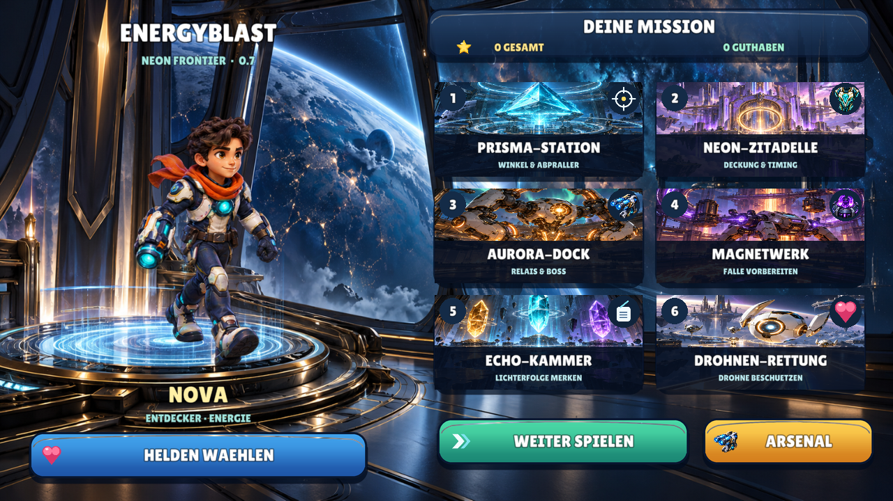
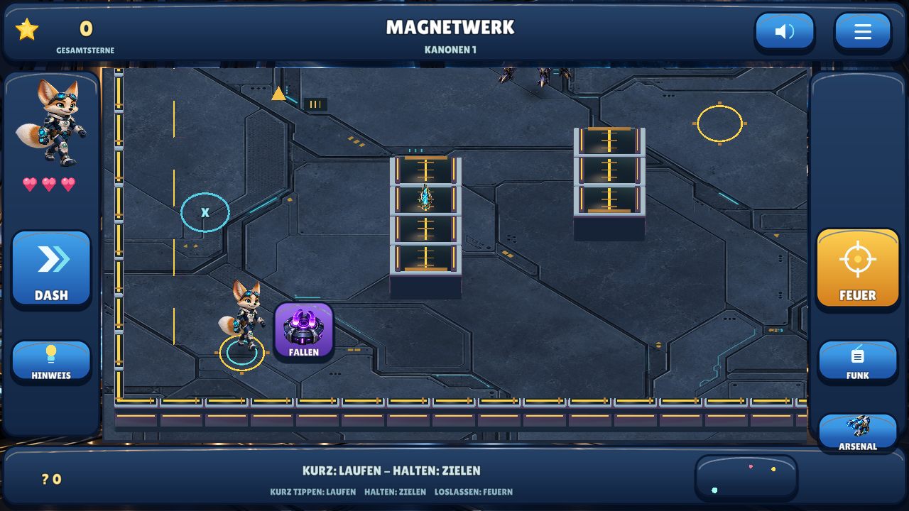
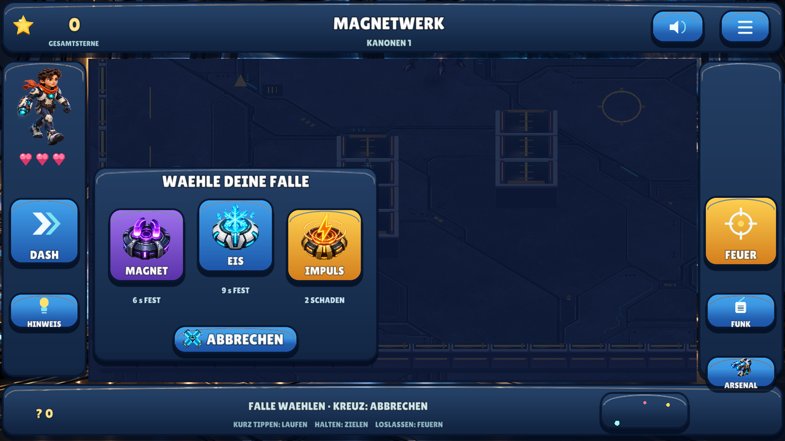

# EnergyBlast — Defold 0.7, Neon Frontier

Ein echter Offline-Touch-Shooter für Kinder etwa von 7 bis 10 Jahren: Deckung,
Ausweichen, Energiegeschosse und selbst eingeschätzte Abpraller. **Sechs Sektoren,
drei Helden, kaufbare Ausrüstung und drei taktische Fallen.** Defold ist der
Schwerpunkt; GDevelop 0.3 und Godot 0.2 bleiben unveränderte Vergleiche.

| Einstieg | Weiterlesen |
|---|---|
| Installierbare Test-App | [Download, Hash und Update-Hinweise](downloads/README.md) |
| Neue Grafik und Fallen | [Meilenstein 06](docs/MILESTONE_06.md), [Fallenbedienung](docs/TRAPS.md) |
| Tatsächlich geprüft / offen | [Qualitätsübersicht](docs/QUALITY.md) |
| Auftrag / Herkunft / selbst bauen | [Projektauftrag](docs/PROJECT_BRIEF.md), [Recherche](docs/ART_DIRECTION.md), [Befehle](docs/BUILD_AND_TEST.md) |
| Historie | [0.6](docs/MILESTONE_05.md), [0.5](docs/MILESTONE_04.md), [Ausgangsvergleich](docs/MILESTONE_01.md) |

**[EnergyBlast 0.7 APK herunterladen](https://raw.githubusercontent.com/sayac007/EnergyBlast/f8e8542b30cf1691bedf8f28a2403936f9bafcb9/downloads/energyblast-defold-debug.apk) — 43,3 MB.**
Android 7/API24+, ARM64, festes Querformat. Als Update über die vorhandene
Defold-App installieren; vorher nicht deinstallieren, damit lokale Sterne bleiben.
Gleiche Paketkennung und verifiziertes Entwicklungssignatur-Zertifikat wie 0.6.

## Neu in 0.7

- **Originale Figurenbilder im Spiel:** Nova, Drache Flammi und Fennek laufen
  mit Front-/Rückansicht und wechselnden Animationsbildern. Native tiefengeprüfte
  Weltflächen ersetzen die bisherigen Baukastenfiguren. Bewusst 2,5D-Hybrid,
  keine Behauptung vollständiger dreidimensionaler Skelettanimation.
- **Drei markante Gegnerbilder:** Sentinel, Magnetwächter und schwebender Boss;
  sichtbares Aufladen, Schusszustand, Rückstoß und Trefferreaktion.
- **Neue futuristische Kulisse:** Metallböden, gepanzerte Deckung, Lichtnähte,
  äußere Reaktoren und Dockarchitektur. Gleiche verlässliche Kollisionsflächen.
- **Bebilderte Missionen und Arsenal:** eigene Illustrationen, Ausrüstungsbilder,
  Piktogramme zusätzlich zu Text, kurze Menüanimation, orbitaler Hintergrund.
- **Energieexplosion:** acht animierte Phasen plus räumlich bewegte Fragmente.
- **Fallen direkt auf dem Feld:** Bild neben der Figur antippen, Magnet/Eis/Impuls
  wählen, Vorschau prüfen, freien Boden antippen. Auswahl pausiert Kampf/Kamera.
  Gesprochene Anleitung passt zu den tatsächlichen Gesten. Kein Fallenknopf unten.

Brawl Stars ist gestalterische Referenz; keine fremden Spielfiguren, Grafiken,
Videoaufnahmen oder Melodien werden in der App verwendet. Die Grafik von 0.6 wurde
vom Betreiber abgelehnt. Testzahlen ersetzen keine persönliche grafische Abnahme.

## Tatsächliche Laufzeitbilder

Native Linux-/OpenGL-Aufnahmen; keine behauptete Handyaufnahme.
[Bewegung und Schüsse](docs/images/07-defold-gameplay.gif).

## Sechs Missionen und dauerhafte Sterne

| Sektor | Spielziel |
|---|---|
| Prisma-Station | Schildkanone durch Abpraller treffen |
| Neon-Zitadelle | Deckung, zwei Kanonen und zeitweise offenes Tor |
| Aurora-Dock | Patrouille, Fächersalven, Abprall-Schalter und geschützter Boss |
| Magnetwerk | Wächter in vorbereitete Falle locken und Schildöffnung nutzen |
| Echo-Kammer | Lichterfolge merken und Kristalle in dieser Reihenfolge treffen |
| Drohnen-Rettung | Verwundbare Drohne um Deckungen begleiten und schützen |

Bis **1.200 Gesamtsterne** im frischen Profil, mit alten 0.1-Erfolgen bis 1.525.
Keine doppelten Belohnungen durch Wiederholung/Warten. Sterne kaufen Prisma-Kanone,
Rüstung, Tempostiefel und Tarnmodul; Gesamtpunktzahl bleibt erhalten. Geheimnisse
haben kostenlose Umwelthinweise; zusätzliche Hinweise kosten verdiente Credits.
Alles lokal gespeichert. Kein Konto, Werbung, Telemetrie oder Netzwerkzugriff.

## Bedienung

| Eingabe | Wirkung |
|---|---|
| Kurz antippen | Laufen, auch beim Tipp auf Gegner/Wand |
| Mindestens 0,30 Sekunden halten | Zielen an beliebiger Stelle |
| Nach dem Halten loslassen | Ein Schuss / Feuerball |
| FEUER halten / DASH | Wiederholtes Schießen / geschütztes Ausweichen |
| Fallenbild **neben der Figur** im Magnetwerk | Pausierter Katalog → Auswahl → Vorschau → Boden antippen |
| Kreuz im Feld | Fallenwahl abbrechen; kein versehentlicher Schuss |
| FUNK / HINWEIS | Mission wiederholen / verdienten Schatzhinweis einsetzen |

Magnet hält 6 Sekunden, Eis 9; Impuls verursacht zwei Schaden und öffnet 5 Sekunden.
Nur freie erreichbare Plätze im hellen Kreis; maximal zwei Geräte gleichzeitig.
[Fallen vollständig erklärt](docs/TRAPS.md). Kein Joystick, keine berechnete Flugbahn.

## Prüfstand und Grenzen

**28.10.2026:** 231 native Prüfungen und 12 gemeinsame Testgruppen bestanden.
Echte Menü-/Kauf-/Touch-Eingaben bei 1280×720 und 1280×800, drei Fallenarten plus
Abbruch, getrennte Speicherneustarts, tatsächliche Audioausgabe und verdeckte /
sichtbare Kontrollgeschosse geprüft. Zwölf Sprachclips im unabhängigen ASR-Screen
normalisiert exakt. [Details](docs/QUALITY.md), [Befehle](docs/BUILD_AND_TEST.md).

Physischer Handy-/Tablet-Test, Hörverständnis des Kindes, längere Runden,
Geräteleistung und grafische Betreiberabnahme bleiben offen. Kein behauptetes
kommerzielles Brawl-Stars-Produktionsniveau, keine empirische Lernwirkung oder
Store-Freigabe. Die APK vom sauberen Quellstand wurde technisch geprüft; Geräteabnahme bleibt offen.

## Arbeitsweise und Quellen

Spielcode auf `feat/touch-shooter-v2`; `main` bleibt Dokumentationsstartseite.
Keine PRs, Spielmerges, neuen Actions-Workflows oder Releases. Kinderwelt und
andere Repositories unverändert. Keine privaten Familienbilder oder Schlüssel.

[Regeln](https://github.com/sayac007/EnergyBlast/blob/e7564ba42e1f665aeb11b66caec7b9f06d0447eb/shared/defold04.json), [Originalbilder / Herkunft](https://github.com/sayac007/EnergyBlast/blob/e7564ba42e1f665aeb11b66caec7b9f06d0447eb/shared/assets/defold07/PROVENANCE.json),
[technischer Bildimport](https://github.com/sayac007/EnergyBlast/blob/e7564ba42e1f665aeb11b66caec7b9f06d0447eb/tools/import_defold07_art.py), [Weltgeometrie](https://github.com/sayac007/EnergyBlast/blob/e7564ba42e1f665aeb11b66caec7b9f06d0447eb/tools/make_defold06_models.py),
[Musik](https://github.com/sayac007/EnergyBlast/blob/e7564ba42e1f665aeb11b66caec7b9f06d0447eb/tools/make_defold_music.py), [Kollision](https://github.com/sayac007/EnergyBlast/blob/e7564ba42e1f665aeb11b66caec7b9f06d0447eb/pilots/defold/main/projectiles.lua),
[Lizenzen](THIRD_PARTY.md), [Dokumentationsstandard](docs/DOCUMENTATION_STANDARD.md).
