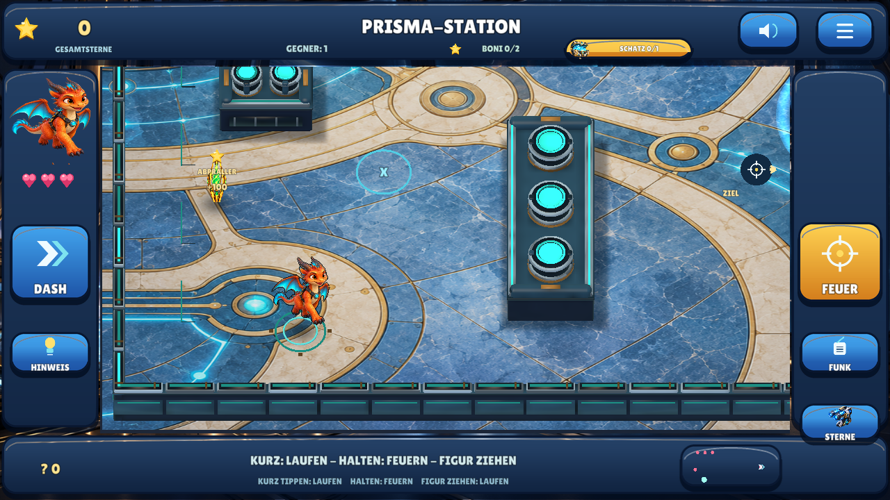
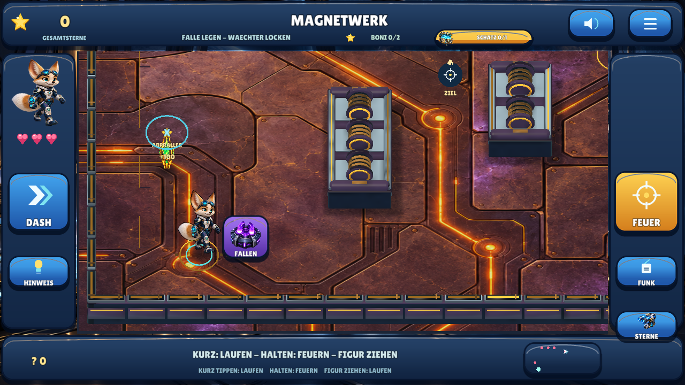
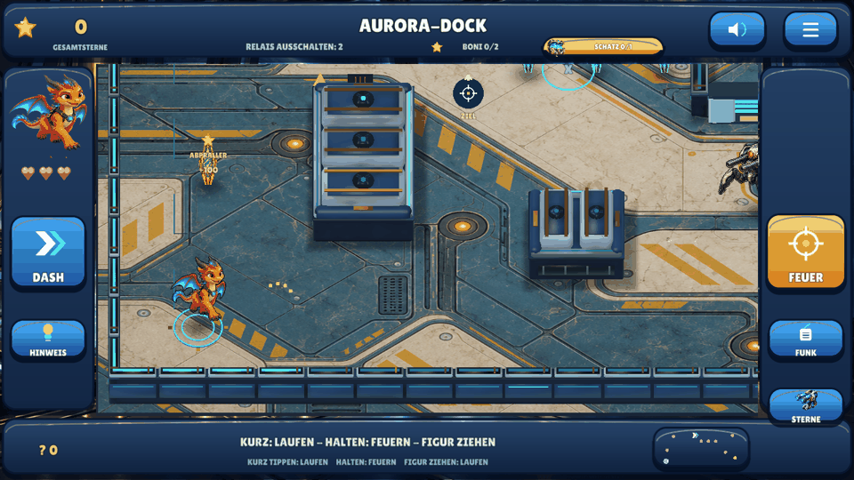

# EnergyBlast — Defold 0.9

Offline-Touch-Shooter mit drei Helden, sechs Missionen, reflektierten Schüssen,
integrierten Bonusaufgaben und lokal gespeicherten Sternen. **Neue Direktsteuerung
und überarbeitete Kampfansichten.** Defold bleibt der Schwerpunkt.

**[Android 0.9 herunterladen — 63,9 MB](https://raw.githubusercontent.com/sayac007/EnergyBlast/e49218e7015e365a0913961a0f1e005436c271f2/downloads/energyblast-defold-debug.apk)** ·
[Update und geprüfte Metadaten](downloads/README.md) ·
[Änderungen und tatsächliche Tests](docs/MILESTONE_08.md) ·
[Qualitätsstatus](docs/QUALITY.md) · [Selbst bauen](docs/BUILD_AND_TEST.md)

## Neue Steuerung

| Berührung im Spielfeld | Wirkung |
|---|---|
| Boden kurz antippen | Dorthin laufen |
| Boden halten | Nach **0,14 Sekunden** wiederholt feuern; Finger bewegen ändert die Richtung |
| Gegner ungefähr antippen | Sofort im Eingabeereignis schießen, mit großzügiger Trefferzone |
| Gegner halten | Weiter beschießen |
| Eigene Figur anfassen und ziehen | Während des Ziehens kollisionssicher laufen |
| Loslassen | Halten/Ziehen beenden; **kein zusätzlicher Schuss** |

Die kurze Bodenschwelle unterscheidet Laufen von Feuern. Beim Gegner entfällt
sie vollständig. Waffenabstand jetzt 0,24 Sekunden; schnelle Gegnertipps während
dieser Abklingzeit werden begrenzt gepuffert. Die Zielhilfe verändert nicht die
Schussphysik: Deckungen reflektieren weiterhin. Reale Android-Eingabelatenz und
Mehrfingergefühl müssen am Gerät geprüft werden; keine Null-Millisekunden-Zusage.
Die Stimme erklärt die neuen Gesten. FEUER, DASH und die Fallenwahl bleiben erhalten.

## Neue Kampfansichten

Sechs eigene großformatige Bodenmaterialien, verschiedene plastische Deckungstypen,
echte gebackene AO-Schattierung pro Arena, weiche Bodenschatten, animierte
Energieschilde und eine nähere Kamera. Keine übernommenen Referenzspiel-Assets.
Die Figuren bleiben ein 2,5D-Hybrid aus Original-Animationsbildern und nativer 3D-Welt.

Native Linux/OpenGL-/XTest-Aufnahmen, keine behaupteten Handyaufnahmen.
[Alle sechs Bereiche und Gestenbelege](docs/MILESTONE_08.md).

## Wo finde ich was?

- **Drache wählen:** Auf der Startseite direkt das Bild **Drache Flammi** antippen.
  Alle drei Helden bleiben sichtbar. Auch das Heldenbild im Spiel öffnet die Wahl.
- **Sterne ausgeben:** Goldene Schaltfläche auf der Startseite → Bild/Effekt ansehen
  → **Kaufen**. Prisma-Waffe, mehr Gesundheit, Tempo und Tarnung. Gesundheitskauf
  wirkt sofort; Gesamtsterne bleiben, nur das verfügbare Guthaben sinkt.
- **Offene Schätze:** Oben steht **Schatz 0/1** oder **1/1**. Antippen aktiviert
  einen kostenlosen goldenen Wegweiser zum Suchgebiet. Bei Annäherung wird die
  Truhe sichtbar. Nach Missionsabschluss führt er direkt zum verbliebenen Schatz.
- **Nächste Mission:** Nach dem Sieg ausdrücklich **Nächste Mission** antippen.
  Der Schatz und die Bonusziele sind freiwillig. Wer weitersucht, kann jederzeit
  über **Weiter** wechseln. Die aktuelle Mission bleibt beim Neustart gespeichert.
- **Neue Aufgaben:** Magnetfallen, Lichterfolge und Drohnenrettung sind deutlich
  markiert. Außerdem enthält **jede Mission zwei Bonusziele direkt im Spielfeld**.

## Mehr Sterne und integrierte Boni

| Erfolg | Einmalige Sterne |
|---|---:|
| Mission geschafft | 300 |
| Ohne Schaden / Drohne unbeschädigt | 100 |
| Schatz gefunden | 75 |
| Goldenen Kristall durch einen echten Abpraller treffen | 100 |
| Lichterfolge oder grünes Zeitfenster lösen | 150 |
| Maximum pro Mission | **725** |

Sechs Missionen ergeben bis **4.350 Sterne**, mit alten 0.1-Erfolgen bis 4.675.
Vorhandene Erfolge werden mit den erhöhten Werten bewertet; Käufe, Figur, Hinweise
und Musik bleiben erhalten. Wiederholen erzeugt keine doppelten Belohnungen.

Die Boni sind tatsächliche Schussaufgaben in der normalen Arena, keine zusätzliche
Bonusmission und kein vorgeschalteter Fragebogen. Die Lichterfolge wird beobachtet
und nachgespielt. Beim Zeitfenster muss das Kind auf Grün warten; Dauerfeuer startet
nur die Wartephase neu. Kein Verlust von Gesundheit oder schon verdienten Punkten.
Auch nach dem Sieg können die offenen Boni in Ruhe gelöst werden.

## Prüfungen und Grenzen

**29.10.2026:** 440 native Prüfungen, 14 gemeinsame Testgruppen, fünf tatsächliche
neue Gestenabläufe und alle bisherigen Menü-/Kauf-/Speicher-/Fallenabläufe bestanden.
Zwei Fenstergrößen, Audioausgabe, tatsächliche Wandverdeckung und ein positiver
Pixeltest der Energieschilde geprüft. Zwei neue Gestenansagen unabhängig exakt
erkannt, 25 andere Sprachdateien unverändert. [Details](docs/QUALITY.md).

Handy-/Tablet-Installation, tatsächliche Latenz, Mehrfingergefühl, Klang,
längere Runden, Leistung und grafische Abnahme bleiben offen. Keine behauptete
kommerziell gleichwertige Gesamtproduktion, empirische Lernwirkung oder Store-Reife.

Spielcode auf `feat/touch-shooter-v2`; `main` bleibt Dokumentationsstartseite.
Keine PRs, Spielmerges, neuen Actions oder Releases. Andere Repositories und
Vergleichs-Engines bleiben unverändert. Keine privaten Familien-Assets oder Schlüssel,
Konten, Werbung oder Telemetrie. Lokale Daten, keine Android-Berechtigungen, Backup aus.

[Auftrag](docs/PROJECT_BRIEF.md), [Art Direction](docs/ART_DIRECTION.md),
[Regeln](https://github.com/sayac007/EnergyBlast/blob/a2fef82fb2c12d5a4b7b56cdd3735c50c6060f89/shared/defold04.json), [Direktsteuerung](https://github.com/sayac007/EnergyBlast/blob/a2fef82fb2c12d5a4b7b56cdd3735c50c6060f89/pilots/defold/main/touch.lua),
[Antippzonen](https://github.com/sayac007/EnergyBlast/blob/a2fef82fb2c12d5a4b7b56cdd3735c50c6060f89/pilots/defold/main/hit_regions.lua),
[neue Bildherkunft](https://github.com/sayac007/EnergyBlast/blob/a2fef82fb2c12d5a4b7b56cdd3735c50c6060f89/shared/assets/defold09/PROVENANCE.json),
[Lizenzen](THIRD_PARTY.md), [vorheriger Stand](docs/MILESTONE_07.md).
