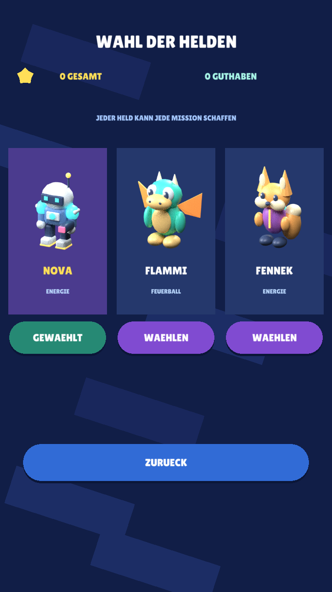
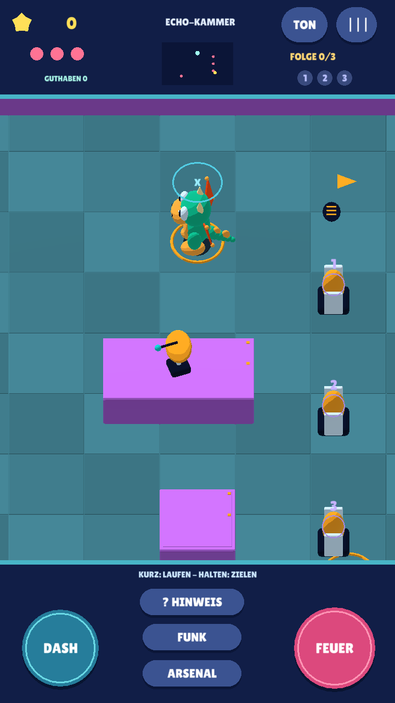

# EnergyBlast — Defold 0.5, Toybox Raid

Ein echter Offline-Touch-Shooter für Kinder etwa von 7 bis 10 Jahren:
aktive Kanonen, Deckung, Ausweichen und klug eingeschätzte Abpraller.
**Sechs Sektoren, drei wählbare Helden und tatsächlich kaufbare Ausrüstung.**
Brawl Stars ist die visuelle Referenz; sämtliche Spielmodelle und die Musik
sind eigenständig erstellt. Defold ist der Schwerpunkt. GDevelop 0.3 und
Godot 0.2 bleiben als eingefrorene Vergleiche erhalten.

| Einstieg | Hier weiterlesen |
|---|---|
| Installierbare Test-App | [APK mit Größe, Hash und Update-Hinweisen](https://github.com/sayac007/EnergyBlast/blob/5459bf741061a02d8dc975894d218e2fa16cfac3/downloads/README.md) |
| Abgleich mit euren sieben Testpunkten | [Meilenstein 04](docs/MILESTONE_04.md) |
| Was geprüft wurde und was offen ist | [Qualitätsüberblick](https://github.com/sayac007/EnergyBlast/blob/5459bf741061a02d8dc975894d218e2fa16cfac3/docs/QUALITY.md) |
| Ausgangsauftrag und aktuelle Entscheidungen | [Projektauftrag](docs/PROJECT_BRIEF.md), [unverändertes Original](docs/pilot-brief.md) |
| Selbst bauen und prüfen | [Build-/Testanleitung](https://github.com/sayac007/EnergyBlast/blob/5459bf741061a02d8dc975894d218e2fa16cfac3/docs/BUILD_AND_TEST.md) |
| Frühere Versionen | [0.4](docs/MILESTONE_03.md), [0.3](docs/MILESTONE_02.md), [0.2](docs/MILESTONE_01.md) |

## Installieren

**[Defold 0.5 APK herunterladen](https://raw.githubusercontent.com/sayac007/EnergyBlast/4315cf73fe6fd5b8688e7d397766394010fe2e5d/downloads/energyblast-defold-debug.apk)** — rund **10,5 MB**.
Android 7/API 24+, ARM64; Version 0.5.0/Code 6, gleiche Entwicklungssignatur wie
0.4.1. Über die vorhandene App installieren, **vorher nicht deinstallieren**.
[Hash, Quellstand und technische Prüfungen](https://github.com/sayac007/EnergyBlast/blob/5459bf741061a02d8dc975894d218e2fa16cfac3/downloads/README.md).
Der physische Update-/Spieltest der neuen Datei bleibt offen.

## Jetzt neu

- **Geschosse bleiben hinter Wänden.** Sie sind echte 3D-Modelle mit Tiefenprüfung,
  keine darüber gezeichneten GUI-Punkte. Alle sichtbaren Wandkörper/Kappen stimmen
  mit ihren Kollisionsflächen überein. Beide Seiten prallen ab; blaue X-Felder
  neutralisieren. Ein Abpraller, Prisma zwei, Gegner einer; begrenzte Reichweite
  und Lebensdauer von 3/6 Sekunden, anschließend Verpuffen.
- **Freies Spielfeld.** Punkte, Energie, Miniübersicht und sämtliche Tasten liegen
  außerhalb des Spielausschnitts. Menüs ersetzen die pausierte Szene vollständig.
  Die große 21×15-Welt und folgende Kamera bleiben erhalten.
- **Findbare Geheimnisse.** Kostenlose goldene Bodenpfeile und dunkle Spuren/Luken
  weisen auf Verstecke hin. Verdiente Zusatzhinweise bleiben freiwillig.
- **Echtes Arsenal.** Prisma, Rüstung, Stiefel und Tarnmodul kaufen, dauerhaft
  ausrüsten und nach einem Neustart behalten. Gesamtsterne bleiben erhalten;
  nur das getrennte Guthaben wird ausgegeben. Alte automatische Freischaltungen
  werden beim Update kostenlos übernommen.
- **Neue Gestaltung und Musik.** Kräftige Spielinseln, klare Wandkronen, eigener
  Toon-Shader, Kontakt-Schatten, animierte Flügel und Energieexplosionen. Eigene
  Stereo-Musik mit neun synthetischen Instrumenten, vier dynamischen Abschnitten
  und ruhigeren Zwischenpassagen. Keine kopierte Referenzmelodie oder Aufnahme.

## Drei Helden und drei zusätzliche Kampfsituationen

**Nova**, **Drache Flammi** mit sichtbaren Feuerbällen und bewegten Flügeln sowie
**Fennek** sind frei wählbar. Gleiche Spielstärke, keine Figur gegen Echtgeld.
Die Auswahl wird lokal gespeichert.

| Sektor | Was tatsächlich gespielt wird |
|---|---|
| Prisma-Station | Schildkanone durch einen klugen Abpraller treffen |
| Neon-Zitadelle | Zwei Kanonen, Deckung und zeitweise geöffnetes Tor |
| Aurora-Dock | Patrouille, Fächersalven, zwei Abprall-Schalter und geschützter Boss |
| **Magnetwerk** | Falle vorbereiten, patrouillierenden Wächter hineinlocken und den vorübergehend ausgeschalteten Schild nutzen |
| **Echo-Kammer** | Lichterfolge beobachten und Kristalle in dieser Reihenfolge treffen; gleichzeitig eine Kanone ausschalten |
| **Drohnen-Rettung** | Eine verwundbare Drohne um Deckungen begleiten und ihren Weg schützen |

Ein frisches Profil erreicht bis **1.200 Gesamtsterne**; mit alten 0.1-Erfolgen
bis 1.525. Wiederholen und Warten erzeugen keine doppelten Belohnungen.
Bedienung und Missionsziel werden gesprochen; die Lichtfolge lässt sich kostenlos
wiederholen. Kein vorgeschalteter Fragebogen, kein Joystick, keine berechnete Flugbahn.

## Tatsächlich gerendert

| Figurenwahl | Neue Echo-Kammer |
|---|---|
|  |  |

Native Linux-/OpenGL-Laufzeit, keine Konzeptbilder und keine behauptete Handyaufnahme.

## Bedienung

| Eingabe | Wirkung |
|---|---|
| Kurz drücken und loslassen | Laufen, unabhängig davon, welches Objekt angetippt wurde |
| Mindestens **0,30 s** halten | An beliebiger Stelle zielen |
| Nach dem Halten loslassen | Ein Schuss / Feuerball |
| FEUER halten | Wiederholt schießen |
| DASH | Kurz geschützt ausweichen |
| FALLE im Magnetwerk | Magnetfalle am aktuellen Standort vorbereiten |
| Funk | Mission/Bedienung wiederholen; in der Echo-Kammer Lichtfolge neu vorführen |
| Hinweis | Verdientes Guthaben für die optionale Schatzsuche einsetzen |

Manchmal muss man die Deckung verlassen. Warten allein ist keine Lösung.
Musik kann im Arsenal separat ausgeschaltet werden; TON schaltet alle Audios um.

## Tatsächliche Prüfungen und Grenzen

**28.10.2026:** **187 native Prüfungen** und **neun gemeinsame Testgruppen**
bestanden. Echte native Menüeingaben prüfen Figurenwechsel, Käufe, kurzen/langen
Druck, FEUER und Tonpause. Getrennte Speicherstarts erhalten Sterne, Restguthaben,
Käufe, Figur, Hinweise und Musikpräferenz.

Ein tatsächlicher Bildtest belegt die Geschossverdeckung hinter Wänden mit einem
sichtbaren Kontrollgeschoss davor. Die exportierten Wand-Positionspuffer werden
gegen die Kollisionsflächen geprüft. Native Musik-/Sprach-/Effektmischung
aufgezeichnet; Musik aus liefert Nullsignal. Fünf Ansagen unabhängig vollständig
per ASR erkannt. [Ausführliche Nachweise](docs/MILESTONE_04.md).

**Für die neue APK offen:** physisches Installieren/Update und Spielstandübernahme,
Touchgefühl, Rotation/Seitenverhältnisse, Klang, längere Runden, Schwierigkeit und
Geräteleistung. Native Linux-/OpenGL-Tests sind keine Handy-Spielrunde. Keine
empirisch nachgewiesene Lernwirkung, keine Store-Reife und keine grüne CI behauptet.

## Arbeitsweise und Herkunft

Spielcode: `feat/touch-shooter-v2`. `main` bleibt die Dokumentationsstartseite.
Keine PRs, automatischen Merges, Actions-Workflows oder GitHub-Releases.
Kinderwelt und andere Repositories bleiben unverändert. Keine privaten Bilder,
Konten, Werbung, Telemetrie oder neuen Berechtigungen. Lokale Daten, Backup aus.

[Regeln](https://github.com/sayac007/EnergyBlast/blob/5459bf741061a02d8dc975894d218e2fa16cfac3/shared/defold04.json), [Originalmodelle/Porträts](https://github.com/sayac007/EnergyBlast/tree/5459bf741061a02d8dc975894d218e2fa16cfac3/shared/assets/defold04),
[Blender-Generator](https://github.com/sayac007/EnergyBlast/blob/5459bf741061a02d8dc975894d218e2fa16cfac3/tools/make_defold04_models.py), [Musikgenerator](https://github.com/sayac007/EnergyBlast/blob/5459bf741061a02d8dc975894d218e2fa16cfac3/tools/make_defold_music.py),
[Kollision/Geschosse](https://github.com/sayac007/EnergyBlast/blob/5459bf741061a02d8dc975894d218e2fa16cfac3/pilots/defold/main/projectiles.lua),
[Käufe/Migration](https://github.com/sayac007/EnergyBlast/blob/5459bf741061a02d8dc975894d218e2fa16cfac3/pilots/defold/main/progression.lua),
[neue Ziele](https://github.com/sayac007/EnergyBlast/blob/5459bf741061a02d8dc975894d218e2fa16cfac3/pilots/defold/main/objectives.lua),
[Herkunft/Lizenzen](https://github.com/sayac007/EnergyBlast/blob/5459bf741061a02d8dc975894d218e2fa16cfac3/THIRD_PARTY.md), [Dokumentationsstandard](docs/DOCUMENTATION_STANDARD.md).
