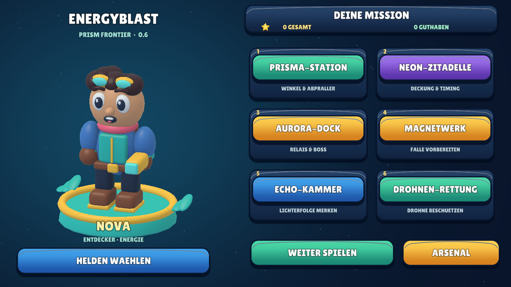
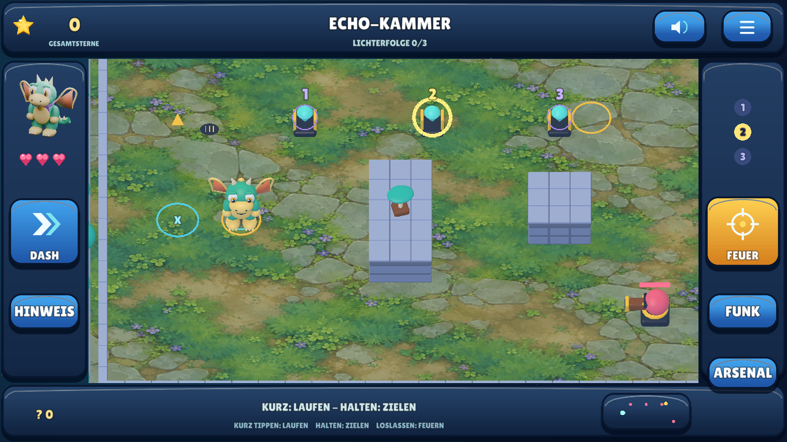
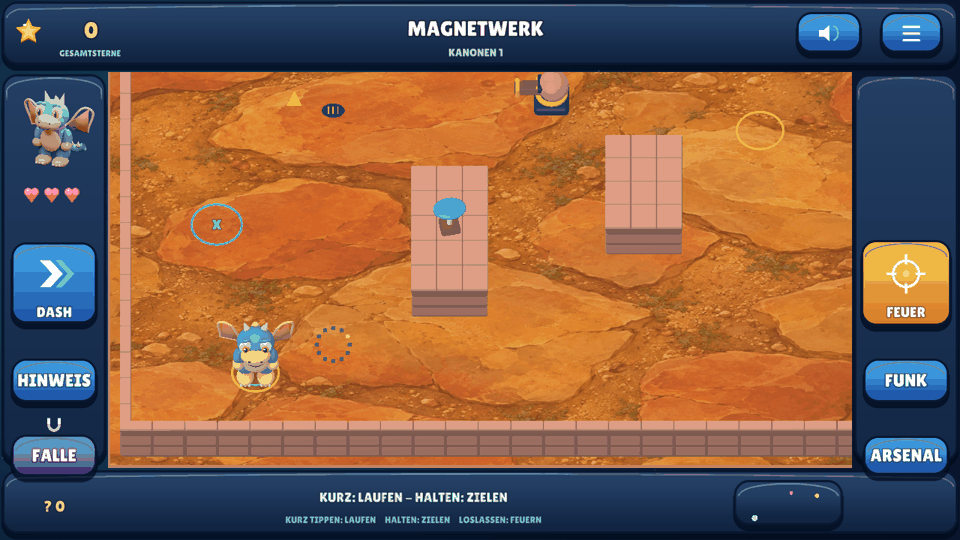

# Meilenstein 05 — Defold 0.6, Prism Frontier

**28.10.2026.** Der Betreiber hat die visuelle Qualität von 0.5 abgelehnt.
Diese Iteration bearbeitet deshalb die Darstellung des tatsächlich laufenden
Spiels. [Recherche und gestalterische Ableitungen](ART_DIRECTION.md) dokumentieren
die eingesehenen offiziellen Brawl-Stars-Bilder und Produktionsberichte.
Die persönliche ästhetische Abnahme wird nicht durch technische Tests ersetzt.

## Was sich tatsächlich geändert hat

- **Zusammenhängende Landschaft statt Kachelbrett.** Eigene neu erzeugte
  Sandstein-/Gartenillustrationen werden als echte Materialien auf die Arenaböden
  gebunden. Mauerflächen besitzen gegliederte Steinlagen, Kappen und Fugen.
  Außenbepflanzung und Randarchitektur ergänzen die sechs unterschiedlichen Sektoren.
- **Neue native 3D-Figuren.** Nova als Entdecker, Drache Flammi und Fennek haben
  überarbeitete Silhouetten, Gesichter, Kleidung und Details. Arme, Beine,
  Flügel und Schwanz sind getrennte Körperteile mit richtigen lokalen Gelenkpunkten.
  Gehen bewegt gegenüberliegende Gliedmaßen, Leerlauf besitzt eine kleine Atmung,
  Drehen ist geglättet; Schießen zeigt Rückstoß und Treffer stauchen das Ziel.
- **Materialdarstellung bis zum Renderer.** Gebackene AO-Texturen der eigenen
  Modelle erreichen die native Shader-Ausgabe. Licht, Farbraumbehandlung und
  weiche Kontaktschatten ersetzen die bisher überwiegend flachen Materialfarben.
- **Eigene Menüinszenierung.** Dieselbe animierte 3D-Figur steht auf einer
  Präsentationsbühne. Figurenwahl zeigt keine bloß konzeptionell bessere Figur.
  Neue selbst gezeichnete Oberflächen, Stern-/Herz-/Ziel-/Funk-Symbole und
  deutlich gegliederte Beschriftungen ersetzen die flachen Pillen.
- **Querformat mit freiem Spielfeld.** 1280×720 Referenz, feste Landschafts-
  orientierung. 992×528 zusammenhängende logische Spielfläche; Tasten in eigenen
  Seitenleisten, Punkte/Status außerhalb. Normale Weltachsen, folgende Kamera,
  dieselbe 0,30-s-Touch-Regel. Keine Joysticks und keine berechnete Flugbahn.
- **Räumliche Lichtspuren.** Geschosse, Feuerbälle, Halos und kurze vergangene
  Spuren werden mit Tiefenprüfung gezeichnet. Kein darübergelegter GUI-Schuss
  und keine Darstellung eines künftigen Schussweges. Die Spuren sind begrenzt
  und werden beim Ablauf/Sektorwechsel gelöscht.

## Darstellung darf die Bedienung nicht verschlechtern

Die erste detaillierte Arena verursachte zu viele einzelne Zeichenaufrufe und
verzögerte Cloud-Eingaben. Die statischen Objekte werden deshalb für die Laufzeit
nach Material zusammengefasst; die semantischen Quellmodelle bleiben prüfbar.

| Sektor | Quell-Primitiven → Laufzeit-Batches |
|---|---:|
| Prisma-Station | 467 → 8 |
| Neon-Zitadelle | 481 → 8 |
| Aurora-Dock | 465 → 8 |
| Magnetwerk | 447 → 8 |
| Echo-Kammer | 460 → 8 |
| Drohnen-Rettung | 470 → 8 |

Die tatsächlichen exportierten Positionspuffer werden beidseitig geometrisch
verglichen, mit Toleranz für Float32-Transformationen. Wand-/Kollisionsprüfung und
native Geschossverdeckung bleiben Pflicht. Diese Zahlen betreffen die statische
Arenageometrie, nicht sämtliche UI-/Figuren-/Effektaufrufe eines Frames. Es wird
keine neue Handy-Bildrate behauptet.

## Tatsächliche Laufzeitbilder

Direkt aus Defold/Linux/OpenGL aufgenommen. Die Sequenz verwendet echte XTest-
Eingaben und enthält 35 gerenderte Frames, keine erfundenen Animationsbilder.
Es handelt sich um eine geskriptete Cloud-Aufnahme, keine physische Handy-Spielrunde.

## Erhaltene Funktionen

Alle sechs Missionen, Fallen-/Lichtfolgen-/Drohnenziele, Gegner, Reflexionen,
Neutralisationsfelder, endliche Geschosse, Geheimnisse, verdiente Hinweise,
Gesamtsterne und der tatsächliche Ausrüstungskauf bleiben. Musik und Sprach-
aufnahmen unverändert. Migration älterer Spielstände und Kauf-/Figurenspeicherung
bleiben geprüft. Keine neuen Missionen oder Konten als Ablenkung vom Grafikauftrag.

## Prüfungen und Grenzen

[Kommandos und Voraussetzungen](BUILD_AND_TEST.md),
[aktueller Qualitätsstatus](QUALITY.md), [APK-/Quellmetadaten](../downloads/README.md).

- **199 native Prüfungen**: die bisherigen 187 und zwölf zusätzliche Prüfungen
  für Querformat/Bediengrenzen, tatsächlich instanziierte Gelenkhierarchie,
  gegenläufig bewegte Beine und natives Effekt-/Figureninventar.
- **Echte native Eingaben**: Figurenwechsel, Käufe, Mission, kurzer Tipp,
  längeres Halten/Loslassen, FEUER und Tonpause/Fortsetzung, bei 1280×720 und nach echter Fensteränderung auf
  1280×800. Tatsächliche
  Gliedmaßenbewegung im Eingabelauf zusätzlich geprüft.
- **Getrennte Speicherstarts**: Gesamtsterne, Guthaben/Käufe, Figur, Hinweise
  und Musikpräferenz bleiben erhalten.
- **Native Bildprüfung**: vollständig verdecktes Geschoss verändert keinen
  sichtbaren Pixel; sichtbares Kontrollgeschoss einschließlich Licht ist vorhanden.
  Der isolierte Vergleich friert unabhängige Leerlaufbewegungen ein.
- **Elf gemeinsame Testgruppen**: alte Funktions-/Medien-/Privatsphäreprüfungen,
  echte Wandpuffer, AO-/Texturbindung, Gelenkdaten und die geometrische Erhaltung
  beim Zusammenfassen der statischen Laufzeitmodelle.
- **Tatsächliche Audioausgabe** mit Musik an/aus und Sprach-/Effektmischung
  erneut aufgezeichnet; Signal, Stille bei aus und Pegel geprüft.
- Menü, Auswahl, Kampfszene und neue Missionen selbst als Laufzeitbilder angesehen;
  abgeschnittene Menükulisse und schlecht lesbare Goldbeschriftungen korrigiert.

Offen bleiben physisches Installieren/Update und Spielstandübernahme der neuen
APK, Geräteleistung, Klang-/Touchgefühl und die persönliche grafische Abnahme.
Keine grüne CI, kein Hardwarebenchmark, keine empirisch bewiesene Lernwirkung
und keine Behauptung, die Gesamtproduktion von Brawl Stars erreicht zu haben.

Eigene neue 3D-Modelle/AO/UI werden durch die versionierten Generatoren erzeugt.
Die zwei neuen originalen Bodentexturen stammen aus dem Bildgenerator; Herkunft
und Hashwerte sind dokumentiert. Keine Supercell-Assets im Repository/APK.
GDevelop 0.3 und Godot 0.2, andere Repositories und Release-Schlüssel unverändert.
Kein PR, Merge, Actions-Workflow oder GitHub-Release.
