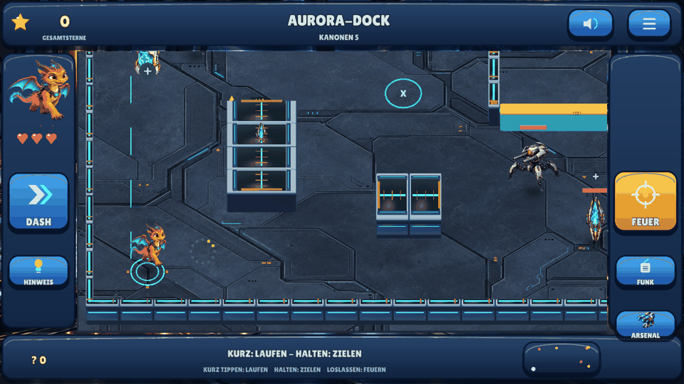

# Meilenstein 06 — Neon Frontier / Defold 0.7

**28.10.2026.** 0.6 wurde grafisch erneut abgelehnt. Neuer Auftrag: futuristische
Präsentation, starke Figuren/Gegner, Animationen, bebilderte Menüs und Extras;
Fallen verständlich erklären und ausdrücklich direkt auf dem Spielfeld bedienen.
[Auftrag](PROJECT_BRIEF.md), [Recherche](ART_DIRECTION.md), [Prüfstatus](QUALITY.md).

## Tatsächliche Umsetzung

Originale detaillierte Animationsgrafiken für Nova, Flammi und Fennek, drei
Robotertypen mit Lade-/Feuerzuständen, neue Reaktorkulisse mit metallener Deckung,
leuchtende Architektur und ruhigem Boden; bebilderte Missionskarten und Arsenal,
Piktogramme, animierte Energieexplosion und räumlich bewegte Fragmente. Zehn
unveränderte originale Bildquellen mit Hashes und reproduzierbarer Atlas-Aufbereitung.
Keine fremden Spielgrafiken. Bewusst 2,5D-Hybrid aus Illustrationsanimation und
nativer 3D-Welt; kein vorgetäuschtes vollwertiges 3D-Skelettsystem.

Fallen: Bild neben der Figur → Auswahl Magnet/Eis/Impuls → pausierte Vorschau →
freien nahen Boden antippen. Mauer, verdeckter und zu ferner Ort abgelehnt.
Kreuz bricht ab. Normales Halten bleibt Zielen. Maximal zwei Geräte; 12s Lebensdauer,
unterschiedliche Abklingzeiten und Wirkungen. [Exakte Bedienung/Regeln](TRAPS.md).
Zwölf vollständige Sprachhinweise, passend zu Gesten und Wirkungen. Veraltete
Kontextansagen werden ersetzt; Schildansage passt in die verlängerte Öffnung.

Sechs Missionen, endliche reflektierende Geschosse, Käufe, Gesamtsterne, Hinweise
und lokale Spielstände bleiben. Andere Engines und Repositories bleiben unverändert.

## Tatsächliche Laufzeit

Native Linux/OpenGL-/XTest-Aufnahmen, keine Handyaufnahmen. Eigene Sichtprüfung
fand und korrigierte einen vertikal gespiegelten Bildimport und eine störende
alte Menüplattform. Die abschließenden Bilder stammen vom korrigierten Renderer.

## Prüfungen / Auslieferung

231 native Prüfungen, 12 gemeinsame Gruppen, tatsächliche Menü-/Fallen-Eingaben,
getrennte Speicherstarts, Audioaufnahme, exportierte Kollisionsgeometrie und native
Wandverdeckung bestanden. Zwölf Sprachclips unabhängig normalisiert exakt erkannt.
[Zentrale Ergebnisse und Grenzen](QUALITY.md), [Bauweg](BUILD_AND_TEST.md).
[APK-/Quellmetadaten](../downloads/README.md) ordnen den gesonderten Abschlussbuild zu.

Manuell offen: Geräteinstallation/Update und reale Spielstandübernahme, längeres
Spiel, Schwierigkeit, Touch-/Klanggefühl, kindliches Verständnis, Hardwareleistung
und grafische Betreiberabnahme. Kein kommerzielles Produktionsniveau allein aus
Testzahlen behauptet; keine Store-/Wirksamkeitsfreigabe. Kein PR, Spielmerge,
Actions-Workflow, GitHub-Release oder Zugriff auf Kinderwelt.
