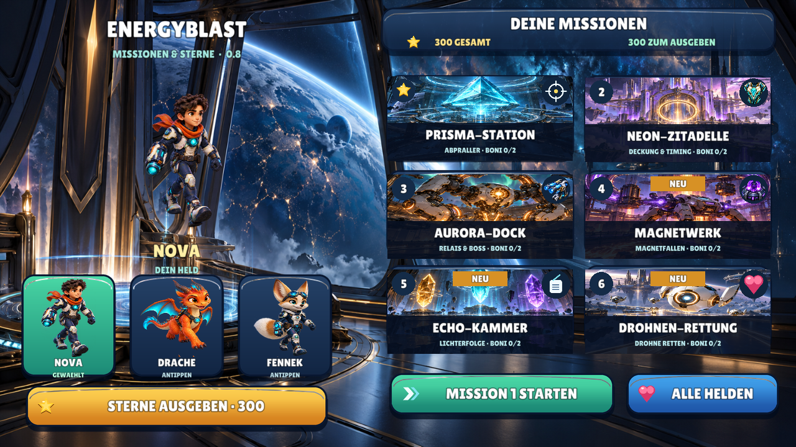
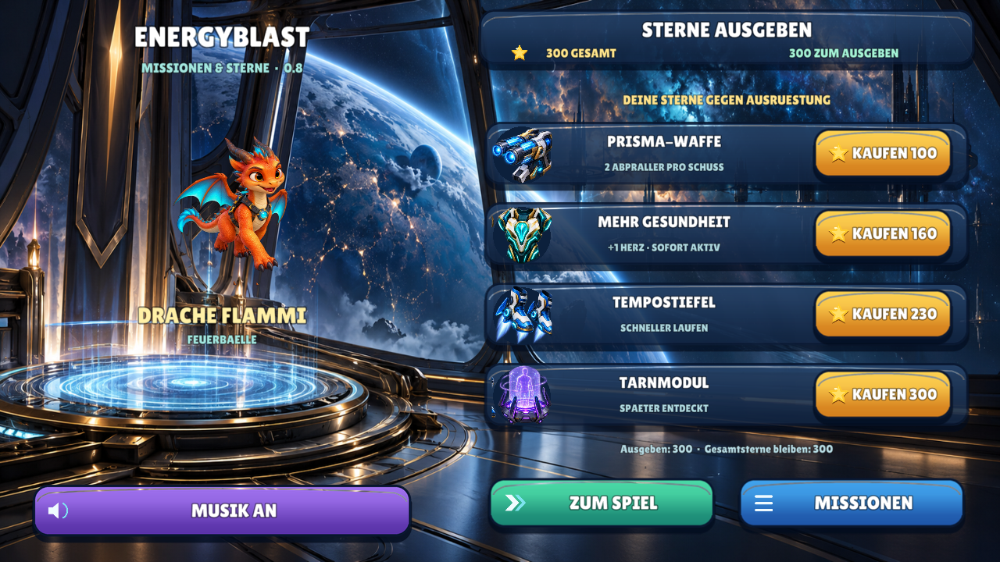
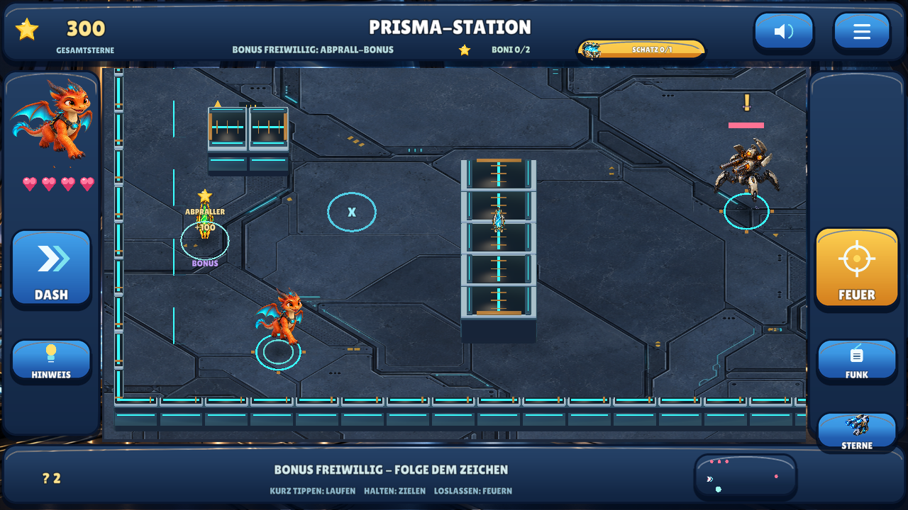

# Meilenstein 07 — Verständlicher Spielfluss / Defold 0.8

**28.10.2026.** Rückmeldung zur 0.7: Schätze und Restziele unklar, kein verständlicher
Missionswechsel, Käufe und Drache versteckt, neue Aufgaben schwer auffindbar.
Gewünscht: Boni in normalen Missionen, höhere Belohnung, intuitivere Touch-Menüs.

## Nachgewiesene Ursachen und Korrekturen

Der Siegbildschirm hatte keinen direkten Nachfolger. Allgemeines „Weiter spielen“
konnte den Dialog schließen und gleichzeitig `over=true` behalten; dann stand die
Simulation. Jetzt existieren getrennte Aktionen für nächste Mission, Fortsetzen
und freiwillige sichere Suche. Nach dem Sieg können offene Schätze/Boni den Wechsel
nicht blockieren. Die aktuelle Mission wird validiert gespeichert und wiederhergestellt.

Schätze waren erst aus zwei Welteinheiten sichtbar; winzige Spuren und bezahlte
Hinweise halfen einem frischen Profil wenig. Jetzt gibt es einen sichtbaren
Restzähler, einen kostenlosen Wegweiser zum Suchgebiet und größere Sichtbarkeit.
Bezahlte Hinweise bleiben zusätzliche Hilfen. Nach dem Sieg wird die verbliebene
Truhe direkt geführt; Gegner schießen während der freien Suche nicht weiter.

Heldenbilder sind auf der Startseite direkt antippbar. „Sterne ausgeben“ und
„Kaufen“ ersetzen den versteckten Arsenal-Einstieg. Preise, verfügbares Guthaben,
Gesamtsterne und dauerhafte Wirkung sind getrennt erkennbar; mehr Gesundheit wirkt sofort.

## Neue Bonusaufgaben innerhalb aller sechs Missionen

Je Mission ein goldener Abprall-Kristall (+100) und eine Lichterfolge oder ein
Geduldsfenster (+150). Es sind tatsächlich treffbare Weltobjekte, keine weiteren
Missionen. Zufälliges Dauerfeuer kann den Geduldsbonus nicht erzwingen. Fehler
kosten keine Gesundheit und löschen keine bestehenden Sterne. Wegweiser auf
Lichterfolgen zeigen den Beobachtungsbereich, niemals die nächste richtige Antwort.

300 Sterne für Abschluss, 100 für unbeschädigten Erfolg, 75 für Schatz: bis 725 je 
Mission, 4.350 frisch / 4.675 mit alten 0.1-Erfolgen. Einmalige Schlüssel verhindern Farming.
Bisherige Erfolge/Käufe bleiben erhalten; die höheren Werte erhöhen auch die
Bewertung bestehender Erfolge. Alte Tests nutzen die unveränderte 0.7-Datenfixture.

Diese Aufnahmen stammen aus der nativen Linux-Laufzeit. Die Siegprüfung verwendet
kontrolliert den echten Abschlussweg mit ausgeschalteten Pflichtgegnern; kein
vorgetäuschter manuell geschaffter Android-Level.

## Prüfung und Grenzen

[Zentrale tatsächliche Prüfergebnisse](QUALITY.md), [Befehle](BUILD_AND_TEST.md),
[APK-/Quellmetadaten](../downloads/README.md). Neue Prüfungen kontrollieren echte
Eingaben für Drachenwahl, Käufe und unmittelbare Gesundheit, fehlendes Guthaben,
Schatz-/Bonusführung und Wechsel trotz offenem Schatz. Physische Geräteprobe,
Hörverständnis des Kindes, längere Runden und Schwierigkeit bleiben offen.
Keine Änderungen an anderen Repositories, Release-Schlüsseln oder Store-Freigaben.
