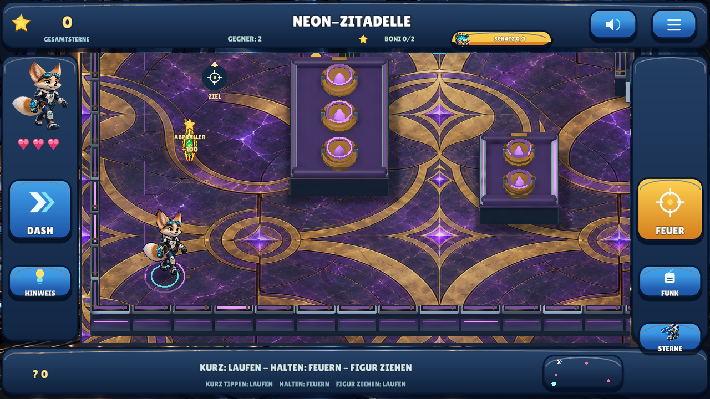
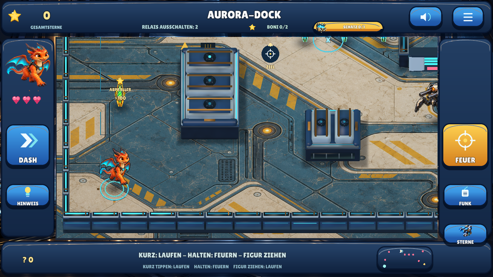
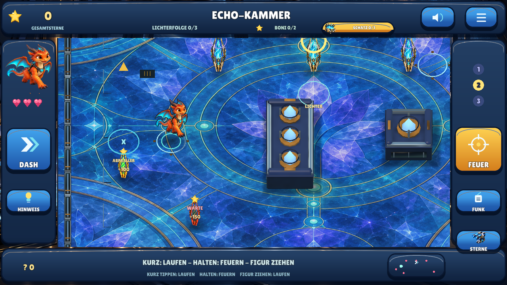
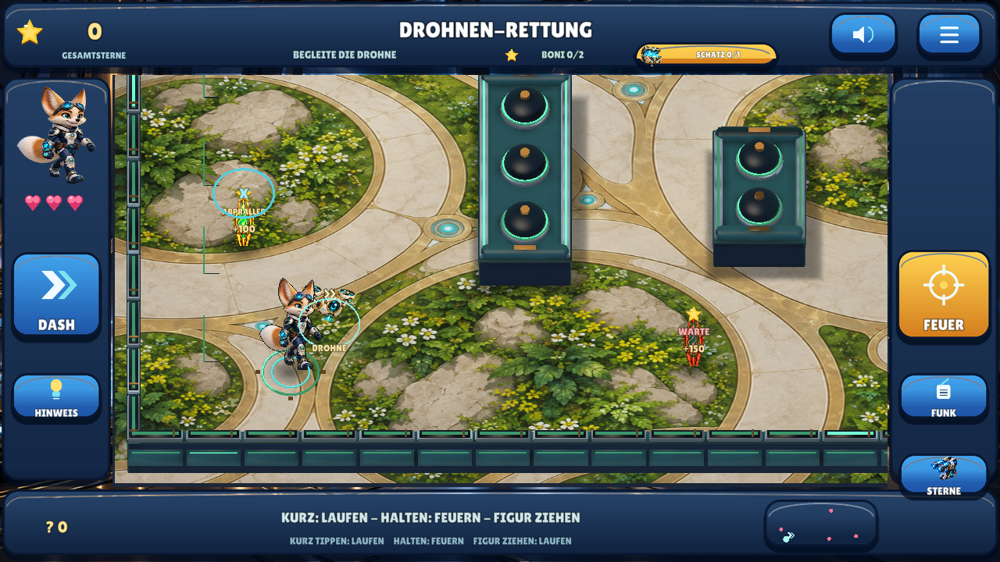

# Meilenstein 08 — Direktsteuerung und stärkere Kampfansichten / 0.9

**29.10.2026.** Neuer Auftrag: bessere Grafik, geringere Eingabeverzögerung,
Schießen beim Halten, Bodentipp zum Laufen, eigene Figur ziehen und sofortige
Gegnerschüsse mit großzügiger Antippzone. Diese Gesten ersetzen ausdrücklich
die bisherige 0,30-Sekunden-/Loslassen-Steuerung der aktiven App.

## Tatsächliche Umsetzung

Boden bleibt bis 0,14 Sekunden eine Laufabsicht; danach feuert das Spiel während
des Kontakts wiederholt. Gegner werden schon beim Drücken anhand ihrer sichtbaren
Bildfläche plus 18 Referenzpixeln Zugabe ausgewählt. Mindestflächen und Abstandswahl
helfen bei kleinen/nachbarlichen Figuren. Vollständig verdeckte oder tote Ziele
werden nicht ausgewählt. Die echte Geschosskollision bleibt unverändert.

Die eigene Figur lässt sich kollisionssicher ziehen. Ein Finger besitzt seine
Geste; fremde Finger, Menüwechsel, Pause und Hintergrund können keinen alten
Schuss freigeben. Loslassen erzeugt keinen neuen Schuss. Schnelle Gegnertipps
während der 0,24-Sekunden-Waffenpause werden begrenzt gepuffert; keine Umgehung der
Feuerrate und keine behauptete Null-Millisekunden-Hardwarelatenz.

Die beiden neuen Sprachhinweise werden nacheinander abgespielt; veraltete
Kontextanweisungen werden bei einem echten Menü-/Fallenwechsel verworfen.
Historische Steuerungstests bleiben unverändert über `touch_legacy.lua` und die
versionierte 0.7-Regelfixture erhalten. Aktive Daten verwenden ausschließlich
`direct_touch_hold_fire_drag_hero`.

## Grafik im tatsächlichen Spiel

Originale neue Bodenbilder pro Bereich, sechs unterschiedliche Deckungstypen,
1024×1024-AO-Texturen aus echtem Blender-Bake, weiche Boden-Kontaktschatten,
animierte tiefengeprüfte Energieschilde, dünne Figurenkonturen und nähere Kamera.
Die Figuren bleiben originale 2,5D-Animationsbilder, keine behaupteten vollständigen
Skelettmodelle. Kollisionsrechtecke bleiben exakt erhalten. Je Arena sieben
statische Batches, 48.800–58.100 Dreiecke und 1,89–2,17 MB Vertexpuffer; keine daraus
abgeleitete Behauptung einer Handy-Bildrate.

Diese Bilder und 36 aufgezeichnete Animationsframes stammen aus der nativen
Linux-Laufzeit mit echten XTest-Eingaben. [Feuern vor dem Loslassen](images/09-defold-hold.png),
[Gegnertipp neben der Figur](images/09-defold-instant-target.png),
[Bewegen während des Ziehens](images/09-defold-drag.png). Keine vorgetäuschte Handyaufnahme.

## Verifikation

440 native Prüfungen = 347 erhaltene und 93 neue direkte Gestenprüfungen;
14 gemeinsame Medien-/Geometrie-/Konfigurationsgruppen. Fünf tatsächliche neue
Touchabläufe, bestehende Menüs/Käufe/Fallen/Missionswechsel, getrennte Speicherstarts,
zwei Fensterformate, Audioausgabe und exportierte Wand-/Batch-Geometrie bestanden.
Geschossverdeckung 0 veränderte Pixel, davor 328 sichtbare Kontrollpixel. Energieschild
an/aus verändert 15.701 Pixel und erreicht damit tatsächlich den Renderer.

Zwei neue Sprachdateien frisch unabhängig normalisiert exakt erkannt; 25 vorherige
Clips unverändert. Alle 27 technisch dekodiert/geprüft. [Zentraler Status](QUALITY.md),
[Befehle](BUILD_AND_TEST.md), [APK-/Quellbezug](../downloads/README.md).

Manuell offen: tatsächliche Geräte-Latenz, Mehrfingergefühl, Update/Spielstandübernahme,
Klang, längere Runden, mobile Leistung und persönliche grafische Abnahme. Keine
Store-/Lernwirkungsfreigabe, neue grüne CI oder kommerzielle Gleichwertigkeit behauptet.

## Nachvollziehbarer Android-Snapshot

Quellcommit [`d4dea7d`](https://github.com/sayac007/EnergyBlast/commit/d4dea7d0768191c67d01206381d4913615f74ff0),
APK-Commit [`e49218e`](https://github.com/sayac007/EnergyBlast/commit/e49218e7015e365a0913961a0f1e005436c271f2),
gebaut 29.10.2026, 08:08 MEZ vom sauberen Stand. **0.9.0 / Code 10**, 63.853.754 Bytes,
SHA-256 `9bbb4d96d4b61c0725876f8be8e842d38114ee6bd1e8805890289669749c6ec3`.

Paket, APIs, userLandscape, keine Berechtigungen, Backup aus, v2-Signatur und
Zertifikatsgleichheit mit 0.8, ZIP-CRC, keine Schlüsseldateien, 16-KB-ZIP-Ausrichtung
und identischer vollständiger Projektabzug (795 Dateien) geprüft.
[APK und Installation](https://raw.githubusercontent.com/sayac007/EnergyBlast/e49218e7015e365a0913961a0f1e005436c271f2/downloads/energyblast-defold-debug.apk) · [Geprüfte Metadaten](../downloads/README.md).
Keine physische Android-Installation oder mobile Bildrate aus diesen Prüfungen abgeleitet.
