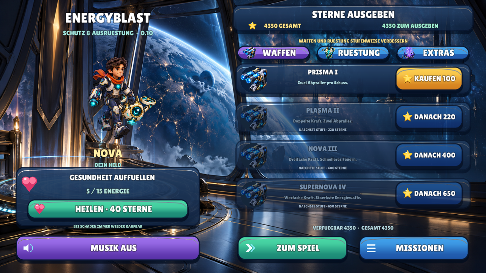
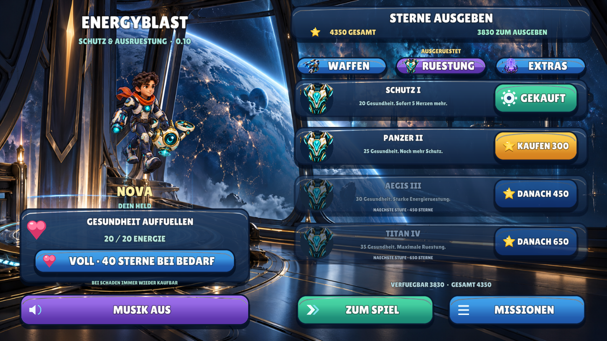
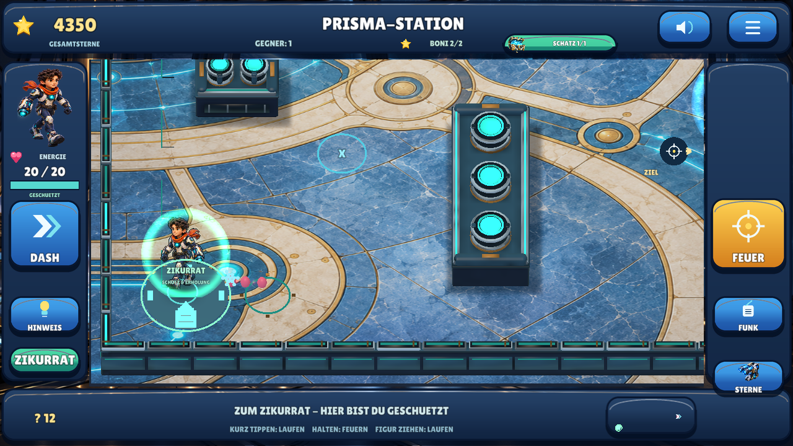

# Meilenstein 09 — Erholung, Zikurrat und Ausrüstungsstufen / 0.10

**29.10.2026.** Betreiberwunsch: weniger Frustration durch fünfmal mehr Gesundheit,
Erholung und einen unverwundbaren Rückzugsort; mehr Ausrüstung für Sterne, keine
neuen Tempokäufe; eine musikalisch passende Science-Fiction-Atmosphäre.

## Im Spiel

Die Figur startet mit **15 statt 3 Energie**. Vier aktive Sekunden ohne Treffer
starten die kostenlose Erholung mit einem Punkt je zwei Sekunden. Treffer setzen
diese Wartezeit zurück. Pausen, Hintergrund und Fallenplatzierung sammeln keine
Erholungszeit; eine besiegte Figur wird nicht still wiederbelebt.

Jede der sechs Arenen hat einen deutlich mintfarben leuchtenden **Zikurrat** nahe
dem Start. Ein Wegknopf und ein Minikartenzeichen machen ihn auffindbar. Die
Navigationswege sind in der Simulation in weniger als 1,25 Sekunden erreichbar.
Im geschützten Innenbereich erholen sich sofort zwei Energiepunkte pro Sekunde.
Die Anzeige sagt dort **GESCHUETZT**. Die gesamte Figur muss innerhalb der Grenze sein.

Geschosse werden an der echten Schutzgrenze neutralisiert — auch schnelle,
reflektierte und bereits innen erzeugte Geschosse. Es reicht nicht, einen Schaden
nur durch Heilung zu kaschieren. Beide Seiten können nicht durch das Feld schießen;
zum eigenen Feuern verlässt man den Rückzugsort. Der Schutz ist kostenlos.

Der Shop hat zwölf Angebote. Gesundheit bleibt in jedem Tab sichtbar und ist
nach späteren Treffern erneut kaufbar. Volle Gesundheit verursacht keine Abbuchung.

| Angebot | Sterne | Tatsächliche Wirkung |
|---|---:|---|
| Energie auffüllen | 40 je Kauf | Sofort vollständig heilen, wiederholt kaufbar |
| Prisma I | 100 | Zwei Abpraller, Schaden 1, Abstand 0,24 s |
| Plasma II | 220 | Schaden 2, Abstand 0,22 s, nach Prisma I |
| Nova III | 400 | Schaden 3, Abstand 0,20 s, nach Plasma II |
| Supernova IV | 650 | Schaden 4, Abstand 0,18 s, nach Nova III |
| Rüstung I / II / III / IV | 160 / 300 / 450 / 650 | Maximale Energie 20 / 25 / 30 / 35 |
| Tarnung I / II | 300 / 450 | Geringere gegnerische Erfassungsreichweite |
| Erholungskern | 280 | Erholung beginnt nach zwei statt vier Sekunden |

Waffen und Rüstung werden der Reihe nach gekauft; spätere Stufen bleiben gedimmt
mit Preis sichtbar. Bereits gekaufte Waffen lassen sich kostenlos wieder wählen.
Alle dauerhaften Angebote zusammen kosten **3.960 Sterne**; die sechs Missionen
bieten frisch bis 4.350. Heilung konkurriert mit diesen Käufen, bleibt aber immer
auch kostenlos über Zeit oder Schutzort erreichbar. Gesamtsterne sinken nicht,
nur das verfügbare Guthaben. Alte Käufe, Ausgaben, Waffen, Figuren und auch früher
gekaufte Stiefel bleiben erhalten; neue Stiefel-/Tempokäufe gibt es nicht.

Stärkere Waffen umgehen weder Reflexionsschilde noch Magnetfallen-, Relais- oder
Bonusbedingungen. Die direkte Steuerung aus 0.9 und alle sechs Missionen bleiben.

## Musik und kurze Ansagen

**Zikurrat — Signal in the Dark** ersetzt die hüpfende Plattformmusik: eigene
80-Sekunden-Komposition, 96 BPM, D-Moll/modal, tiefer Puls, warme Flächen, sparsame
Signalmelodie und gedämpfte Percussion. Vier komponierte Abschnitte entwickeln
Spannung und Entlastung; sie werden nicht als adaptiver Kampf-Sequencer beworben.
Im Schutzort wird die Musik leiser, unter Ansagen weiterhin abgesenkt.
Keine kopierten Melodien oder heruntergeladenen Aufnahmen.

Drei neue kurze Serena-Ansagen erklären Schutzort, Stufenshop und Heilung. Der
ungewöhnliche Name wird sichtbar als „Zikurrat“ gezeigt; die Stimme verwendet
verständlich „leuchtender Schutzort“. Alle 27 bisherigen Aufnahmen bleiben erhalten.

## Tatsächliche Laufzeitbilder

Native Linux/OpenGL-Aufnahmen mit echten XTest-Eingaben und ausdrücklich verdienten
Teststern-/Schadensfixtures; keine Handyaufnahmen und kein Konzeptbild. Das
Schutzortbild folgt einer echten Navigation und realen abgefangenen Geschossen.

## Tatsächliche Verifikation

**629 native Prüfungen**, einschließlich 189 neuer Prüfungen für Gesundheit,
Erholung, sechs erreichbare Schutzorte, Geschossabsorption aus allen Richtungen,
Abpraller, neu erzeugte Geschosse, Wiederholungskäufe, Stufen und Spielstandmigration.
**14 gemeinsame Testgruppen** für Daten, Medien, Herkunft, Geometrie und Manifeste.

Die vollständige bisherige Suite läuft weiter: fünf direkte Gesten, Menüs/Käufe,
Missionen, Fallen, getrennte Speicherneustarts, zwei Fensterformate, aufgezeichnete
Audioausgabe, echte Geschossverdeckung und positiver Energieschild-Pixeltest.
Der neue echte GUI-Test kauft Heilung und Waffen-/Rüstungsstufen, prüft die fehlende
Doppelabbuchung bei voller Energie, besucht alle Shop-Tabs und geht zum Schutzort.
Die gespeicherte native Aufnahme zeigt 75 injizierte, 72 tatsächlich absorbierte
Geschosse und 0 Schaden bei 20/20 Energie. Der Test verlangt mindestens zehn
**tatsächliche** Schutzortabsorptionen, null
Schaden und vollständige Erholung auf 20 Energie. Ein gesonderter Zähler verhindert,
dass gewöhnliche Neutralisationsfelder als Zikurrat-Nachweis zählen.

Drei neue Ansagen frisch unabhängig ASR-exakt erkannt; 30/30 Sprachdateien technisch
geprüft, die bisherigen 27 Dateien und Metadaten unverändert. Musikdekodierung,
Stereo, Abschnittsdynamik und Schleifenübergang geprüft. Die tatsächliche native
Musikausgabe ist mit aktiviertem Ton messbar, bei stummer Musik null.

[Zentrale Prüfwerte und Grenzen](QUALITY.md), [Befehle](BUILD_AND_TEST.md),
[APK, Quellstand und Hash](../downloads/README.md).

**Manuell offen:** Update/Spielstandübernahme auf Android, langfristige Motivation,
Schwierigkeit und Wirtschaft, Wahrnehmung des Schutzorts, Klang und musikalische
Atmosphäre, Touchgefühl und Geräteleistung. Keine empirische Lernwirkung,
kommerzielle Gesamtgleichwertigkeit oder Store-Abnahme behauptet.

## Nachvollziehbarer Android-Snapshot

Quellcommit [`6cea6cd`](https://github.com/sayac007/EnergyBlast/commit/6cea6cdcdb0ad8092fa483dd641836dcbca2be94),
APK-Commit [`6ef588b`](https://github.com/sayac007/EnergyBlast/commit/6ef588bd40f4a63e5f267f2fbf45e77b74aeca18),
gebaut 29.10.2026, 09:19 MEZ vom sauberen Stand. **0.10.0 / Code 11**, 64.033.978 Bytes,
SHA-256 `2e63aff021048d617febf5415388af6da4237979e54470a39e088bb221c90623`.
Paket, APIs, Querformat, Berechtigungsfreiheit, deaktiviertes Backup, v2-Signatur,
Zertifikatsgleichheit, ZIP-CRC, fehlende Schlüsseldateien, ZIP-Ausrichtung und
identischer Projektabzug mit 810 Dateien geprüft.

[APK direkt herunterladen](https://raw.githubusercontent.com/sayac007/EnergyBlast/6ef588bd40f4a63e5f267f2fbf45e77b74aeca18/downloads/energyblast-defold-debug.apk) · [Metadaten/Installation](../downloads/README.md).
