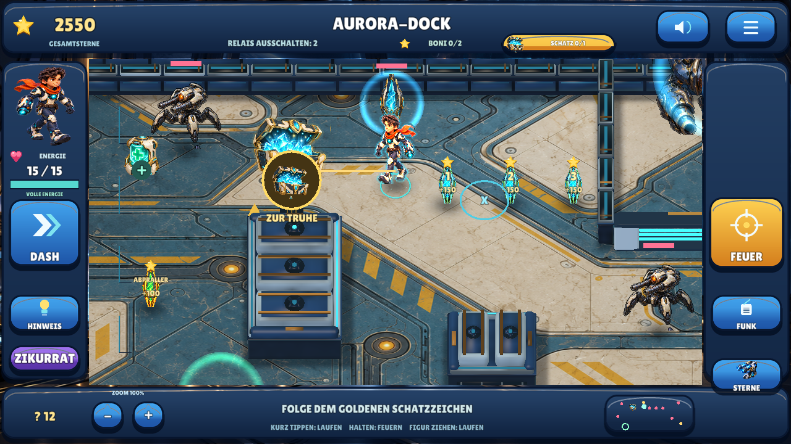
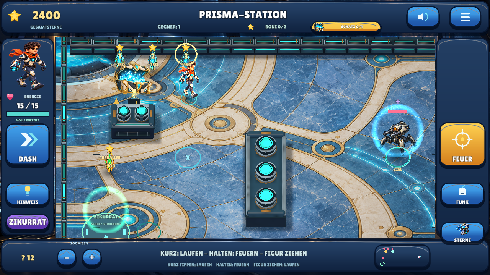
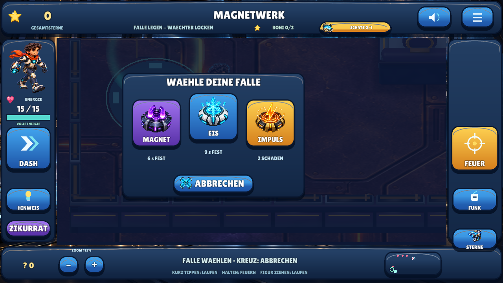
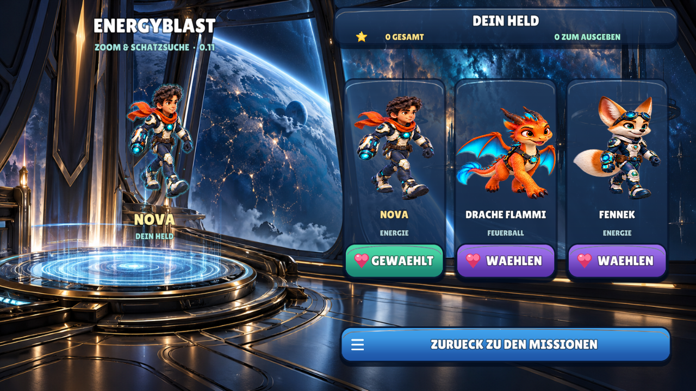

# Meilenstein 10 — Zoom, sichtbare Schätze und HD-Figuren / 0.11

**29.10.2026.** Auftrag: irreführende Hinweise beheben, das ganze Spielfeld zum
Betrachten vergrößern/verkleinern und die Figurenbilder samt Animation aufwerten.
Arbeitsbranch `feat/zoom-treasure-polish`, Ausgangspunkt der integrierte 0.10-Stand
[`fb75f01`](https://github.com/sayac007/EnergyBlast/commit/fb75f015ba31141b1658207b581e87bdffb2a279).
Keine automatische Spielübernahme in main, kein PR oder Release-/Store-Upload.

## Nachgewiesene Ursache der unklaren Hinweise

Die alten Suchpunkte für Reaktor, Zitadelle und Dock lagen innerhalb der festen
Deckungsrechtecke. „Hinweis“ spielte eine Ortsbeschreibung und eine kurz sichtbare
Linie ab, änderte aber den normalen Zielpfeil nicht auf Schatzsuche. Die Truhe
wurde erst unter vier Metern und bei freier Sicht dargestellt. Hinter einer Wand
wirkte der Hinweis deshalb leer; der kleine Aufnahmeradius von 0,7 Metern half nicht.

Die drei Suchpunkte liegen jetzt auf erreichbarem Boden. Ein Hinweis schaltet
auf die passende goldene Schatzführung und eine neue kurze Ansage: dem goldenen
Zeichen folgen, bei Annäherung die leuchtende Truhe suchen und tatsächlich hingehen.
Keine falsche Beschreibung einer blauen Kiste. Schon entdeckte oder gesammelte
Truhen kosten keine weiteren Hinweise. Ohne Hinweisguthaben bleibt eine kostenlose
Suchgebietsführung möglich; genaue Entdeckung entsteht auch durch Annäherung.

Unter 5,2 Metern wird die Entdeckung lokal gespeichert. Die Truhe wächst von
Faktor 1,4 bis 2,3 und leuchtet; Goldzeichen und Minikarte bleiben deutlich.
Bei verdeckter Truhe bezeichnet die Markierung die Deckung, während die native
Truhendarstellung weiter korrekt von Wänden verdeckt wird. Das Goldzeichen lässt
sich antippen, um einen echten kollisionssicheren Weg zum Ziel zu laufen.

Die Aufnahme erfolgt unter 1,05 Metern bei freier Sicht. Es gibt keine Aufnahme
durch Wände, geschlossene Tore oder per direktem Punkteknopf. Gesammelte Truhen
bleiben weg und zahlen keine Sterne ein zweites Mal.

## Ganze Welt vergrößern und verkleinern

Plus/Minus unten links oder zwei Finger auf freiem Spielfeld verändern die Ansicht
zwischen **75 und 175 Prozent**. Alle nativen Weltobjekte und Figuren verwenden
zusammen dieselbe Kameramatrix; Touchrückprojektion und Zielbereiche folgen ihr.
Welttexte werden bei Vergrößerung ebenfalls größer. Fallenmenü und taktische Bedientexte behalten ebenfalls ihre feste Bildschirmgröße.
HUD und Bedientasten behalten
ihre Größe und liegen weiterhin außerhalb der Arena.

Die Stelle zwischen den beiden Fingern bleibt beim Zoomen möglichst am selben
Bildpunkt, begrenzt durch die Arenaränder. Nach dem Loslassen bleibt der betrachtete
Bereich stehen, solange die Figur stillsteht. Beim Weiterlaufen folgt die Kamera
wieder. Die Zoomstufe wird lokal gespeichert, ohne jeden Fingerframe zu speichern.

Zwei Finger übernehmen die Eingabe vor der normalen Verarbeitung eines gemeinsamen
Touchpakets. Zielen, Schießen und Laufen werden beendet; der letzte verbleibende
Finger löst beim Loslassen keine nachträgliche Aktion aus. Eine zuvor bereits
mit dem ersten Finger ausgelöste Sofortattacke auf einen Gegner wird nicht rückgängig
gemacht. Deshalb beginnt die Zoomgeste am besten auf freiem Boden. Das erhält die
vom Betreiber verlangte sofortige Gegnerreaktion.

## Figurenbilder und tatsächliche Animation

Drei neue Originalbearbeitungen der eigenen Nova-, Flammi- und Fennek-Entwürfe,
keine übernommenen Referenzspielgrafiken. Laufatlanten **1536×1024** statt
1024×768 Pixeln, Zellen **384×512** statt 256×384, insgesamt doppelte Pixelzahl.
24 unterschiedliche frontale/rückwärtige Bildphasen bleiben transparent und haben
saubere Ränder. Quellen, erste Bearbeitungen, Elternbilder und Ableitungen sind
mit Hashes in [PROVENANCE.json](../shared/assets/defold11/PROVENANCE.json) dokumentiert.
Die Laufbilder werden beim technischen Import nicht aus alten kleinen Bildern
hochskaliert; Porträts passen auf die bestehende 512×640-Menüfläche.

Farbige animierte Schimmerkanten, sechs begrenzte native Lichtpartikel, Atmen,
Laufschwung, Nachschwingen und Rückstoß ergänzen die acht Bildphasen pro Figur.
Lichter und Figuren sind tiefengeprüfte Weltobjekte. Das bleibt ein 2,5D-Hybrid,
keine Behauptung einer vollständigen Skelettanimation.

Bilder und 35 Animationsframes stammen aus der nativen Linux/OpenGL-Laufzeit mit
echten XTest-Eingaben, nicht aus einer Handyaufnahme. Die Schatz-Testprofile
geben ausdrücklich Abschlusssterne für Hinweisguthaben und deaktivieren Gegner-KI;
Truhen werden durch echte Bewegung gesammelt, nicht per Fixture vergeben.

## Tatsächliche Prüfungen

- **820 native Prüfungen:** 629 bisherige, 72 neue Kameramatrix-/Zoom-/Eingabefälle,
  117 neue Schatzfälle und zwei weitere Prüfungen an echten Figurenmaterialien.
- **15 gemeinsame Testgruppen:** Herkunft, Audiodekodierung, Original-/HD-Atlanten,
  aktive native Ressourcenbindungen, tatsächliche Wandgeometrie und Manifeste.
- Echte Plus-/Minus-Klicks verändern Weltpixel und die projizierte Figurengröße.
  Derselbe Lauf findet **alle sechs Truhen mit je 75 Sternen und null Schüssen**.
- Alle bisherigen echten Gesten, Menüs, Käufe, Fallen, Speicherneustarts,
  Schutzort-/Heilungstests und beide Fensterformate bestehen weiterhin. Alle drei
  Fallen wurden zusätzlich bei 175% Zoom ausgewählt und gesetzt; auch der Abbruch
  wurde geprüft.
- Schimmer an/aus: **2.937 geänderte native Pixel**. Geschossverdeckung: 0 Pixel
  hinter der Wand, 328 im sichtbaren Kontrollfall. Energieschild: 15.701 Pixel.
- **32/32 Sprachdateien technisch geprüft**, zwei neue Ansagen frisch unabhängig
  ASR-exakt erkannt; 30 bisherige Dateien und Metadaten unverändert.

[Testbefehle](BUILD_AND_TEST.md), [zentraler Qualitätsstatus](QUALITY.md),
[APK-/Quellbezug und Installation](../downloads/README.md).

**Offen:** tatsächlicher Zwei-Finger-Zoom und Bediengefühl auf Handy/Tablet,
Update/Spielstandübernahme, Geräteleistung bei maximalem Zoom, menschlicher Hörtest
und ästhetische Abnahme. Native Touchpaketprüfungen sind kein physischer
Android-Mehrfingertest. Keine neue grüne CI, Store-Freigabe oder Lernwirkung behauptet.

Beim ersten Android-Export wurde eine nicht für ESSL 100 verfügbare Texturabfrage
im neuen Schimmer gefunden. Texturabmessungen werden deshalb als Materialkonstante
übergeben. Die nativen Prüfungen und der positive Schimmervergleich wurden danach
erneut bestanden; der ältere Shaderpfad wird beibehalten.

## Nachvollziehbarer Android-Snapshot

Quellcommit [`f8e63f6`](https://github.com/sayac007/EnergyBlast/commit/f8e63f64fb8275cc49e609479777486c10da7181),
APK-Commit [`284a94a`](https://github.com/sayac007/EnergyBlast/commit/284a94a0659ca9c0fd453977343053274bf214df),
gebaut 29.10.2026, 11:15 MEZ vom sauberen Stand. **0.11.0 / Code 12**, 68.195.514 Bytes,
SHA-256 `d53d05d51aced01aa0407866cd48ca3ea7f107bdc9e6e60e5ba9a3739e345308`.
Paket/APIs, Querformat, Berechtigungsfreiheit, Backup aus, Signatur/v2 und
Zertifikatsgleichheit, ZIP-CRC, fehlende Schlüsseldateien, ZIP-Ausrichtung und
identischer Projektabzug (828 Dateien) geprüft. Der Android-Export mit dem
beibehaltenen älteren Shaderpfad ist bestanden.

[APK direkt herunterladen](https://raw.githubusercontent.com/sayac007/EnergyBlast/284a94a0659ca9c0fd453977343053274bf214df/downloads/energyblast-defold-debug.apk) · [Metadaten/Installation](../downloads/README.md).
