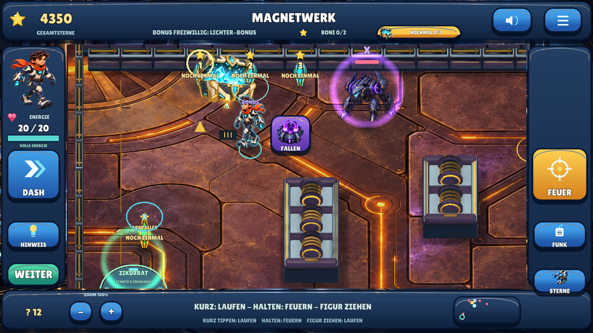
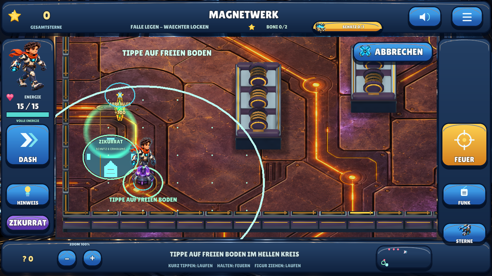
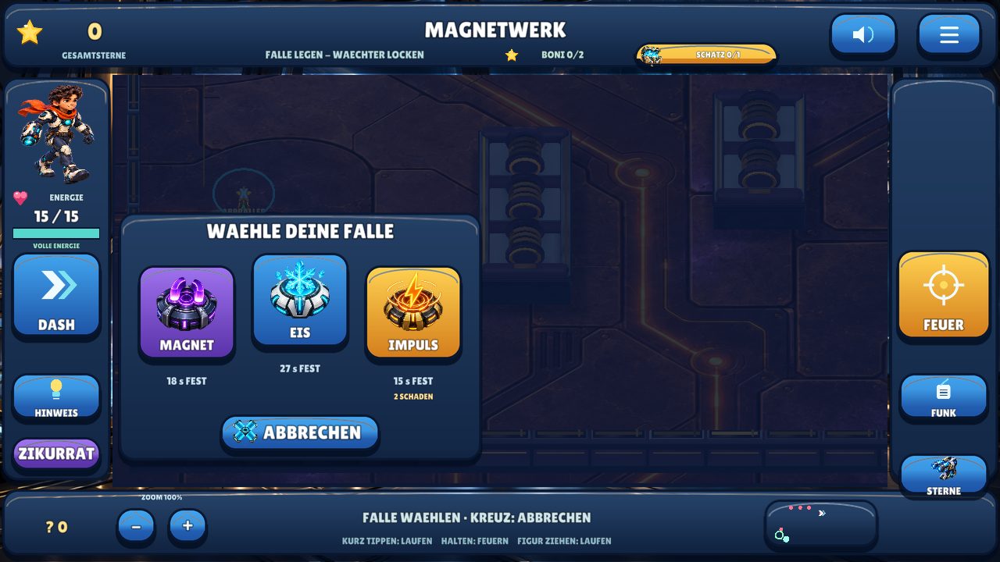

# Meilenstein 11 — Boni wieder spielbar, mehr Zeit für Fallen / 0.12

**29.10.2026.** Betreiber-Rückmeldung: Bonusmissionen wirken leer, Info meldet nur
einen bereits gesammelten Bonus. Fallen sollen innerhalb eines größeren hellen
Kreises liegen und zunächst dreimal länger wirken; spätere Missionen dürfen nach
erfolgreicher Anwendung langsam anspruchsvoller werden.

Version **0.12.0 / Android-Code 13**, Branch `feat/zoom-treasure-polish`. Der
0.11-Stand wurde inzwischen extern durch PR #1 nach `main` übernommen. Diese
Korrekturrunde enthält keinen automatischen Merge, PR, Actions-Lauf oder Release-/
Store-Upload. Paketkennung, Entwicklungszertifikat und lokale Spielstände bleiben.

## Nachgewiesene Ursache und Korrektur

Die bisherige Initialisierung setzt einen bereits belohnten Bonus auf `done=true`
und erzeugt dessen Ziel mit `hp=0`. Auf einem vollständig abgeschlossenen Spielstand
hatten dadurch **alle sechs Arenen null lebende Bonusziele**. Gleichzeitig prüft
„Hinweis“ zuerst den einmaligen Schatz-Erfolg und spielt die Fertigmeldung ab,
obwohl noch Bonusaufgaben offen sein können. Das ist ein Zustandsfehler; fehlende
Grafikdateien oder neue versteckte Fundorte waren nicht die Ursache.

Gespeicherte Belohnungen und die aktuelle Runde sind jetzt getrennt. Ein erneuter
Missionsbesuch lädt beide Bonusaufgaben und die Truhe spielbar. Innerhalb derselben
Runde bleiben gelöste Aufgaben erledigt: Menü, Fokuswechsel oder Fortsetzen setzen
sie nicht zurück. Sterne, Guthaben und Käufe bleiben erhalten; derselbe Erfolg
zahlt **nur einmal**. Wiederholungen sind als „Noch einmal“ gekennzeichnet und
geben keine neue Sternenzahl vor.

Info, Funk und Hinweis erklären eine offene Bonusaufgabe, wenn die Schatzbelohnung schon
verdient wurde. Die vorhandenen Ansagen für Abpraller, Lichterfolge und grünes
Zeitfenster bleiben. Bewusstes Antippen der Schatzanzeige führt weiterhin zur
Truhe. Die bereits in 0.11 eingeführten erreichbaren Suchpunkte, Goldführung,
Vergrößerung und Sichtlinienprüfung bleiben erhalten.

## Größerer Platzierungskreis und längere Fallenwirkung

Der Radius wächst von **3,5 auf 5,25 Welteinheiten**. Der hellere Kreis und Punkte
auf gültigem Boden zeigen die erreichbare Fläche. Vorschau, direkte Spielregel
und Darstellung verwenden dieselbe Grenze; eine Wand bleibt ein Hindernis.

Anfangs wirken Magnet **18 Sekunden**, Eis **27 Sekunden** und Impuls **15 Sekunden**.
Eine noch nicht ausgelöste Falle bleibt **36 statt 12 Sekunden** bereit.
Alle drei Wirkzeiten und die Bereitschaftszeit sind verdreifacht. Nachladezeiten,
Impulsschaden und die Grenze von zwei gelegten Fallen bleiben unverändert.

Die Fallenwahl ist außerdem in Echo-Kammer und Drohnen-Rettung verfügbar. Die
Faktoren reduzieren sich von 3 auf 2,5 und anschließend 2, wenn in unterschiedlichen
früheren Fallenmissionen ein echter Fang und der erfolgreiche Rundenabschluss
zusammen nachgewiesen wurden. Ohne solche Erfolge bleiben die langen Zeiten.
Wiederholtes Laden, bloßes Platzieren und alte Abschlusssterne beschleunigen diese
Stufen nicht. Die Zeitstufe bleibt während der Runde stabil. Der Katalog und
Restzeitanzeigen machen die tatsächlich geltende Dauer sichtbar.

[Vollständige Bedienung und Zeittabelle](TRAPS.md).

## Tatsächliche Spielansichten

Native Linux/OpenGL-Aufnahmen, keine Konzeptbilder und keine behaupteten
Android-Geräteaufnahmen. Die Wiederholungsszene nutzt den kontrollierten alten
Spielstand aus dem unten beschriebenen GUI-Test.

## Prüfstand dieser Korrektur

**1.066 native Prüfungen und 15 gemeinsame Testgruppen bestanden.** Die komplette
native Suite wurde erneut ausgeführt: 820 bisherige Prüfungen, 167 neue
Wiederholungsprüfungen und 79 Fallenprüfungen. Tatsächliche GUI-Eingaben lösen
alle sechs Lichter-/Zeitfensterboni, sammeln alle sechs Truhen und prüfen erneutes
Betreten sowie Prozessneustart. Gesamtsterne 4.350 und Guthaben 4.090 bleiben
unverändert. Die reale Fallenbedienung prüft alle drei Geräte bei 100% und 175%
Zoom mit einem Ziel 4,4 Welteinheiten entfernt, außerhalb der früheren Reichweite.

Vorhandene Gesten-, Menü-, Shop-, Speicher-, Zoom-, Audio-, Verdeckungs- und
Materialtests bleiben bestanden. Auch Funk wird in allen sechs Arenen mit
echten Eingaben auf passende Bonusansagen geprüft. Der Android-Build ist bestanden.
Ausführliche Ergebnisse und Grenzen stehen im [Qualitätsstatus](QUALITY.md).

Geprüfter Quellstand [`9554e66`](https://github.com/sayac007/EnergyBlast/commit/9554e66ba5ede774779857a0285b27e4d670d8c1),
APK-Snapshot [`8d0de93`](https://github.com/sayac007/EnergyBlast/commit/8d0de931d121f89e5ad8b6841c4124035a24c12b),
gebaut am 29.10.2026, 16:31 MEZ. APK **68.211.898 Bytes**; Paket/Version/APIs,
Berechtigungsfreiheit, Backup aus, v2/v3-Signatur und Zertifikatsgleichheit,
ZIP-CRC, keine privaten Schlüsseldateien, 16-KB-ZIP-Ausrichtung und 831 identische
Projektdateien geprüft. Der Quellstand war sauber. [Download und SHA-256](../downloads/README.md).

Neue Regressionen prüfen zuvor vollständig abgeschlossene Spielstände,
Wiederholbarkeit ohne Doppelbelohnung, alle sechs Bonusorte, echte Abprallschüsse,
Hinweiswahl, Fallengrenzen, verlängerte Zeiten und gespeicherte Übungserfolge.
Ein eigener nativer GUI-Test bedient die wiederhergestellten Aufgaben über echte
Bildschirmeingaben; kontrollierte Testpositionen und deaktivierte Gegner-KI sind
Prüfhilfen und keine behauptete unbegleitete Kinderspielrunde.

**Weiterhin manuell offen:** Update und Spielstandübernahme auf Android,
Bedienbarkeit des größeren Kreises auf Handy/Tablet, die neue zeitliche Balance,
menschlicher Hörtest und echte Zwei-Finger-Gesten. Keine neue pädagogische Wirkung
oder Store-Reife behauptet.

[Testbefehle](BUILD_AND_TEST.md) · [Download und Installationshinweise](../downloads/README.md)
· [Vorheriger Meilenstein 0.11](MILESTONE_10.md).
