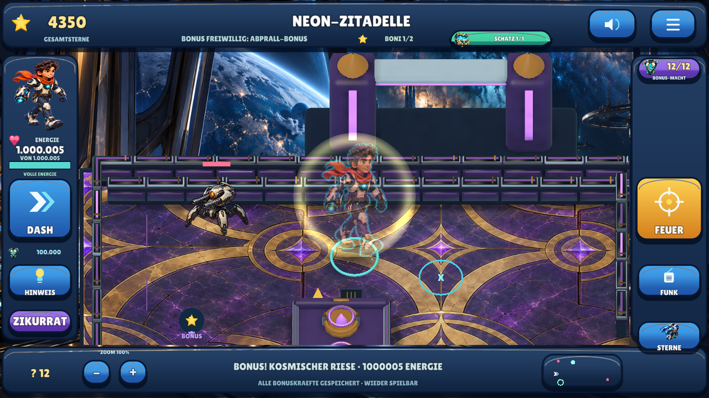
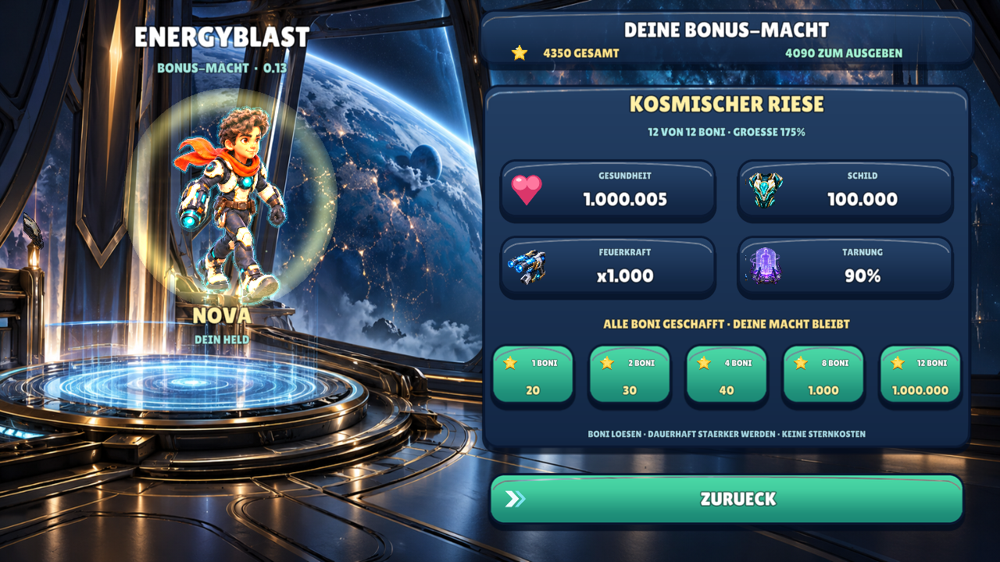

# Meilenstein 12 — Dauerhafte Bonus-Macht / 0.13

**29.10.2026.** Die neue Priorität lautet: zuerst durch gelöste Bonusaufgaben
größer, stärker und besser geschützt werden. Gesundheit soll bewusst bis zu
einer Million steigen. Branch `feat/bonus-power`, Version **0.13.0 / Android-Code
14**. Die bestehenden sechs Missionen bleiben erhalten.

Die **20 zusätzlichen Missionen und die steuerbare FPV-Spiel-Drohne mit
Sprengladung, elektronischer Störung und Blitzanimation sind als nächste Schritte geplant**, in dieser Runde aber noch nicht umgesetzt. Es gibt keinen automatischen
Merge, PR, Actions-Lauf oder Release-/Store-Upload.

## Jeder neue Bonus bringt dauerhaft mehr Kraft

Die zwölf verschiedenen Bonusaufgaben der sechs Missionen zählen einzeln. Ihre
bereits gespeicherten Erfolge werden unmittelbar angerechnet: Ein vorhandener
vollständiger Spielstand beginnt mit der höchsten Bonus-Macht, ohne dass die
Aufgaben erneut gelöst werden müssen. Es wird kein ungesicherter separater
Levelwert geladen; maßgeblich sind die bekannten einmaligen Bonus-Erfolge.

Eine erstmals gelöste Bonusaufgabe erhöht die aktuelle Gesundheit samt Maximum,
Schild und Feuerkraft direkt in der Runde. Schon erlittener Schaden bleibt als
Differenz bestehen; die Erhöhung belebt eine besiegte Figur nicht wieder.
Gesamtsterne, Guthaben und gekaufte Ausrüstung bleiben erhalten. Das erneute
Spielen einer schon belohnten Aufgabe gibt weder doppelte Sterne noch zusätzliche
Bonus-Macht.

| Verschiedene gelöste Boni | Gesundheit ohne gekaufte Rüstung | Feuerkraftfaktor | Schildpunkte |
|---|---:|---:|---:|
| 0 | 15 | 1 | 0 |
| 1 | 20 | 2 | 3 |
| 2 | 30 | 3 | 5 |
| 3 | 35 | 4 | 8 |
| 4 | 40 | 6 | 12 |
| 5 | 80 | 10 | 20 |
| 6 | 160 | 16 | 40 |
| 7 | 400 | 25 | 75 |
| 8 | 1.000 | 50 | 150 |
| 9 | 10.000 | 100 | 1.000 |
| 10 | 100.000 | 250 | 5.000 |
| 11 | 400.000 | 500 | 20.000 |
| 12 | 1.000.000 | 1.000 | 100.000 |

Gekaufte Rüstung kommt hinzu: Mit höchster Rüstung sind zuletzt **1.000.020
Gesundheitspunkte** möglich. Der Feuerkraftfaktor verstärkt die ausgerüstete Waffe;
eine gekaufte stärkere Waffe bleibt daher nützlich. Auch der Schussabstand sinkt
begrenzt. Geschosse bleiben endlich und reflektieren weiterhin an den tatsächlichen
Wänden. Mehr Feuerkraft löst keine vorgeschriebenen Abpraller, Lichterfolgen oder
grünen Zeitfenster automatisch.

Die fünf benannten Meilensteine liegen bei 1, 2, 4, 8 und 12 Boni: **Funkenheld,
Kraftheld, Sternenheld, Titan und Kosmischer Riese**. Dazwischen verbessert ebenfalls
jeder einzelne neue Bonus die Werte; es sind keine wirkungslosen Zwischenpunkte.

## Sichtbare und tatsächliche Veränderungen

Die Figur wächst mit dem Bonusfortschritt, schimmert stärker und erhält ein
sichtbares Energieschild. Die Darstellungsgröße bleibt begrenzt, damit die Figur
weiter zwischen Deckungen spielbar bleibt. Bewegungs- und Kollisionsgröße werden
nicht vergrößert. Die Zahl der Aura- und Schildobjekte bleibt begrenzt.

Das Schild fängt echte Treffer ab und lädt nach einer Pause wieder auf. Erholung
skaliert mit der höheren Gesundheit, statt bei großen Zahlen praktisch stehen
zu bleiben. Tarnung wird sichtbar und reduziert die tatsächliche gegnerische
Erfassungsreichweite; gekaufte Tarnung wirkt zusätzlich. Es gibt keinen neuen
Geschwindigkeitsbonus.

Eine bebilderte **Bonus-Macht**-Ansicht zeigt den Stand, Gesundheit, Schild,
Feuerkraft, Tarnung und die nächste Verbesserung. HUD und Zahlenformat zeigen auch
die Million lesbar als Zahl, nicht als `1e+06`. Neue Sprachhinweise erklären die
dauerhafte Kraft und einen erreichten Zuwachs.

## Native Spielansichten

Echte Linux/OpenGL-Aufnahmen der kontrollierten GUI-Prüfung, keine Konzeptbilder
oder behaupteten Android-Aufnahmen. Die gekaufte Rüstung addiert hier fünf Punkte.
Bei der Sichtprüfung fiel zunächst ein abgeschnittener Kopf auf. Feldkamera und
Menübühne berücksichtigen jetzt die gewachsene Figur. Native Prüfungen messen
alle vier tatsächlichen Modell-Eckpunkte auch bei 175% Zoom am nördlichen Arenarand.
Eine echte Wand darf Teile der Figur weiterhin durch Tiefenprüfung verdecken.

## Tatsächlicher Prüfstand

**Bereits ausgeführt:** Die beiden neuen vollständigen Serena/Qwen-Ansagen wurden
unabhängig ohne Referenztext-Vorgabe mit Whisper geprüft: **2/2 nach
Normalisierung exakt erkannt**, Dauer 6,84 beziehungsweise 10,36 Sekunden.
**34/34 aktive Sprachaufnahmen technisch bestanden**: tatsächliche FFmpeg-
Dekodierung, Hash, Dauer und Wiedergabepegel. Die 32 früheren Aufnahmen samt
Herkunftszeilen sind unverändert. Dies ersetzt keinen menschlichen Hörtest.

**1.311 native Prüfungen und 15 gemeinsame Testgruppen bestanden.** 245 neue
Machtprüfungen ergänzen die bisherigen Regressionen. Echte native Bonusschüsse
verdienen die Stufen 1, 8 und 12: 20 / 1.005 / 1.000.005 Gesundheit, inklusive
vorhandener Rüstung. Modellgröße, Schildmaterial und Tarnung sind an den echten
Objekten geprüft; die Millionenzahl passt mit 86,42 Pixeln in die 126-Pixel-Anzeige.
Prozessneustart und Wiederholung erhalten Macht und Käufe ohne zusätzliche Vergabe.

Die vollständige Suite enthält außerdem die bisherigen Gesten-, Speicher-, Menü-,
Kauf-, Fallen-, Bonus-, Schatz-, Zoom-, Verdeckungs- und Audioabläufe. Die exakten
alten Shop-/Erholungswerte werden zusätzlich mit der unveränderten 0.12-Fixture
geprüft; die übrigen Regeln und Macht-GUI laufen mit dem aktuellen Stand.

Der Android-Build folgt vom sauberen Quellcommit; dessen Metadaten und feste
Verweise werden vor Auslieferung ergänzt. [Zentraler Qualitätsstatus](QUALITY.md).

**Manuell offen:** Android-Update und Spielstandübernahme, Lesbarkeit auf kleinen
Displays, Bewegungsgefühl mit größeren Figuren, subjektiver Klang, Leistung und
Balance der bewusst sehr mächtigen späteren Stufen. Keine Store-Freigabe oder
empirische Lernwirkung behauptet.

[Regeln](../shared/defold04.json) · [Testbefehle](BUILD_AND_TEST.md) ·
[zentraler Qualitätsstatus](QUALITY.md) · [Downloads](../downloads/README.md) ·
[vorherige Korrekturrunde](MILESTONE_11.md).
