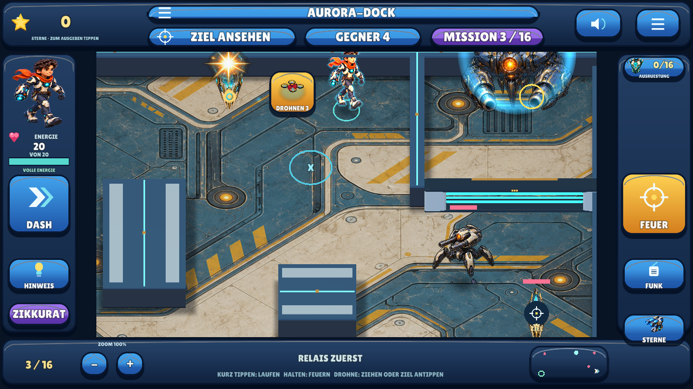
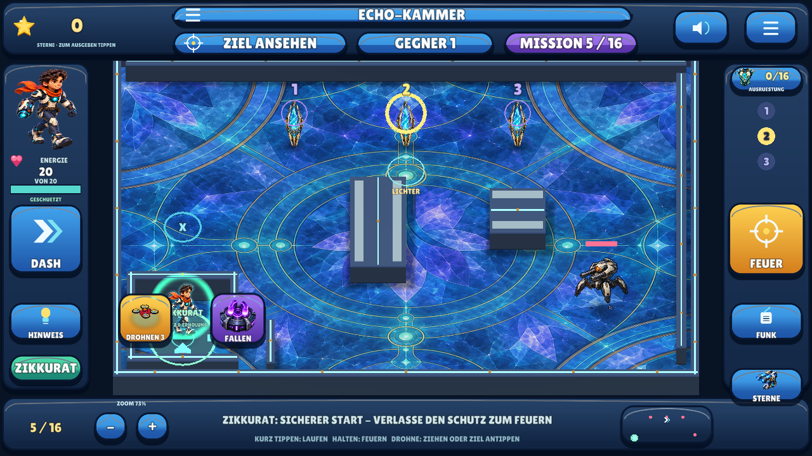
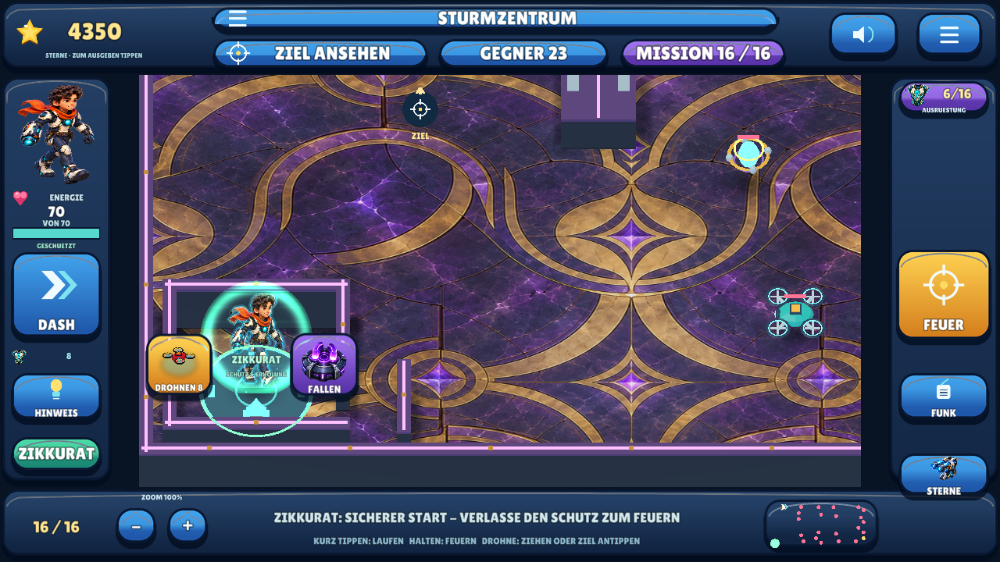

# Meilenstein 13 — 16 Missionen und steuerbare Angriffsdrohnen / 0.14

**30.10.2026.** Version **0.14.0 / Android-Code 15**, Branch
`feat/campaign-16`, auf Betreiberauftrag vollständig nach **`main`** übernommen.
Die aktuelle Betreiberrevision ersetzt die frühere Planung
von 20 zusätzlichen Missionen durch **zehn neue Missionen, insgesamt 16**.
Die Bonus-Suche und die Millionengesundheit aus 0.13 werden ausdrücklich abgelöst.

## Kleine Korrektur 0.14.1 — freie Schalter und langsamere Lichter

**30.10.2026, Android-Code 16**, Branch `fix/free-relays-slower-patterns`.
Passive Relais-Schalter lassen sich nun direkt **oder** per Abpraller treffen.
Die Reihenfolge „Schalter vor dem Kern“ bleibt; die Wand ist für diese Aufgaben
keine Pflicht mehr. Gefährliche Gegner behalten ihre Schild-/Fallenregeln,
alle Wände reflektieren weiter. Die bisherigen 16 Missionen und Spielstände bleiben.

Die Lichterfolgen in Mission 5 (Echo-Kammer), 10 (Doppeltes Signal) und 14
(Lichtlabyrinth) wechseln langsamer: **1,8 Sekunden je Schritt**, davon 1,2 Sekunden
leuchtend und 0,6 Sekunden dunkel; anschließend 2,4 Sekunden Pause. Eine Dreierfolge
wiederholt sich nach **7,8 Sekunden**, zuvor nach 4,6 Sekunden mit 0,9-Sekunden-
Schritten. Weltkreise und Seitenanzeige verwenden dieselbe Timingfunktion.

Eine neue vollständige Serena/Qwen-Ansage erklärt die freie Wahl:
„Erst die Schalter, dann der Kern. Du kannst direkt treffen oder die Wand nutzen.“
**6,12 Sekunden, technisch PASS, unabhängig mit Whisper 1/1 exakt erkannt.**
Die früheren 42 Clips samt Herkunfts-/Modelldaten sind unverändert; das Paket
enthält jetzt 43 Defold-Aufnahmen und 62 native Soundkomponenten.

**Aktuelle vollständige Regression: PASS.** 22 Befehle, 4.674 native Prüfungen
(1.311 historische und 3.363 aktuelle, darunter 134 neue), 16 gemeinsame Gruppen.
Alle elf Relais werden durch echte Direktprojektile getroffen; ein tatsächlicher
Abpraller bleibt gültig. XTest prüft den direkten Relaistreffer, die Boss-Sperre,
sechs langsamere Pixelzustände im laufenden Takt sowie die Ansage ohne Neustart
bei wiederholten Bosstreffern. Sauberer Android-Export und feste Pins folgen.
Die nachfolgenden Ergebnisse und APK-Verweise dokumentieren den unveränderten
vorherigen 0.14-Stand. Reale
Handy-/Tablet-Abnahme bleibt gesondert offen.




Native Laufzeitaufnahmen aus einer kontrollierten Regression: erreichbare
Schussposition, ruhige Gegner; der Relaistreffer entsteht durch einen tatsächlichen
Bildschirmtipp und ein fliegendes Projektil. Die Lichteraufnahme beobachtet den
laufenden Takt ohne gesetzte Lösung oder vorgerückten Zeitwert.

## Aktueller Umfang

Versteckte Bonusaufgaben und Schatztruhen entfallen aus allen aktiven Missionen.
Info und Hinweis führen zu den eigentlichen Missionszielen. Bereits verdiente
Sterne und Käufe bleiben im Spielstand; alte Bonus- und Schatzwerte werden nicht
nachträglich abgezogen. Neue Stärke entsteht durch abgeschlossene Missionen und
Ausrüstung. Wiederholungen vergeben denselben Erfolg nicht mehrfach.

**Gesundheit endet bei 100 einschließlich gekaufter Rüstung**, Schild bei 20,
Projektilschaden bei 8. Die Feuerpause beträgt mindestens 0,16 Sekunden. Tarnung
reduziert die gewöhnliche Erfassung bis zu einer festen Grenze; die verbleibende
Erfassungsreichweite sinkt auch mit gekaufter Tarnung nicht unter 55 Prozent.
Gegner besitzen zusätzliche periodische Sensorortung, die den Spieler auch aus
großer Entfernung genau anvisiert. Die tatsächlichen Geschosse bleiben an Wände,
Reflexionen und Absorptionszonen gebunden.

Jede Mission beginnt **im Zikkurat**. Er liegt in einer begehbaren Nische mit
physischer Deckung und einem schussabsorbierenden Schutzbereich. Die Figur kann
den Schutz verlassen und dorthin zurückkehren. Gesundheit erholt sich dort
schneller. Die bisherigen Bewegungs-, Schieß- und Fallengesten bleiben erhalten.

## Missionen und steigende Komplexität

Die Zahl der Gegner und die Kombination aus Schusslinien, beweglichen Einheiten,
Relais, Lichterfolgen, Fallen und Angriffsdrohnen steigen im Verlauf. Die
nachstehenden Startzahlen zählen Angreifer; Relais und Lichter stehen zusätzlich
in der Aufgabenbeschreibung. Teilungen können die Zahl später erhöhen.

| Nr. | Mission | Feld in Welteinheiten | Startgegner | Schwerpunkt |
|---|---|---|---:|---|
| 1 | Prisma-Station | 21 × 15 | 1 | Abpraller und Schild |
| 2 | Neon-Zitadelle | 21 × 15 | 2 | Deckung, Schussfenster und Ausgang |
| 3 | Aurora-Dock | 21 × 15 | 3 | Zwei Relais vor dem Kern und Ausgang |
| 4 | Magnetwerk | 21 × 15 | 1 | Fallen gegen den geschützten Wächter |
| 5 | Echo-Kammer | 21 × 15 | 1 | Gegner und beobachtete Lichterfolge |
| 6 | Drohnen-Angriff | 21 × 15 | 4 | Angriffsdrohne und erste gemischte Gegner |
| 7 | Kristallpass | 31,5 × 22,5 | 4 | Mehrere Schusslinien und Krabbler |
| 8 | Schwarmnest | 31,5 × 22,5 | 10 | Mini-Drohnen und teilbare Familien |
| 9 | Relaisring | 31,5 × 22,5 | 5 | Zwei Relais, Wächter und Energiefunken |
| 10 | Doppeltes Signal | 31,5 × 22,5 | 4 | Wächter, Drohnen und Lichterfolge |
| 11 | Spukfunken | 35 × 25 | 8 | Bewegliche Energiefunken und Bodenkrabbler |
| 12 | Drohnenkorridor | 35 × 25 | 9 | Gemischte Gegner, zwei Relais und Drohnenvorrat |
| 13 | Magnetkaskade | 35 × 25 | 9 | Drei Wächter und ein Drohnenschwarm |
| 14 | Lichtlabyrinth | 42 × 30 | 12 | Größere Wege, Teilungen und Lichterfolge |
| 15 | Dreifachkern | 42 × 30 | 11 | Drei Relais mit unterschiedlichen Gegnern |
| 16 | Sturmzentrum | 42 × 30 | 21 | Kombination der Werkzeuge, zwei Relais und Schwärme |

Die neuen Arenen wachsen in **Breite und Tiefe um 50 bis 100 Prozent** gegenüber
21 × 15. Das entspricht 2,25- bis vierfacher Fläche. Kollision, sichtbare Wände,
Navigation und Kamerabegrenzung verwenden dieselben individuellen Feldmaße.
Originale vorhandene Bodenbilder werden wiederverwendet; neue Geländegeometrie
kommt aus dem versionierten eigenen Generator.

Mini-Drohnen schweben, Bodenkrabbler bewegen sich am Boden, Energiefunken und
stärkere Wächter ergänzen die bisherigen Robotertypen. Teilbare Familien haben
begrenzte Generationen und können nur begrenzt Nachwuchs bilden. **Maximal 50
lebende Gegner gleichzeitig** sind erlaubt. Erledigte Familien erzeugen keine
endlose Warteschlange, die den Missionsabschluss verhindern würde.

## Angriffsdrohne: Vorrat wählen, ziehen oder Ziel antippen

1. Das Drohnenbild auf dem Spielfeld antippen. Die taktische Auswahl pausiert die
   Handlung und zeigt den verfügbaren Vorrat.
2. Die Drohne im Katalog auswählen. Die Ansage beginnt mit **„Wähle jetzt das
   Ziel“** und erklärt beide Eingabemöglichkeiten. Eine vorübergehende Übersicht
   zeigt das gesamte Feld, damit auch entfernte Gegner erreichbar sind. Die
   gespeicherte Zoomstufe bleibt erhalten; nach Flug und Blitz kehrt die Kamera
   zurück. Bewusstes Zoomen während des Flugs hat Vorrang.
3. Entweder die bereitstehende Drohne mit dem Finger zum Gegner ziehen und dort
   loslassen, oder den Gegner nach der Zielansage antippen. Großzügige Zielbereiche
   erleichtern die Bedienung auf dem Handy.
4. Eine gültige Auswahl startet den tatsächlichen Flug. Die Drohne steuert über
   einen freien Weg zum gewählten Gegner. Erst der Kontakt erzeugt den elektrischen
   Treffer und die animierte Zerstörung. Nahe Gegner können kurz gestört werden.

Pro Mission stehen **drei bis acht Drohnen** bereit. Ein ungültiges Ziel,
Abbrechen, ein fremder Finger oder ein Menüwechsel verbraucht keine Drohne und
löst keinen normalen Schuss aus. Ein bereits geschützter Boss behält seine
Relaisregel; erst die Relais ausschalten. Bei leerem Vorrat bleiben Waffe und
Fallen verfügbar. Die Spielfigur und ihre Wegplanung werden durch die
Drohnenroute nicht versetzt. Die Drohnenbedienung bleibt in der bekannten Draufsicht.

## Kamera, Auswahl und obere Leiste

Maximales Herauszoomen richtet sich nach der Feldgröße und endet an dessen
Grenzen. Es zeigt die vollständige Arena. Die Kamera wird innerhalb dieser
Grenzen gehalten; außerhalb erscheint keine All-Kulisse. Für unterschiedliche
Bildschirmproportionen bleiben gegebenenfalls neutrale Randflächen. Figuren,
Schüsse, Hinweise und die Rückprojektion von Touchpunkten verwenden dieselben
Kameramaße.

Die Missionsauswahl bietet alle 16 Missionen auf drei Seiten mit gut erreichbaren
Seitenschaltern. Die obere Leiste verwendet anklickbare Bedienelemente für die
angebotenen Aktionen und zeigt aktuelle Ziele sowie die verbleibenden Gegner.
Die früheren Bonus- und Schatzanzeigen entfallen. Hinweise sprechen über die
aktuelle Aufgabe, statt einen bereits eingesammelten Fund zu melden.

## Tatsächliche native Laufzeitbilder


Die Übersicht entstand aus dem echten Missionsstart; kein versetzter Spieler.
Die Stern-/Rüstungswerte stammen aus einer kontrollierten Migrationsfixture.




[Missionsseite 3](images/14-mission-page-3.png) ·
[Gesamtes Feld am Zoomlimit](images/14-bounded-arena.png) ·
[50 tatsächliche native Gegner](images/14-fifty-hostiles.png).
Die Schwarmaufnahme beschleunigt die realen Vermehrungstimer; KI und Schaden
sind in den GUI-Prüfungen teilweise kontrolliert. Das ist keine Geräteabnahme.

## Tatsächlicher Prüfstand der ursprünglichen 0.14-Fassung

**Sprachdateien bereits geprüft:** Acht neue vollständige Serena/Qwen-Ansagen
wurden unabhängig ohne Referenztext-Prompt mit Whisper geprüft: **8/8 nach
Normalisierung exakt erkannt**. Alle **42 Sprachdateien im Paket sind technisch
bestanden**: tatsächliche FFmpeg-Dekodierung, Hash, Dauer und Wiedergabepegel.
Die 34 früheren Dateien, ihre Herkunftseinträge und die Sprecher-/Modelldaten
bleiben unverändert. Die Zielansage dauert 5,56 Sekunden. Das ist kein menschlicher
Hörtest und kein Nachweis tatsächlicher Android-Audioausgabe.

**Vollständiger nativer Lauf am 30.10.2026 bestanden:**
`python3 tools/check_defold.py` baut den aktuellen Quellstand und führt alle
21 Befehle erfolgreich aus. **4.540 native Regel-/Darstellungsprüfungen**, davon
**1.311 mit eingefrorenen 0.13-Regeln** und **3.229 mit der aktiven 0.14-Kampagne**.
Dazu tatsächliche GUI-/Speicher-/Audio-/Pixelprüfungen: alle 16 Missionen und drei
Menüseiten, aktive obere Tasten, geschützte Starts, begrenzte Kamera bei
1280×720 und 1280×800, Migration und Prozessneustart eines alten Millionenspiels
(4.350 Sterne, 2.690 Guthaben und Käufe erhalten; jetzt 70 Gesundheit), echte
Vermehrung bis 50 native Gegner. Die erste Mission wird vom tatsächlichen
Zikkurat-Start aus durch Drohnenflug gewonnen und per WEITER verlassen.
Antippen, Ziehen, Abbruch, ungültige HUD-Treffer, Bestandsverbrauch,
Blitzanimation und bewusstes Zoomen während des Flugs bestehen.

`python3 tools/check_shared.py`: **16 Testgruppen bestanden**, einschließlich
**1.686 Prüfungen echter exportierter Geometriepuffer**. Python-Syntax und
`git diff --check` sind bestanden. Alte Bonus-/Schatz-/Millionen-GUI-Fälle laufen
nur mit ausdrücklich eingefrorenen historischen Daten; sie behaupten keine
solchen Funktionen in der aktiven App. Der normale App-Start lädt 0.14.

**Android-Abschlussprüfung: PASS.** 0.14.0/Code 15, **69.063.866 Bytes**,
gebaut 30.10.2026, 15:10 MEZ von [sauberer Quelle](https://github.com/sayac007/EnergyBlast/commit/9eecbbe5efe88973c8e4a4f0e26bbaa4a5dfdfa4).
[Fester APK-Snapshot](https://github.com/sayac007/EnergyBlast/tree/11248b5ef4215838cb08bd2c8164d9718d9efcae/downloads); gleiches Paket und Entwicklungszertifikat wie
0.13. Paket/Version/API/Querformat, keine Berechtigungen, Backup aus, v2/v3,
ZIP-CRC, keine privaten Schlüsseldateien, 16-KB-ZIP-Ausrichtung sowie alle
**1.220 Projektdateien** im Abzug bytegleich geprüft. APK nur 720.896 Bytes größer
als 0.13. Keine Play-/16-KB-Freigabe allein aus der ZIP-Prüfung ableitbar.

```text
SHA-256 d8a3206c2e45f48bdb9765ba73c4646ce62ca02738b86b1d5d3d0015b3cc7bfd
```

**Manuell offen:** Android-Update und eigene Spielstände, reale Handy-/Tablet-
Gesten einschließlich Ziehen der Drohne, Lesbarkeit, Audio, GPU-Leistung bei
50 Gegnern, längere Runden und die neue Schwierigkeit. Keine Store-Freigabe,
kommerzielle Qualitätsgleichheit oder empirische Lernwirkung behauptet.

[Aktuelle Regeln](../shared/defold04.json) ·
[Weltgenerator](../tools/make_defold14_worlds.py) ·
[Eigene Geländeherkunft](../shared/assets/defold14/PROVENANCE.json) ·
[Drohnenregeln](../pilots/defold/main/attack_drone.lua) ·
[Drohnensteuerung](../pilots/defold/main/drone_controls.lua) ·
[Kampagnenprüfungen](../pilots/defold/main/campaign_checks.lua) ·
[Zusätzliche Kernprüfungen](../pilots/defold/main/campaign_core_checks.lua) ·
[Kameraprüfungen](../pilots/defold/main/camera14_checks.lua) ·
[Testanleitung](BUILD_AND_TEST.md) · [Downloads](../downloads/README.md) ·
[Vorheriger Stand 0.13](MILESTONE_12.md).

## Repository-Übernahme — 30.10.2026

Der fertige Stand `425dd3c` wurde auf Betreiberauftrag mit erhaltener beiderseitiger
Historie nach `main` übernommen. Die ältere README-Ankündigung war der einzige
Merge-Konflikt. Spielcode, Werkzeuge, Assets und Downloads sind bytegleich zum
geprüften Entwicklungsbranch; die APK behält Größe, Hash und ursprüngliche
Quellreferenz. README, Auftrag und Arbeitsregeln dokumentieren die Übernahme.
Dateiidentität, APK-Hash/ZIP-Integrität, alle 199 lokalen Dokumentationsziele und
die geplanten Merge-Eltern sind für die Integration geprüft; daraus wird kein erneuter Spiel- oder
Gerätetest abgeleitet. [Vollständiger aktueller Stand](../README.md).
